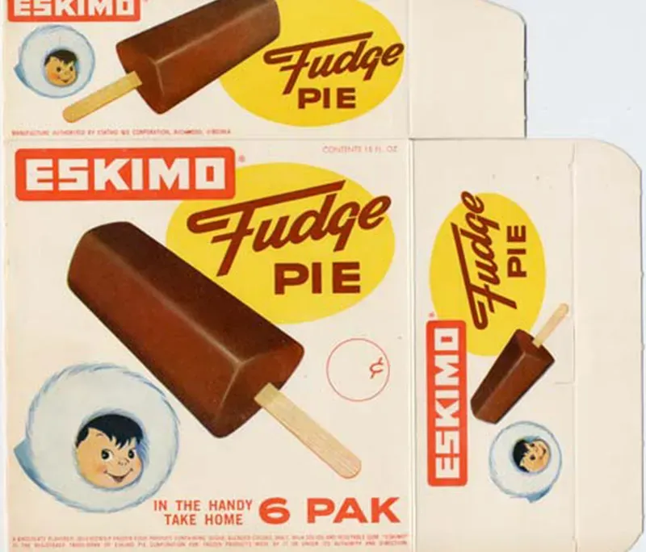
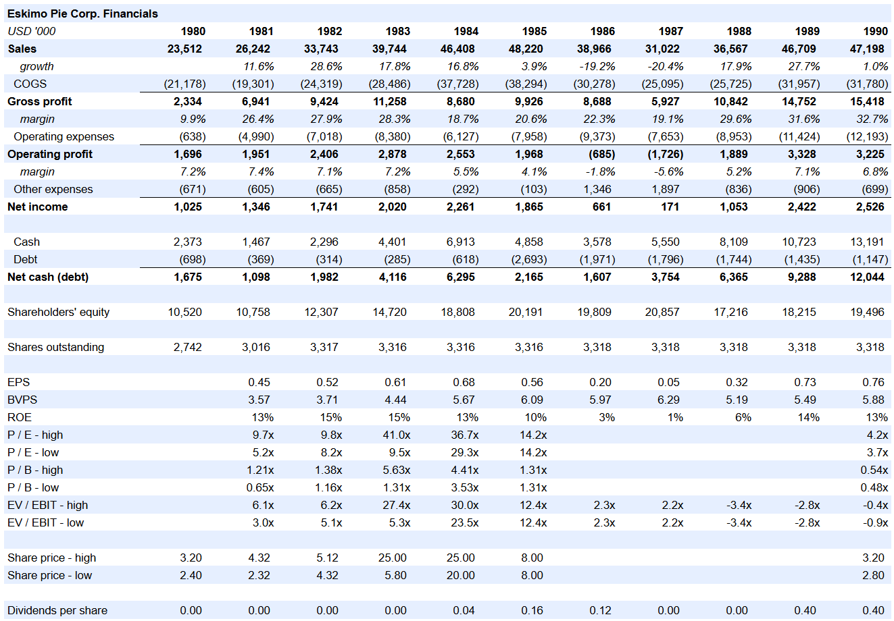
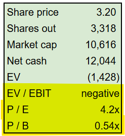
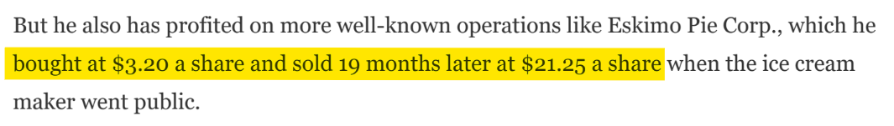

# 100% IRR in Ice Cream

15 Dec 2025 · Joe Raymond  
[Original article](https://www.joekraymond.com/100-irr-in-ice-cream/)

*6.6x in two years*

Imagine finding a 70-year-old ice cream company with a teens ROE trading for **less than net cash and only 4x earnings**.

Talk about mouthwatering!

That's exactly the position Jim Mitchell found himself in in 1990.

Here's the little-known story.

## Mitchell Partners

For those who traffic in obscure stocks, Jim Mitchell and his partnership Mitchell Partners (MP) are household names.

Here's a brief background.

Jim was a private-practice attorney when one of his clients hired him to draft the formation documents for Century 21 Real Estate Corporation. He later joined the company full-time as general counsel.

When Century 21 was sold in 1979, Jim used his proceeds to form Mitchell Partners. Over time, family and friends invested in MP alongside him.

Jim noticed that his illiquid pink sheet stocks performed better than liquid, listed ones. **So, he wrote down the names and addresses of every stock with a 10% or greater spread between the bid and the offer and mailed thousands of letters requesting annual reports.**

About a third responded, and that became his investment universe.

## Eskimo Pie Corporation

One such illiquid gem was Eskimo Pie Corporation (EPIE), a neat company with an interesting history.

As the story goes, Christian Nelson was running a small candy store in Onawa, Iowa in the early 1920s. One day, a boy walked into his store and showed notable indecision. He started to buy an ice cream, then changed his mind and bought a chocolate bar. Nelson inquired as to his thought process.

*"I want 'em both, but I only got a nickel,"* the boy responded.

**Thus, the idea to marry ice cream and the chocolate bar was born.**

Nelson played around with different formulas with varying degrees of success. Eventually, he found that adding cocoa butter was the best way to stick melting chocolate to ice cream. He produced a 500-treat trial batch that quickly sold out at the local town picnic.

Armed with the proper formula and proof of demand, Nelson started searching for partners to manufacture his new product.

He joined forces with a little-known chocolate maker at the time. A man named Russell Stover, who came up with the name "Eskimo Pie." The two planned to produce the treats and also franchise the product, allowing other ice cream manufacturers to make Eskimo Pies.

Thus, **Eskimo Pie Corporation was founded in 1921 by Nelson and Stover to produce America's first chocolate-covered ice cream bar.**

## **Patent Problems**

Unfortunately, they filed a patent that ended up being a little too flimsy.

It aimed to protect the general concept of chocolate-covered ice cream (rather than the specific ingredients and manufacturing process).

The product gained quick traction, but Nelson and Stover were spending thousands of dollars per day (big money in the '20s) and countless hours defending their patent from copycats.

Stover pulled out in 1923 to start his own candy company (which still bears his name today). Nelson decided to sell the business in 1924 to the company that made its wrapper, the U.S. Foil Corporation (later named Reynolds Metals).

## The Investment

When Jim Mitchell started buying EPIE in 1990, Reynolds Metals owned 88% of the outstanding shares. The other 12% traded OTC.

Thus, Eskimo Pie was ***controlled***, ***illiquid***, ***non-reporting***, and ***unlisted***.

Music to Mitchell's ears!

The business itself was perfectly satisfactory. Here's a 10-year operating history leading up to his purchase:

*Source: Moody's Manuals*

Average annual operating profit was \$1.6 million and ROE was in the low-teens. Aside from a blip in 1986 and '87, EPIE earned a healthy profit every year. By the end of 1990, the company had a cash reserve of \$12 million.

Here's the valuation Mitchell Partners was paying in 1990:

I can’t think of a single case where buying a decent, stable business with a multi-decade history of profitability at a negative EV, single digit earnings multiple, and huge discount to book value hasn’t resulted in a home run return.

**And Eskimo Pie certainly classifies as a home run.**\
\
Reynolds Metals decided to spin off EPIE and complete an IPO in 1992, less than two years after Jim started buying the stock.

Returns are typically favorable when you can buy a non-marketed minority interest on the pink sheets and later sell that same asset once it’s listed after a promoted IPO.

**Mitchell Partners made 6.6x on Eskimo Pie in 19 months.**

Here's a snippet from an old *LA Times* article discussing some of Jim's investments:

EPIE paid a special dividend of more than \$4 per share as part of the IPO. They then levered up in 1994 to acquire Sugar Creek Foods, a frozen yogurt company.

Profitability worsened in the late ‘90s, and the balance sheet didn't look great due largely to acquisitions. To make matters worse, the stock was no longer cheap trading around 20x earnings.

After treading water for a few years, the company ended up selling to CoolBrands International in 2000 for \$10.25 per share in cash.

CoolBrands sold Eskimo Pie to the Dreyer's division of Nestle in 2007, and in 2021 Nestle rebranded the product as "Edy's Pie."

## Recognizing Patterns

The Eskimo Pie story reminds me in some ways of <a href="https://www.joekraymond.com/racing-to-riches/" rel="noreferrer">International Speedway</a>, which was a wonderful investment while it traded OTC and became a poor investment after its IPO and exchange listing (for similar reasons to EPIE).

The best investment opportunities I can find in today's market (and in most markets) are things that are discounted due to **neglect**. This often happens because of some combination of illiquidity, lack of marketability, or control shareholders.

Not every neglected stock is a good one, of course.

**But you improve your odds of finding something interesting when searching amongst the overlooked and ignored.**

Jim Mitchell produced a healthy double-digit annual return net of fees (taking what I believe to be very little risk) for more than 40 years investing in these sorts of stocks.

Low risk, solid return, long duration.

**A fun, reliable, and sustainable way to turn a small pile into a big one.**

## Postscript

Sadly, Jim Mitchell passed away last year. Below are some of my favorite resources that talk about him and his investment approach.

<a href="https://www.latimes.com/archives/la-xpm-1995-05-01-fi-61056-story.html?ref=joekraymond.com" rel="noreferrer">LA Times article 1995</a>

<a href="https://www.forbes.com/global/2003/0526/052.html?ref=joekraymond.com" rel="noreferrer">Forbes article 2003</a>

<a href="https://soundcloud.com/hsu-untied/james-e-mitchell-hedge-fund-manager-and-value-investor?ref=joekraymond.com" rel="noreferrer">Podcast interview 2016</a>

<a href="https://www.barrons.com/articles/making-big-money-in-microcap-stocks-51568995601?reflink=desktopwebshare_permalink&amp;ref=joekraymond.com" rel="noreferrer">Barron's article 2019</a>
