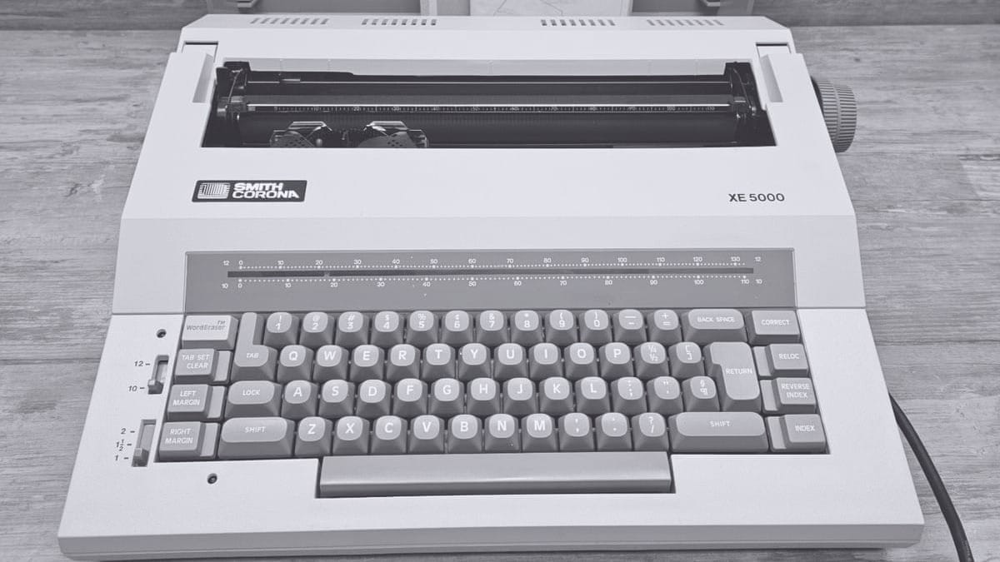
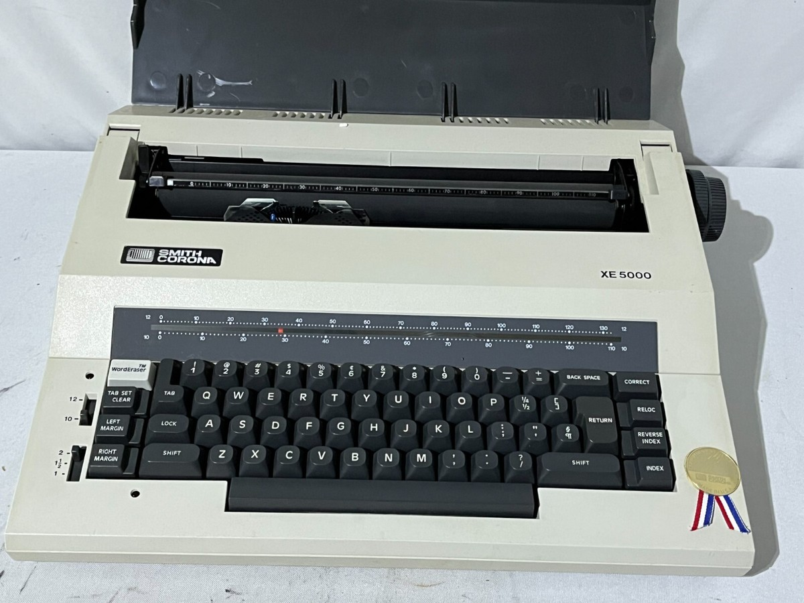
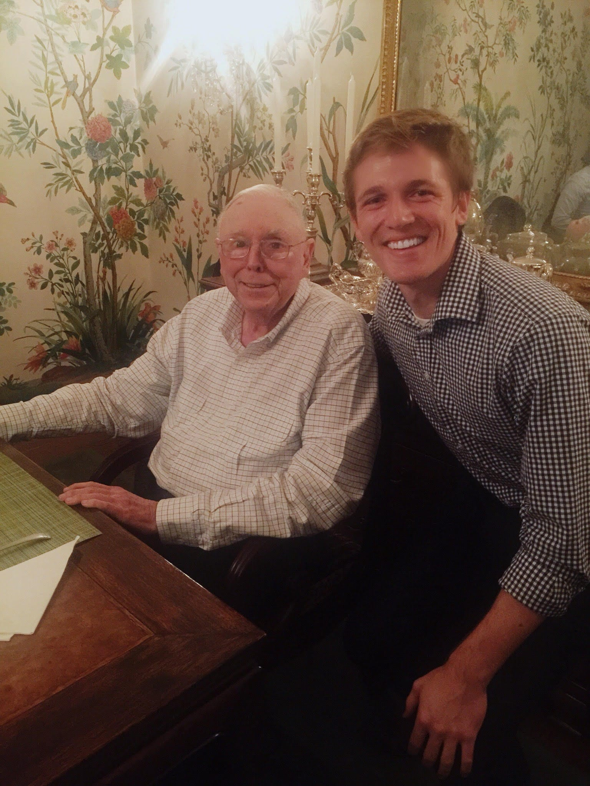
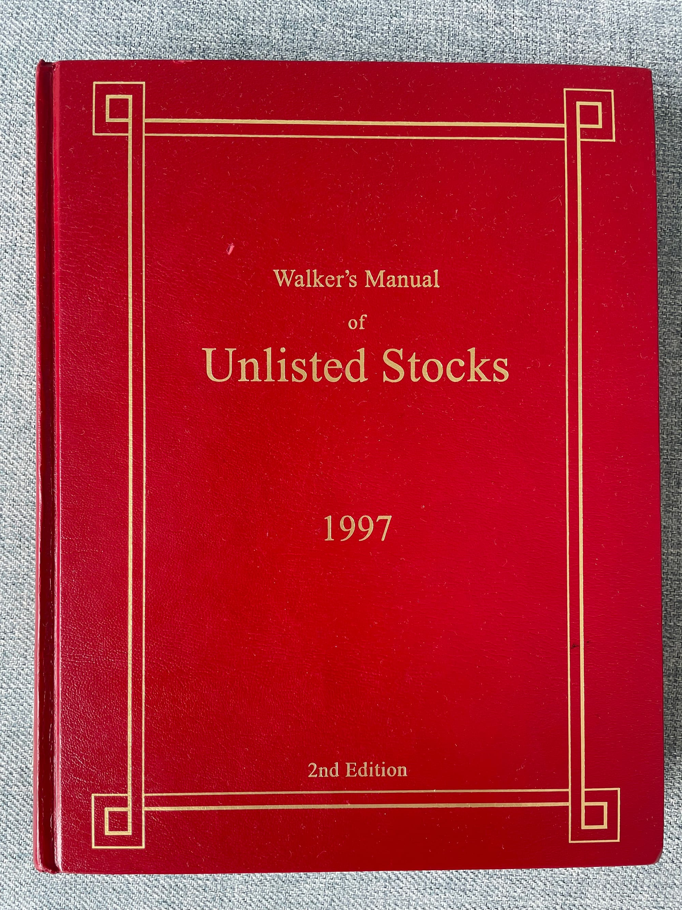
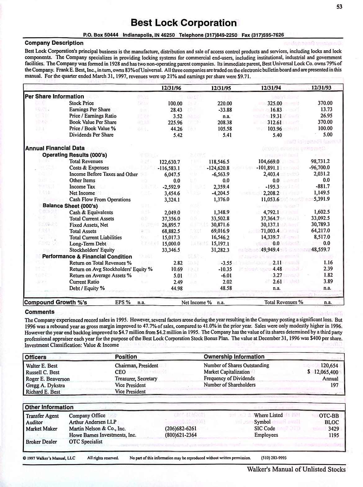
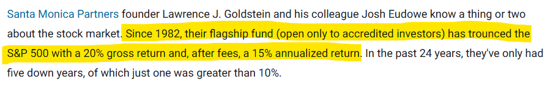
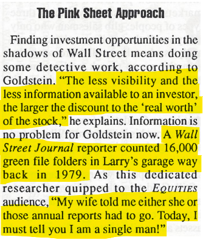

# 160x in a Month

12 Aug 2025 · Joe Raymond  
[Original article](https://www.joekraymond.com/160x-in-a-month/)

*The best investment I've ever made*

Excuse the flashy title.

I didn't actually make 160x in a month *on a stock*.

But I did turn \$25 into \$4,000. That same \$25 also got me my first two jobs and the opportunity to meet a personal hero. And that meeting led me down my current career path.

This post is different from prior ones. This isn't a story about a specific investment, but rather a few little ways I've been able to "find contrast" in my professional efforts. As Howard Marks says, *"In order to outperform, your thinking has to be **different** and **better**."*

It's uncomfortable and unnatural for me to write about myself. But I know readers of this blog are thoughtful and ambitious. And I have gotten multiple questions on my background and professional experience.

I hope sharing these personal stories can spur some useful ideas for you (or at least be mildly entertaining).

## The \$25 Investment

I was born with the bargain gene. I like to go to garage sales, buy used books, and shop for clothes at Costco.

I have this in common with my father.

When I was growing up, my dad and I used to go to thrift stores together. He would buy old antique furniture, and I would buy collectible Nintendo 64 games.

One day, when I was visiting home during my freshman year of college, we found a vintage Smith Corona XE 5000 electrical typewriter at the local thrift store. It looked like it had never been used. Typewriters were a shared interest of ours, and this one was pristine. We just couldn't help ourselves.

The best part? ***It was only \$5***.

The ribbons were more expensive than the machine. We spent \$20 on two new ribbons from Staples. Our all-in cost was \$25.

*Smith Corona XE 5000*

## Putting the Asset to Work

A few days after our typewriter purchase, I applied for the Brandes Investment Scholarship.

This was a \$4,000 cash prize awarded to five students who exhibited an understanding of Benjamin Graham's value investing principles. It was sponsored by Brandes Investment Partners (BIP) – an investment firm in San Diego.

I typed the scholarship essay application in Microsoft Word and submitted it online. Then I typed a follow-up *"thank you for the opportunity"* letter on my Smith Corona. I then printed out a hard copy of the essay, paperclipped it to my typewritten thank you note, attached a personal photo of myself, and mailed the package to Brandes headquarters.

There aren't a lot of 19-year-olds with an intimate understanding of Ben Graham's teachings. **But there are plenty of 19-year-olds who want \$4,000.** I thought the typewritten letter was a creative way to stand out.

And it worked.

I was one of five winners selected from a pool of over 2,700 applicants.

I later found out the Brandes Institute (the subgroup within BIP overseeing the scholarship program) had gotten a big kick out of my typewritten letter. No other entries had gone to such lengths.

## Keeping the Good Things Going

Almost immediately after learning that I won, I sent a message to the scholarship organizer asking if I could come visit Brandes to thank them in person for this generous award. I was the only winner who asked to do this.

I know how these things work now.

Executives and directors of large companies are busy. They're happy to allocate \$20k to college kids in a scholarship contest. But they don't necessarily want to spend their days hosting teenagers with millions of questions and no way to add any value.

But Brandes was more than welcoming. I think they looked forward to meeting *"the typewriter kid."*

The President of the Brandes Institute not only invited me to visit, **but he also scheduled a full day of meetings for me with the heads of every department** (research, trading, sales, HR, etc.). It was an incredibly kind thing to do for a know-nothing undergrad.

*Brandes HQ at the time in Del Mar, CA*

My day at Brandes was the most exciting professional experience I'd had to that point. Here I was – a kid from a no-stoplight town with zero connections in finance – meeting with the department heads of a \$20 billion institutional investment firm.

What a rush!

I learned a lot about the business of investment management that day. And I suppose I made a favorable enough impression that my new friend at the Brandes Institute offered me remote part-time work assisting him with various thought leadership projects and research reports.

For the next three years of college, I earned twice the minimum wage working on things directly related to investing. My only other gainful employment to that point had been cleaning old gym equipment at Anytime Fitness.

It was a nice upgrade.

I ultimately parlayed my three years of consulting work into a full-time junior analyst position at Brandes after graduating college. By some combination of diligent work, the kindness of others, creativity, and good fortune, I found myself on a research team surrounded by Ivy League MBAs and CFAs with intelligence and experience multiples of my own.

It was a wonderful opportunity.

## Meeting a Hero

Part of my typewriter routine is sending "gratitude letters" to people who have helped me – authors of books I've read, guests on podcasts I've listened to, university speakers, etc. The goal with these letters is to show genuine admiration and appreciation, while expecting nothing in return.

Most of the time, I receive no response to these letters. Which is completely fine.

**But occasionally, I stumble into something special.**

In the fall of 2019, while I was working at Brandes, I sent one of these letters to an executive of a large private company in Los Angeles. I was inspired by a presentation he gave at a local university. So, I wrote him a letter on my typewriter expressing my appreciation.

He reached out two days later and invited me up for a visit.

We hit it off immediately. After about an hour of conversation, he told me that he was friends with Charlie Munger and that he was going over to Charlie's house for drinks later that evening. **Would I like to join?**

I nearly fell out of my chair.

Like many other investors, Charlie is on my Mount Rushmore. This was a once-in-a-lifetime opportunity to rub elbows with one of my heroes. And it all came about because of a cold letter and the kindness of a stranger (who has since become a dependable mentor and friend).

*Photo with Charlie Munger October 2019*

I spent roughly three hours with Charlie that evening. The discussion topics varied greatly – from real estate development to dorm design and stock market competitiveness.

One thing in particular he told me changed my career trajectory:

*"You're young and broke, why are you working at a big firm looking at multibillion-dollar companies? **Find something less competitive**."*

This isn't an exact quote, but pretty close.

## Following Good Advice

When Charlie Munger tells you to do something differently, it's probably worth thinking about.

So, I started looking at smaller, less liquid companies. Brandes wasn't interested in these sorts of stocks, so I started dabbling in them with my own money.

One of my colleagues at the time had just received a *Walker's Manual (WM)* for Christmas. For those who don't know, *WM* was a hardbound book produced in the 1990s and early 2000s. It contained one-page summaries of a couple hundred obscure stocks – stocks where information was hard to come by.

These old books have become a collector's item amongst weird stock aficionados. Used copies in good condition sell for hundreds of dollars.

Here's what they look like:

*Walker's Manual of Unlisted Stocks 1997*

And here's a sample page on <a href="https://www.joekraymond.com/the-best-otc-investment-story-never-told/" rel="noreferrer">Best Lock</a>:

*Source: Walkers Manual 1997*

So, my friend got one of these neat old books full of obscure stocks. And he graciously let me borrow it one afternoon.

This specific edition included an introduction with acknowledgements naming the people who had helped contribute to the book. **I wrote down all of the names and firms mentioned and researched each one.**

It was an interesting group. Many of the people had since retired or passed away, but a few were still active in the space.

Larry Goldstein and Santa Monica Partners stood out.

This <a href="https://www.fool.com/investing/value/2007/03/20/investing-war-stories-from-santa-monica-partners.aspx?ref=joekraymond.com" rel="noreferrer"><em>Motley Fool</em> article</a> from 2007 was the first article I found on Larry.

*Source: Motley Fool*

Then I found some old *WSJ* and *Fortune* articles from the 1980s and '90s, including this one that mentions Larry's *"garage with 16,000 annual reports."*

*Source: "I Never Heard of It, Inc." 1995*

How neat!

Here's a guy who has made a healthy living fishing amongst *"stocks overlooked or ignored by otherwise intelligent investors."* A guy so passionate about his niche that he chose his obscure annual reports over his marriage!

And so, I sent another letter. This one to Larry Goldstein.

Beyond the usual shared interest and admiration, I tried to add some value by mentioning a few stocks I owned that I thought he would like.

Larry reached out a few days later and we had a three-hour phone call. He had owned multiple Smith Corona typewriters in his life, so we had a good laugh about the letter and many shared interests to discuss.

I told him about this little royalty company I was buying that traded for 4x earnings and had no debt. He bought some shares, and the stock quickly tripled. Lucky timing, but perhaps proof of the potential of cheap, illiquid stocks.

After a few months of back-and-forth, Larry offered me a job to be his full-time analyst.

I spent three years learning at the feet of a highly accomplished investor (and a thorough, demanding boss) – great training in my chosen "less competitive" niche.

## Finding Contrast

A professional gambler once told me something I'll never forget.

*"Game selection is far more important than player skill."*

You don't want to play poker against the old-timers who have made their living playing cards. You want to play against the freshly minted crypto millionaires who barely know the rules. Those are the best sorts of people to play against.

In other words, **you want to find and create as much contrast as possible between yourself and your competition.**

Whether it's in business, investing, or your career, *the best results are often achieved by pursuing niches with weak competition*, ***and doing so in a thoughtful, creative way.***

This was Charlie's point. And of course, it runs counter what most people do.

Most people pursue the hottest trends or brightest industries. They try to work harder and longer than everyone else. For some, it works. For many others, they'd be better served selecting an easier game. Their success would be greater, and probably their quality of life too.

## Postscript

*-So many outcomes in life can be attributed to luck and the kindness of others. The stories I share here could easily have not gone my way. Good fortune and friendly people deserve much of the credit.*

*-Charlie devoted significant time later in life to meeting with young and eager professionals. It was a very generous thing for him to do. Our meeting is a special memory for me, as I know it was for others who had a similar opportunity.*

*-These are just a few of my favorite typewriter stories. It has paid off in many other ways too. You just never know what good will come when you put yourself out there and show genuine enthusiasm and appreciation. Odds of any individual success are low, but payoffs are big. With small expectations, the downside is limited to time and the cost of a postage stamp.*

*-Shoutout to* <a href="https://x.com/Shadow_Value?ref=joekraymond.com" rel="noreferrer"><em>Shadowridge Value</em></a> *for letting me borrow his Walker's Manual!*
