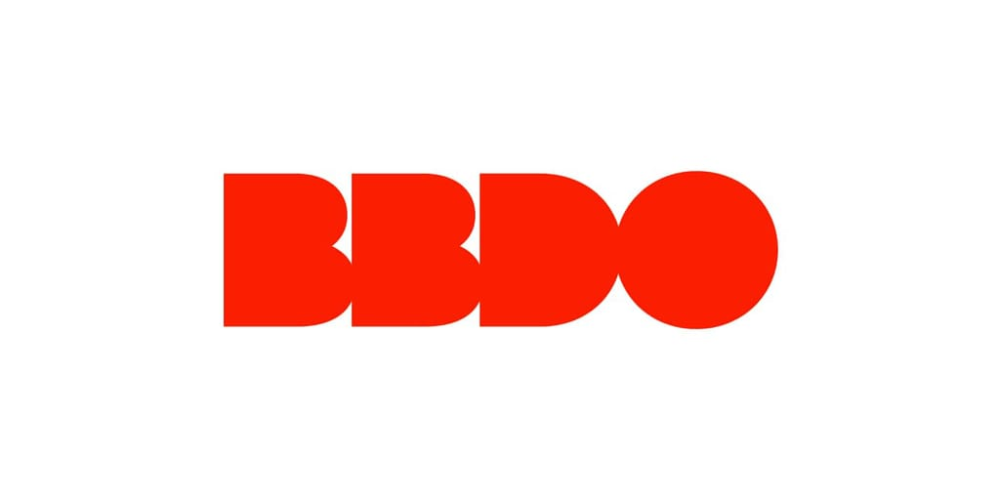
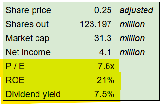
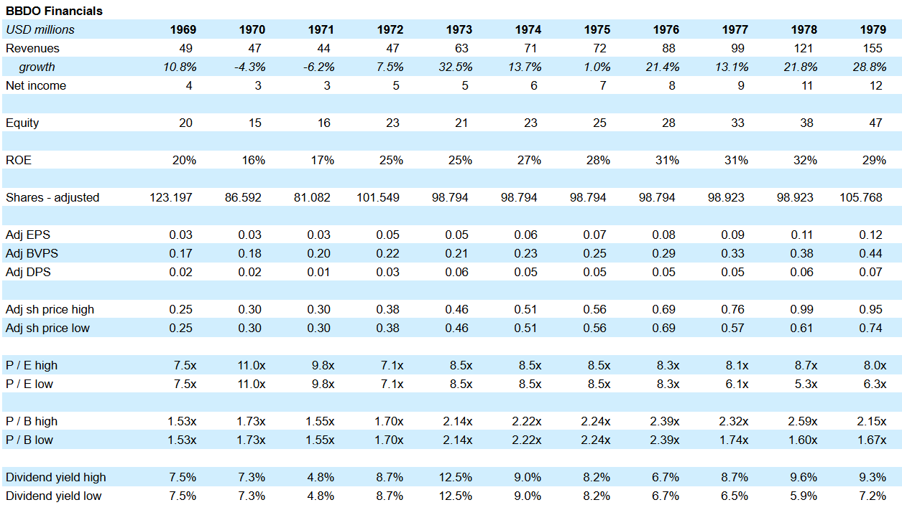
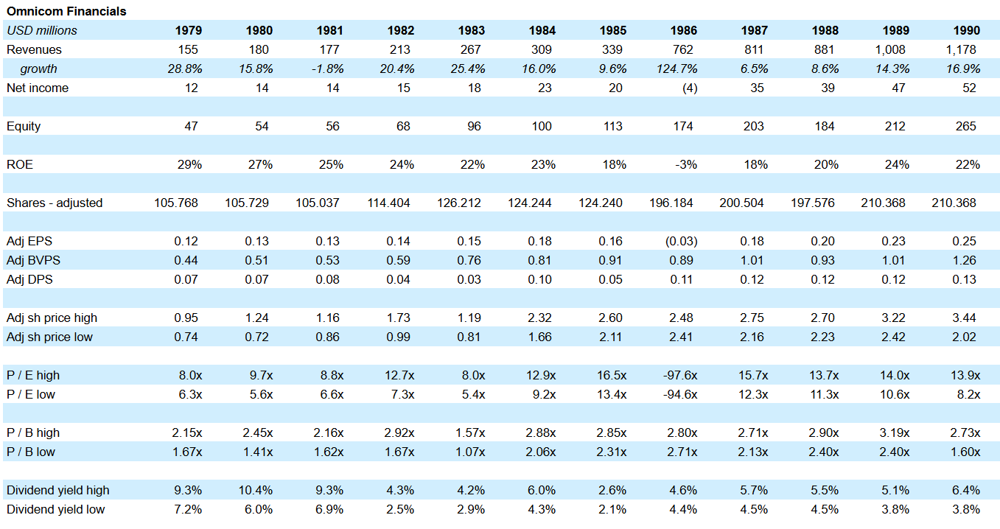
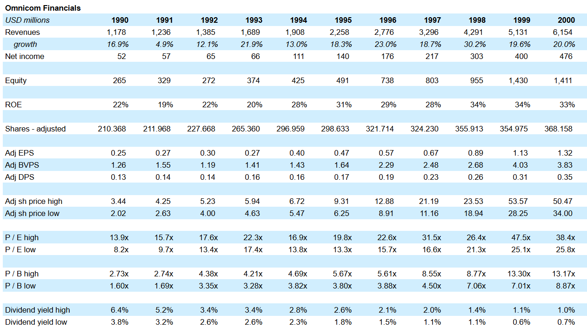
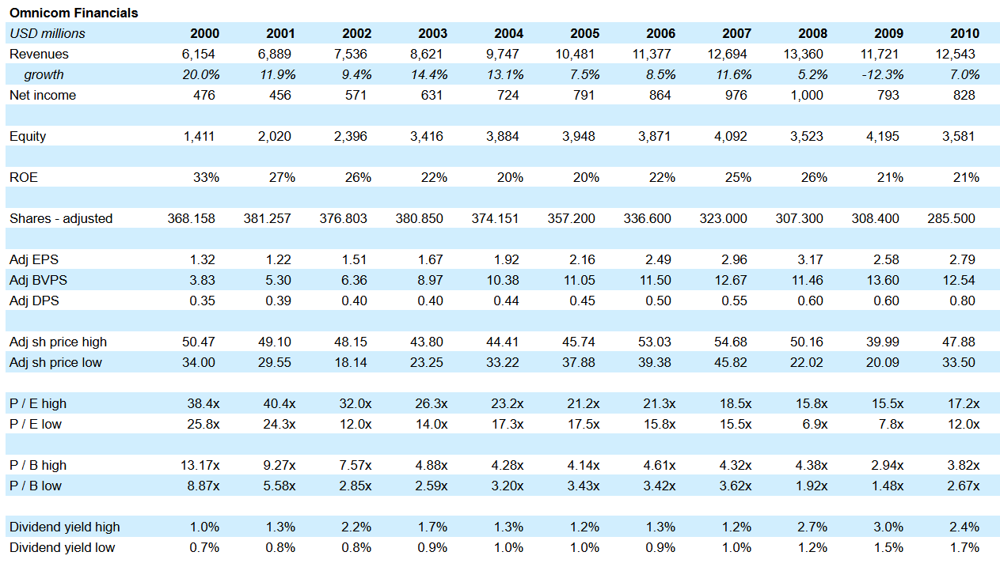
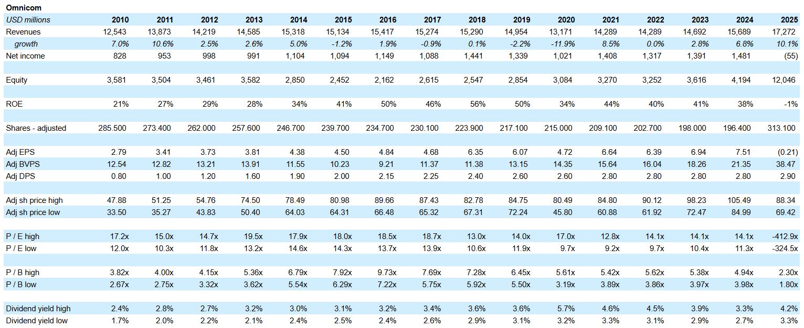
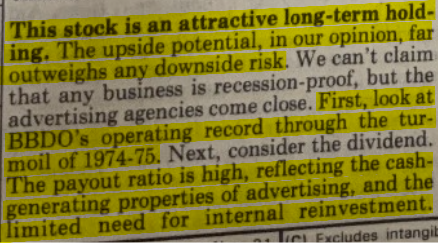
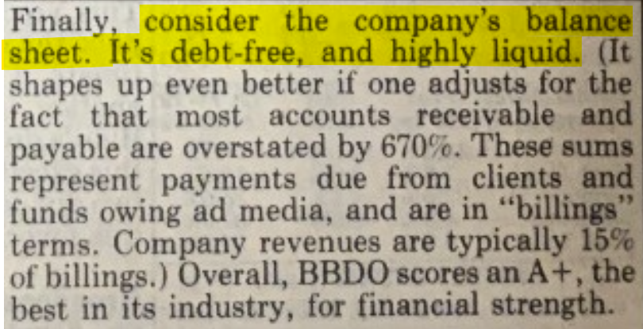

# 18% IRR for 57 Years

19 May 2026 · Joe Raymond  
[Original article](https://www.joekraymond.com/18-irr-for-57-years/)

*Batten, Barton, Durstine & Osborn*

A young Larry Goldstein first invested in Batten, Barton, Durstine & Osborn (BBDO) in 1969.

Adjusted for splits, stock dividends, and a merger, his first purchases were made around **\$0.25 per share**.

In the 57 years since, BBDO and its successor have paid **\$42 per share of dividends.**

***Every \$1 invested has paid out \$168 of dividends.***

\$10,000 invested back then now produces \$116,000 of annual dividends. That's a 1,160% current annual yield on cost.

Talk about tiny acorns turning into massive oak trees!

Plus, those BBDO shares Larry bought in 1969 have now become Omnicom (OMC) shares, which trade for around \$80 each. So, on top of the 168x return from dividends, **Larry has a stock worth roughly 300x what he originally paid.**

## BBDO International

George Batten founded the Batten Company in New York in 1891. At the time, advertising was mostly about placing ads in newspapers.

In 1919, Barton, Durstine & Osborn emerged, focused more on messaging, copywriting, and persuasion.

The two merged in 1928 to form Batten, Barton, Durstine & Osborn.

Over the next several decades, BBDO became a core player on Madison Avenue, helping large corporations build brands as radio and television expanded their reach.

## The Investment

BBDO International started trading over the counter in 1968.

Larry was a young analyst at Burnham & Company, making a name for himself by covering OTC stocks uncovered by other analysts at the firm.

**BBDO fit the bill perfectly.**

It was a good, growing business with healthy prospects trading for a cheap multiple. The stock was overlooked due to its trading venue and relative illiquidity.

As Larry recalls:

> "I came to realize advertising was a royalty business. If you had a consumer product, you needed to advertise. And you needed to use an ad agency like BBD&O. I viewed it as a royalty on consumer spending."

Here's the valuation Larry paid for his shares in 1969:

*Source: Value Line 1977*

He paid less than 8x earnings for a business generating 20% return on equity, growing in the low-double-digits, and yielding 7.5%.

## First Decade of Ownership

BBDO grew revenues from \$49 million to \$155 million from 1969 to 1979 (12% CAGR).

Net income tripled from \$4 million to \$12 million. Shares outstanding declined from 123 million to 106 million. As a result, **EPS quadrupled from 3 cents to 12 cents (15% CAGR).**

The P/E multiple ended the period at about the same 7.6x it started.

The stock went from 25 cents in 1969 to 85 cents in 1979 while also paying out 46 cents per share of dividends.

Including dividends, **the IRR for his first decade of ownership was 20%.**

Here are the financials from this period:

*Source: Moody's Manuals 1969 - 1979*

It's worth noting that the first few years after Larry's purchase weren't very encouraging. Sales fell in 1970 and 1971 and didn't eclipse the 1969 high until 1973.

**The stock was essentially flat for his first two years of ownership.**

Those who know Larry know he isn't quick to sell. His patience would be rewarded by what was to come.

## 1979 to 1990

The 1980s were a decade of rapid consolidation within the advertising industry.

Big multinational clients wanted agencies that could serve them globally. They wanted consistent messaging and strategy, as well as fewer agency relationships.

Importantly, **scale provided volume purchasing advantages**.

Large agency conglomerates could negotiate better rates and positioning with TV networks, newspapers, and radio than small independent agencies could.

**The merger activity culminated with Madison Avenue's "Big Bang" in 1986.**

Three major agency networks (BBDO, Doyle Dane Bernbach, and Needham Harper) combined to form Omnicom Group.

EPS over the 11 years from 1979 to 1990 grew from \$0.12 to \$0.25 (7% CAGR) while paying out a cumulative \$0.99 per share of dividends. Not spectacular performance, but not terrible either.

The stock started the decade at \$0.85 and finished at \$2.73. Thus, **Larry had a 10-bagger in his first 20 years of ownership, plus dividends worth nearly 6x his purchase price.**

1979 to 1990 was a mediocre stretch for earnings growth. But dividends were consistently paid and the multiple expanded 45% from 7.6x to 11.0x. **The result was a 17% IRR for the 11-year period.**

*Source: Moody's Manuals 1979 - 1990*

## 1990 to 2000

This was the home run decade.

Omnicom's business performance was excellent. EPS grew from \$0.25 to \$1.32 (18% CAGR), driven by scale advantages in purchasing coupled with a decentralized and entrepreneurial operating model. Tuck-in acquisitions were made at reasonable prices. Return on equity for the decade averaged 27%.

On top of the strong earnings growth, **the P/E multiple nearly tripled from 11x to 32x.**

OMC started the decade at \$2.73 per share and finished at \$42, while also paying \$2.22 of cumulative dividends. **This works out to an IRR of 34%.**

Here's a visual of the run:

*Source: Moody's Manuals & SEC Filings 1990 - 2000*

**Within 30 years of purchase, Larry had a hundred-bagger (plus all of the dividends paid along the way).**

## 2000 to 2010

Like many other stocks (and the market averages), 2000 to 2010 represented a "lost decade" for Omnicom shareholders.

The business itself grew at a decent rate--EPS compounded at 8% and \$5.48 of cumulative dividends per share were paid.

**Counteracting these factors was a 50% reduction in the multiple.** 32x in 2000 fell to 15x in 2010. The net result was a 1% IRR for the decade.

*Source: SEC Filings 2000 - 2010*

Operationally, the 2000s didn't look that different than the 1970s (8% EPS growth in the former vs 7% in the latter). **Yet the 1970s produced a 17% annualized return while the 2000s yielded only 1%.**

Such is the power of valuation. The same quality business can deliver wildly different results depending on the price paid. In this case, paying 8x earnings resulted in an annual return of 17% for a decade while paying 32x delivered almost nothing for 10 years.

## 2010 to 2025

OMC has grown EPS at 7% per year since 2010. The stock has roughly doubled from \$40 to \$80 while also paying \$34 of dividends.

It recently acquired Interpublic to form the largest ad agency in the world.

*Source: SEC Filings 2010 - 2025*

*This is a historical case study; I present no comment, analysis, or opinion as to the prospects of Omnicom today.*

## Conclusion

BBDO was an ideal buy and hold investment in the 1960s and 1970s.

The economics were attractive (20%+ ROE) and growth prospects solid (decades of global advertising growth ahead). Capital allocation was sensible (small bolt-on acquisitions, share repurchases, and dividends), and the valuation was cheap (sub 10x earnings).

**\$10,000 invested in 1969 and held through today would be worth \$3.2 million, with an additional \$1.7 million of dividends received as well.**

Larry wasn't the only one who recognized it. The analysts at *Value Line* agreed in their 1977 edition:

*Source: Value Line 1977*

Consistent with other successful long-term value investments, the returns produced by BBDO and later Omnicom were a result of good business results, sensible capital allocation, and patience.
