# 20% CAGR for 37 Years

20 May 2025 · Joe Raymond  
[Original article](https://www.joekraymond.com/20-cagr-for-37-years/)

*An obscure 800-bagger*

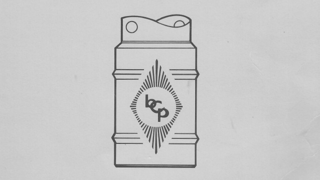

Larry Goldstein started buying Balchem stock in 1988 for less than \$0.20 a share.

**Today it trades for \$170.**

He has held onto the majority of his shares over this period—only occasionally distributing low basis stock to redeeming LPs.

**Larry’s 37-year CAGR in Balchem is north of 20%.**

A six-figure investment has turned into nine figures. Given he bought and held his shares, there have been no capital gains taxes or other frictional costs.

Despite the huge return, the Balchem case remains largely unknown outside of a small circle of investors.

This is the story of how **a patient, well-researched bet turned into one of the best-performing stocks of the last 40 years.**

## Balchem in 1988

Larry started buying Balchem in 1988 after reading the 1987 annual report.

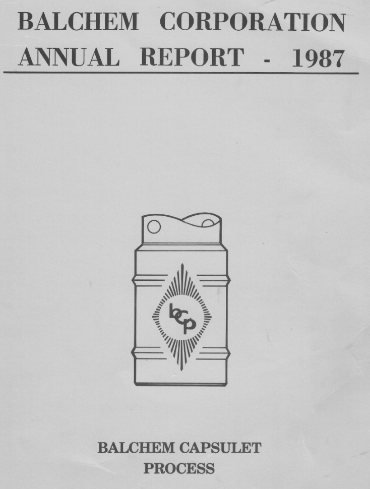

At the time, Balchem was a two-segment chemical company engaged in 1) producing sterilants for the health care industry and 2) microencapsulation (primarily for food ingredients).

Annual sales were \$6.8 million and operating profit was a little over \$700,000. The company had \$1.4 million in debt and \$161,000 of cash. Valuation figures were as follows:

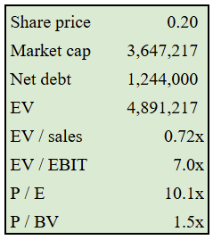

Full financials for those interested:

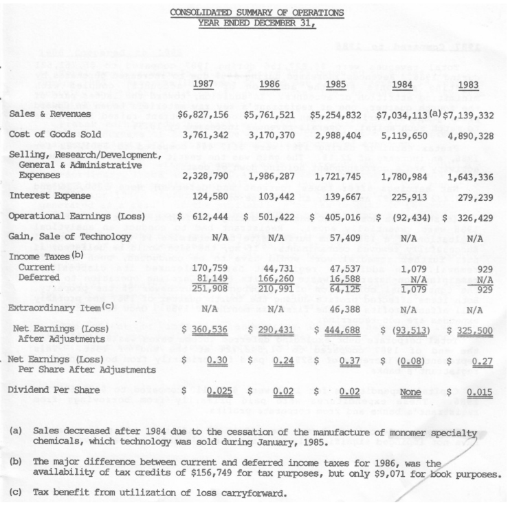

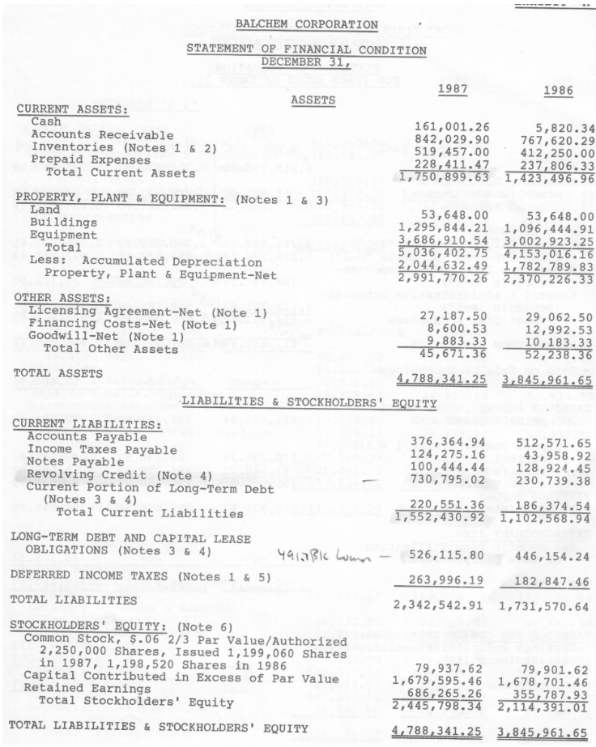

7x EBIT and 10x earnings seems decent but not screaming cheap for a tiny, thinly traded public company (a \$3.6 million market cap in 1988 is equivalent to a \$9.8 million market cap in 2025—teeny tiny). But the growth was strong and incremental economics attractive.

**Consolidated sales in 1987 grew 18% from 1986 and were expected to continue to grow around that level.**

Both segments were growing but the sterilant business looked especially promising.

## Sterilization

From the 1987 annual report:

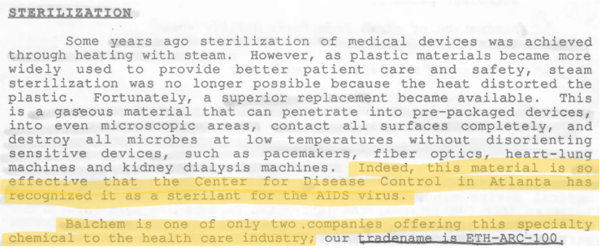

*Source: BCPC 1987 Annual Report*

Balchem started manufacturing and selling Ethylene Oxide (EtO) in the mid-1970s.

Prior to EtO, most medical device sterilization was done with steam. This presented problems when the objects being sterilized could melt or warp from heat. It was especially bad for small, delicate parts made of synthetics or plastic (like heart valves and pacemakers).

EtO solved the problem by being a temperature-neutral gas cleaning agent capable of invading every nook and cranny of even the smallest, most delicate devices.

**As a clearly superior solution for specific applications, EtO had tremendous growth potential.**

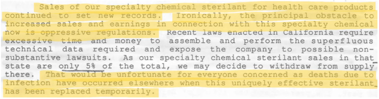

*Source: BCPC 1987 Annual Report*

EtO was controversial due to the potential dangers of its transport (due mainly to flammability) as well as environmental concerns.

**Larger companies were hesitant to enter the market and take on additional potential liability.**

Those who did tried blending EtO with other gasses to reduce flammability—which was expensive. Balchem’s approach was to seal the gas in reusable drums that could be delivered by truck, **making it cheaper and safer than alternatives**.

The only real competitor was Union Carbide—a much larger (and more bureaucratic) company with many different product lines and segments.

UCC was going through a restructuring in the late 1980s driven in part by lawsuits and environmental liabilities (related to multiple chemical leaks and the <a href="https://en.wikipedia.org/wiki/Bhopal_disaster?ref=joekraymond.com" rel="noreferrer noopener">Bhopal Disaster</a>).

EBITDA was around \$1.2 billion vs more than \$3.5 billion of debt and long-term obligations, plus undefined legal liabilities and costs.

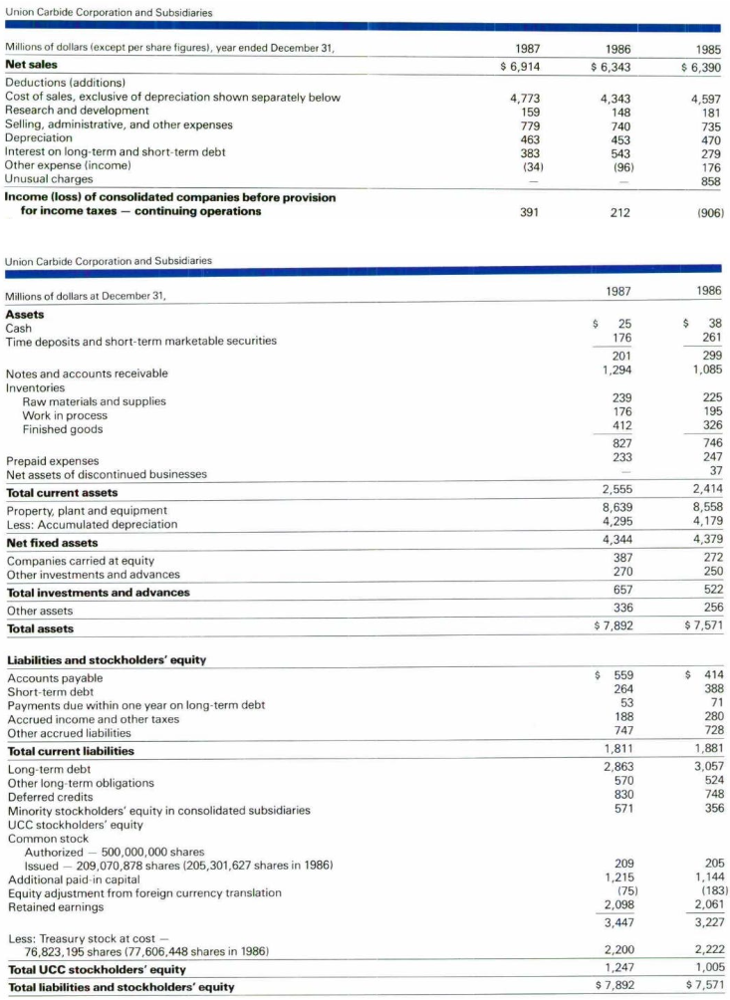

*Source: UCC 1987 Annual Report*

Ethylene Oxide was buried within their “Industrial Gases” segment, most of which was focused on industrial manufacturing, not sterilization.

Industrial manufacturing was a larger market for EtO than sterilization at the time, and that’s where UCC was focused.

**So, this was a small market in a subsection of a segment that wasn’t their largest.**

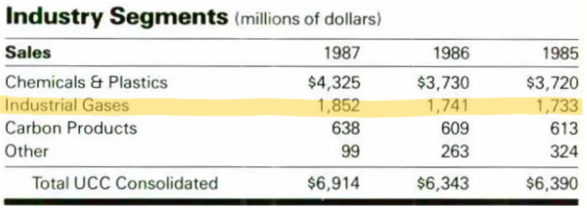

*Source: UCC 1987 Annual Report*

Big, bloated, bureaucratic, indebted, scattered.

All of this is to say, **UCC was a great company for the nimble Balchem to compete with.**

Over the years, Balchem’s higher volumes contributed to a cost advantage which, when added to the potential liability, **has kept competitors at bay for more than three decades.**

## Microencapsulation

This segment was also growing with lots of potential.

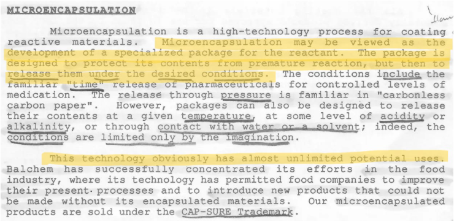

*Source: BCPC 1987 Annual Report*

The microencapsulation business had long lead times as food companies required extensive testing, studying, and different rounds of approval. But these were large companies with potential for high volumes.

**In 1987 Balchem was expensing these efforts without realizing the future benefits.**

This pointed even more towards the possibility of future growth and margin expansion.

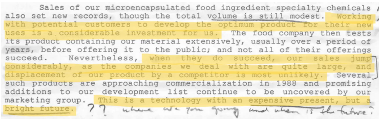

*Source: BCPC 1987 Annual Report*

The big opportunity at the time was the McLean Deluxe hamburger from McDonald’s, which used Balchem’s microencapsulated salt.

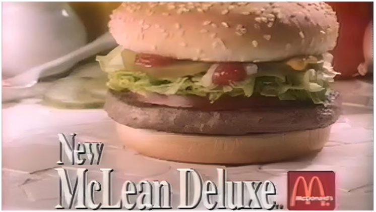

**Once food formulas and ingredients are locked in, companies don’t like to change them** (due mainly to the risk of ruining the taste/consistency). This was especially true in the case of McDonald’s—a company known for sticking with its suppliers.

Unfortunately, the McLean saga ended in 1996 when McDonald’s discontinued it.

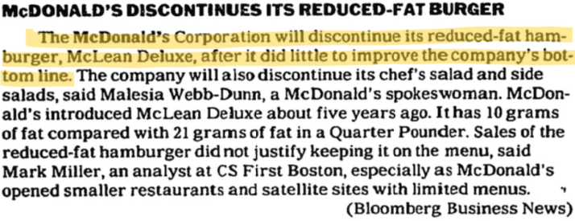

*Source: New York Times February 6, 1996*

But there were other food products that worked out very well—like Sour Patch Kids, where Balchem makes the face-puckering “crystals” on the candy.

All told on a consolidated basis, **Balchem was growing sales in the high teens** (with potential for added lumpy growth from encapsulated food products) **with room for margin expansion**.

With a return on capital of around 20%, a high teens growth rate could be achieved primarily with reinvestment of internal cash flows (with the help of some occasional borrowing).

Equity raises were limited only to options and warrants granted to employees and directors.

## People

Herb Weiss founded Balchem and served as President until 1997.

Herb took the company from a technology/idea (microencapsulated ingredients) to a legitimate commercial enterprise with blue chip customers (including General Foods, Unilever, Nestle, and RJR Nabisco).

Dino Rossi took over in 1997 when Herb retired. Dino did a lot of good things and took the company from \$30 million in annual sales to over \$500 million in 18 years (17% CAGR).

He did this through organic growth, new products, and bolt-on acquisitions.

A big growth effort was the introduction of microencapsulated products for animals.

For example, Vitamin C is fed to fish for their proper development. It used to be sprinkled into the tank in powder form which resulted in roughly 80% of it being wasted (20% consumed by the fish).

**Microencapsulating the Vitamin C flipped this ratio on its head.**

Similarly, under Dino’s leadership Balchem found an encapsulated solution for cows and their compartmentalized stomachs. The company developed a coating that could survive the rumen and dissolve later on in digestion, better delivering the nutrients.

Dino also completed various bolt-on acquisitions in the early to mid-2000s, **compounding EPS at 18% from 1998 through 2015.**

He knew every company and subdivision of large companies that he was interested in acquiring. He made Balchem known as a strategic buyer and never paid finder or banker fees.

As a result of the strong growth, cost control, creativity, and attractively priced acquisitions, **Balchem’s stock increased from \$2.00 to \$60.00 during Dino’s 18-year tenure as CEO** (20.8% CAGR before dividends).

## Outcome

As Larry wrote in a letter in 1990:

*“We bought into this established little company whose stock is basically unknown at a low multiple of current earnings. With luck there could be dramatic expansion of both earnings and price earnings multiple.”*

Were there ever!

The result is one of the best performing stocks of the last few decades, **returning roughly 20% annually from price appreciation through the present date** (with a couple more points added on for dividends).

Jason Zweig wrote about it in a 2016 *Wall Street Journal* article:

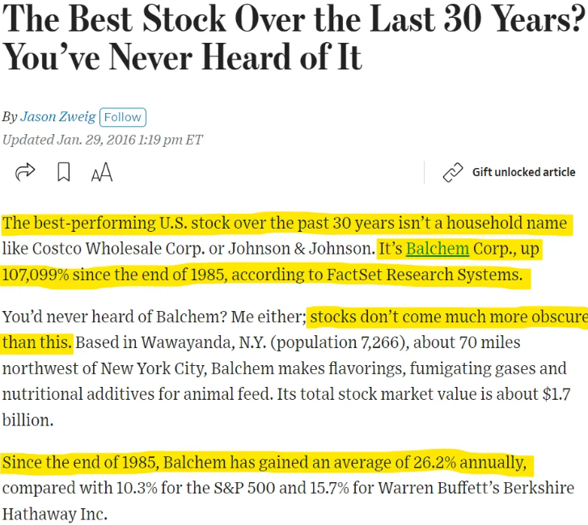

*Source: Wall Street Journal January 29, 2016*

Performance was even better the first couple decades when Balchem’s ROE was in the high teens/low 20s. The return was obviously helped by a period-ending P/E ratio of nearly quadruple where it started (10x to 40x).

Owning a stock for 35+ years is a tall task. But even shorter-term investors who bought the stock in 1989 would have compounded their capital at **50% for the first three years of ownership and 30% for the first five years.**

Larry invested roughly 2% of Santa Monica’s assets into Balchem at cost.

**Had the other 98% gone to zero, SMP still would have compounded at 7.6% before fees**.

This illustrates the power of even a singular winner when compounded over a long time frame.

Historical financials:

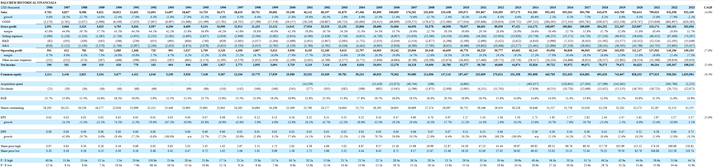

*Source: Annual Reports & Moody's Manuals*

## Larry’s Comments

I showed Larry a draft of this post before publishing and asked if he would like to add anything. Below are his comments.

*Dino Rossi was the Treasurer of Oakite Company in Texas. One of the board members of Balchem was on Oakite’s board and recommended Dino to Balchem to be their CFO.*

*The company didn’t have a formal CFO at the time. Only one name was in the annual report: Herb Weiss. There were no officers or directors mentioned. When Herb retired, the board made Dino CEO and eventually Chairman.*

***Dino began to make moves that really moved the company forward.***

*He was businesslike. Herb was a scientist, and he was good at it. But Dino was a businessman and thought in terms of profits. He understood value and went to work building it up.*

*When Dino took over, they were working on surviving/bypassing the rumen in cows and other animals. They were the first to figure out how to do this—how to encapsulate the nutrients to survive the rumen.*

*That was hard but even harder was getting veterinarians to approve it. Being a conservative group, that took years to get approved—8 or 9 years I believe. I remember Balchem worked with Cornell—one of the best veterinary schools in the nation—to prove their microencapsulated products were safe and effective.*

*Once approved it was a floodgate. Providing nutrients to animals was a very profitable line of business; they provided all kinds of supplements to dairy cows and other animals. Then there was the human nutrition and other applications. It all snowballed.*

*The organic growth was strong for many years, and acquisitions helped too. The way Dino did acquisitions, he knew what he wanted to acquire in the way of products or capabilities. In all cases, they were small private companies or subsidiaries of larger companies.*

***He never paid bankers or brokers. Everything he bought he found.***

*The stock has slowed since Dino’s departure. The valuation isn’t cheap, and management is no longer laser focused on return on equity. It’s still a great company, but the string of unlevered high teens ROE appears to be over.*
