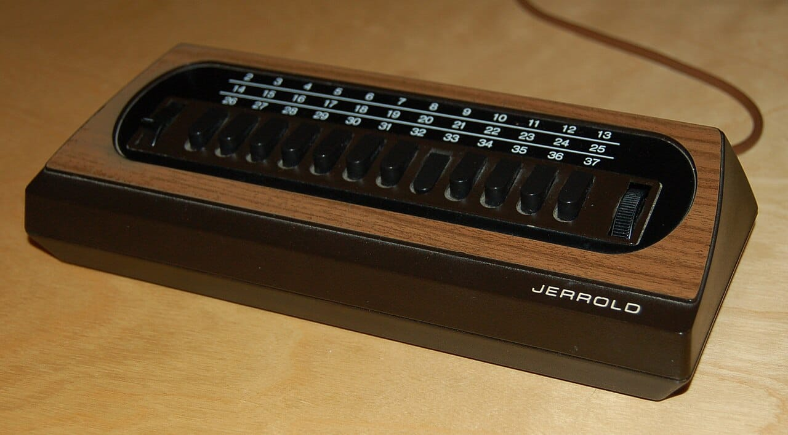
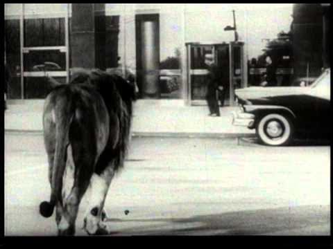
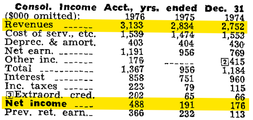

# 50x in 5 Years

6 Jan 2026 · Joe Raymond  
[Original article](https://www.joekraymond.com/50x-in-5-years/)

*Cable Cowboys*

Today's story is a fun one.

**It's about how Larry Goldstein made 50x on an obscure pink sheet stock in only five years**.

The company was sold to John Malone who made a further fortune in the following decades.

The first part of this post is penned by Larry.

I added a few of my own thoughts at the end.

## Cable Information Systems as Told by Larry Goldstein

I discovered Cable Information Systems (CIS) in a page of one-liner descriptions of companies in the OTC edition of Moody's Manual.

It was trading for a dollar per share.

I called the president, Peter Nisselson, in his office at 230 Park Avenue, known as the "Helmsley Building." I was at Burnham & Company three miles south at 60 Broad Street.

I invited Peter to lunch at the Harbor View Club atop the Two Broadway building, which also headquartered Dreyfus and Company and became famous for an ad they ran on TV featuring a lion walking out of the Bowling Green subway exit and crossing the street towards the Two Broadway building.

*Dreyfus Lion Approaching Two Broadway*

Believe it or not, Cable Information Systems had **50,000 subscribers** in 1980 which placed them in the **top 10 U.S. cable companies**.

The company had about 1 million shares outstanding which were inactively trading at a dollar a share in the pink sheets.

At the time, it was said that cable subscribers were going to be worth \$1,000 each to an operator of cable services. Thus, it became apparent that Cable Information with 1 million shares outstanding was worth **\$50 million** although it was selling at a market value of only **\$1 million**.

A second way of valuing a cable company was to apply the then-going multiple to cash flow, deduct debt, and divide by outstanding shares. Doing that I also came up with \$50 a share.

**So, using the two ways of valuing a cable company at the time, I found a \$1 stock worth \$50.**

I asked Peter if he knew of anyone that cared to sell shares, and he told me that some of the employees were shareholders and, from time to time, some of them were interested in selling. I asked him if he would give them my name and number and he said gladly, they’d be happy to know of me.

Over a period of months, some of these employees called and asked if I would buy their shares. I said yes, I am glad to pay the current market price of approximately \$1 per share.

Before buying, I told any caller offering shares to me, *"Look, I want to make clear to you that I’m buying because I think the shares are worth a heck of a lot more than a dollar and if I were you, I would **not** be eager to sell."*

As employees, I wanted them to know I felt strongly it was not a good idea to sell. After questioning them and explaining why they should not sell, some people still sold me their shares.

Additionally, I began to accumulate shares that became available from time to time in the open market.

Every day, I would eagerly call the trader on the Burnham & Company trading desk to ask if we'd bought any shares.

It wasn't easy.

Shares were offered in small dribs and drabs so that it took many months for me to acquire shares for my clients.

When shares stopped flowing in, given my very strong belief that they were worth \$50, I decided to keep raising my bid and bought stock all the way up into the area of \$30 apiece.

**Late in the year, 1981, Peter telephoned me to tell me that he was selling out at \$48 in cash to John Malone, who was the biggest cable operator in the United States.**

My first reaction was, *"Wow, two dollars short of what we had calculated it was worth."*

But Peter told me that there were two dollars being put into escrow and they will probably be paid to shareholders as well, bringing the total consideration to \$50.

I said, *"You know, we've owned some stock less than a year."*

Peter said don’t worry the transaction will not close until next year.

There was little left to argue with.

Shares began trading in the \$40 range and from time to time we would pick up more. I paid up to \$48 and even \$49 as I was highly confident the deal would pay off at \$50. And it did, early in 1982.

**And there was another bonus for me.**

Around the time of the CIS merger closing, I was leaving Drexel Burnham Lambert, where I had been working for over 23 years, to begin investing for a limited partnership that I founded.

And so, I was seeking an office space.

I said to Peter Nisselson, *"John Malone isn’t going to want your office."*

Peter agreed.

I suggested to him that I join in the space because he didn’t have any idea what he would do with it. He had no plans, and we could share the office.

Peter liked that idea and that’s how I got my first office in the tower of 230 Park Avenue and how Peter and I became very close and subsequently began to make some investments together.

Peter invested in Santa Monica Partners. And he joined me in buying shares of Tech Ops and subsequently to buy control of Speed-O-Print Business Machines.

## Additional Comments from Joe

It's remarkable Larry's ability to recount minor details from a stock he owned 50 years ago.

**Then again, if I made 50x on something rather quickly I'd probably remember the little details too.**

Here's what Larry was looking at in Moody's Manual back in 1977:

*Moody's OTC Industrial Manual 1977*

Sales were growing double digits and accelerating. Margins were expanding.

The stock traded between \$0.38 and \$1.00 in 1977. **The normalized P/E ratio was 1x on the low end and 3x on the high end.**

There was some debt, as was common with fast growing cable companies at the time. The EV/EBITDA at \$1 per share was 5x.

Larry wanted to buy every share of CIS he could find. **He was so compelled that he moved the bid up over time from \$1 all the way to \$30.**

You know you have something good on your hands when your appetite for a stock is insatiable. When you get "casino odds" worthy of a "big swing." ***When it's impossible to own too much***.

This is a rare thing, but it does happen.

And there's no better feeling in the investment business.
