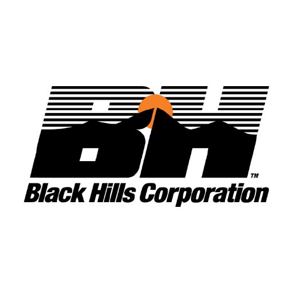
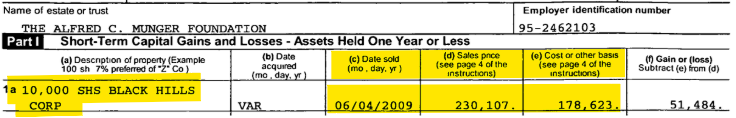
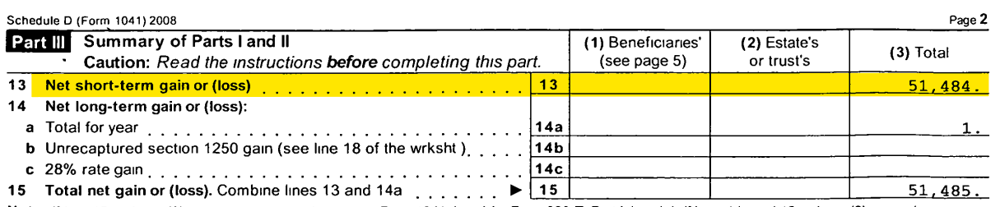
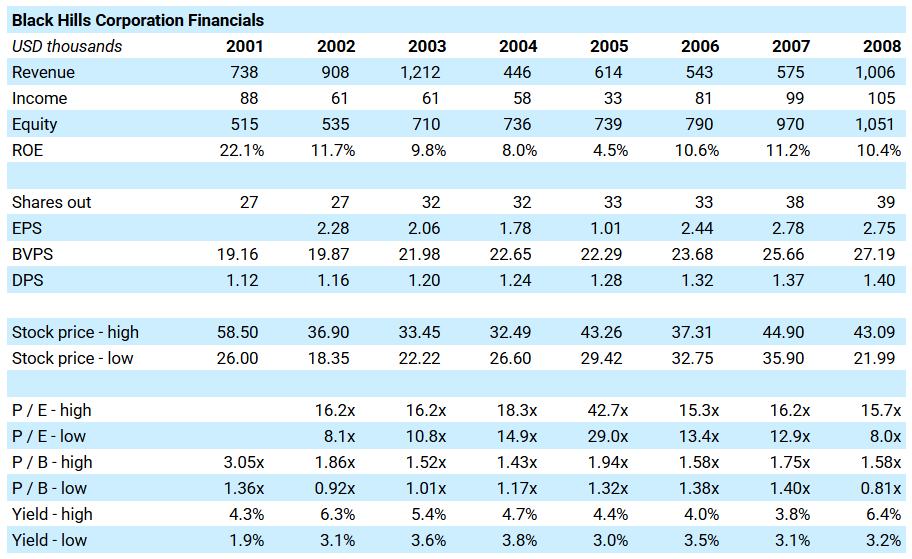
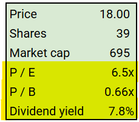
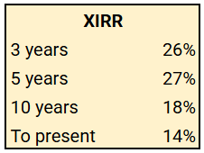
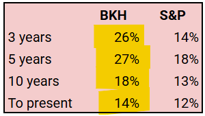
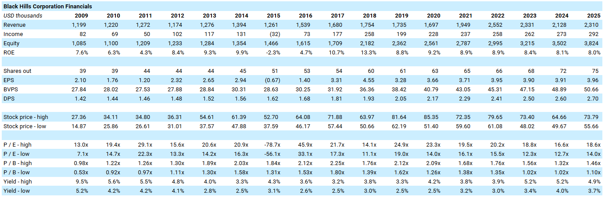

# A Munger PA Investment

25 Feb 2026 · Joe Raymond  
[Original article](https://www.joekraymond.com/a-munger-pa-investment/)

*Black Hills Corporation*

Reading foundation filings is an interesting way to see what otherwise private people have invested in personally.

**This is a neat trick for examining both Buffett's and Munger's PA investments.** It's how I first learned about <a href="https://www.joekraymond.com/charlie-munger-the-cigar-butt-investor/" rel="noreferrer">Hayes Lemmerz</a>.

Form 990-PF is public record. It shows contributed and purchased securities, cost basis, sales proceeds, and a slew of other information.

The Alfred C. Munger Foundation (named for Charlie's father) sold 10,000 shares of Black Hills Corporation (BKH) for \$23 each in June 2009, resulting in a short-term gain of 29%.

Here's the source document:

*Source: 2009 990-PF Alfred C. Munger Foundation*

A reasonable assumption based on this filing is that Charlie purchased this specific lot of 10,000 shares for \$18 apiece in early 2009 and sold in June 2009 around \$23.

He could have been buying the stock before that and holding shares after.

**The only thing we know with reasonable certainty is that Charlie thought Black Hills was a good buy in 2009 at \$18 per share.**

This case study will examine what BKH looked like when Charlie bought it and what the ultimate results were, both over short and longer time frames.

## Historical Set Up

Black Hills is a utility company based in South Dakota.

It was formed in 1941 through a combination of several existing utility companies serving the Black Hills region. The earliest predecessor traces its roots back to 1883.

This is a sleepy ho-hum electric and gas utility company. It has slowly compounded for decades, adding connections and making the occasional tuck-in acquisition.

By 2008, BKH had shareholders' equity of just over \$1 billion and served customers in four states (South Dakota, Wyoming, Colorado, and Montana).

Here's a financial snapshot from 2001 to 2008:

Black Hills could be described as a **decent** and **predictable** business in the years leading up to Charlie's purchase. ROE was in the low double digits and book value per share growth (adding back dividends) averaged 11% from 2002 to 2008.

**Simple, clean, predictable, decent quality.**

## Valuation

Early 2009 was a great time to buy stocks. And BKH was no exception.

Black Hills earned \$105 million in 2008 (\$2.75 per share). It paid \$1.40 of dividends that year and finished the year with \$27.19 of per share book value.

Here's the valuation Charlie's foundation paid for its shares in early 2009:

I think the thesis here was pretty simple.

**A durable, safe business that earns double digits on equity shouldn't trade for 66% of book value.**

The crashing economy wasn't going to kill the utility business. People still needed to turn their lights on and fire up the stove.

BKH was a relatively small \$695 million market cap at Charlie's purchase price, which is probably why he bought it personally and not for Berkshire or Daily Journal.

## Results

BKH's average price three years later in 2012 was \$33.66 per share, good for a return of 98% (25% CAGR) before dividends.

Here's the forward IRR (including dividends) for various timeframes after Charlie's purchase:

I asked ChatGPT to give me the S&P 500 total return over the same periods. Here's the comparison:

So, Charlie's pick handily outperformed the S&P over both short and medium timeframes. The long-term result is closer.

Black Hills has paid out \$31 of dividends per share (172% of Charlie's \$18 cost) and now trades for more than \$70 per share.

Here's the financial record since 2009:

## Takeaways

The Black Hills case isn't terribly exciting, but I do find it interesting and useful.

If I had to nail it down to one simple idea it would be this:

*Buying an adequately capitalized business, that should earn at least a high-single-digit return on its common equity, at a substantial discount to book value **often works very well over short- and medium-term time frames.***

The beauty of these sorts of investments is that the downside is protected by tangible equity, while the upside is driven by earnings and multiple re-rating. **Low risk, high return.**

This is value investing nirvana.

That said, as Charlie pointed out multiple times over the years, *the longer you hold this sort of business, the closer your annual return trends towards the ROE.*

You can't earn 20%+ per year for decades by sitting on something that earns 9% on equity. The benefit of multiple expansion gets diluted over time.

Still, BKH with its mediocre 8-11% ROE has delivered 14% per year from 2009 to present.

**Good results can be achieved over long time frames (with low risk) by buying merely average businesses at cheap prices**.
