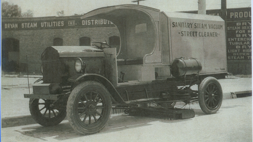
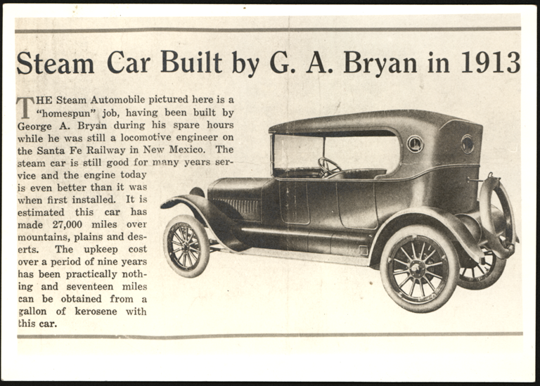
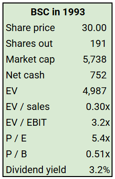
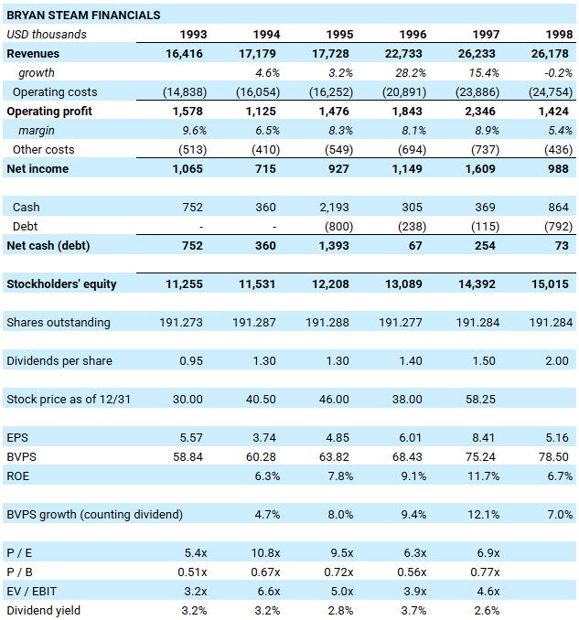
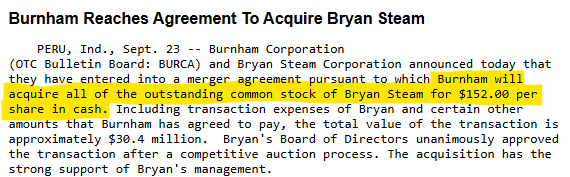
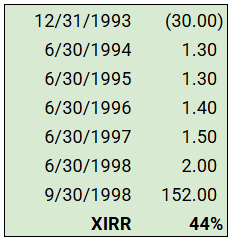
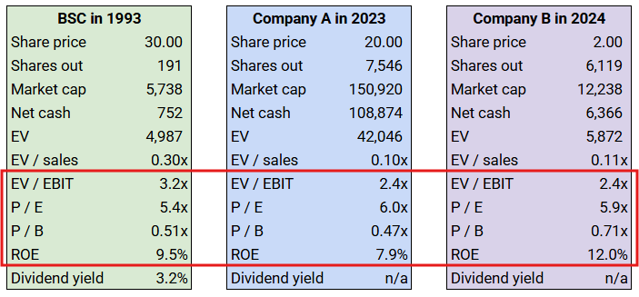

# A Sleepy 5x

25 Sep 2025 · Joe Raymond  
[Original article](https://www.joekraymond.com/a-sleepy-5x/)

*44% IRR in a boiler company*

I love a boring company with a thinly traded stock.

These sorts of stocks are prone to neglect. Neglect can reduce downside and improve eventual upside too. It's a beautiful structural factor that has been present since the beginning of markets, and I think it will likely continue to be present for the foreseeable future.

**In fact, I think the neglect of boring and obscure securities might become even more prevalent as attention spans and holding periods continue to shorten.**

In my experience, stocks with the following characteristics tend to do well on average over time:

1.  Boring businesses with long histories of profitability
2.  Clean balance sheets (more cash than debt)
3.  Honest insiders (even if they aren't terribly talented)
4.  Trading cheaply (say, 5x EBIT or less)

Once in a while one of these sorts of stocks might do poorly. But in aggregate, this group does tremendously well – at least in my experience and based on conversations with many other investors.

There are just too many things working in your favor. The odds are overwhelmingly on your side.

If profits continue as they have, and the balance sheet can't force you out of ownership, and insiders aren't going to siphon off value to themselves, **then the stock can't help but go up.** If it doesn't go up, you will have the entire market cap in cash within 6-7 years.

I am talking primarily about stocks in the U.S. and Canada as that is where the bulk of my experience lies, but I imagine the same idea holds true elsewhere too.

**It isn't glamorous, *but it works*.**

Today's story was provided by a friend of mine who has been investing in these sorts of "overlooked" stocks with his own money for more than 40 years.

It's a great example of the kind of boring, neglected stocks I like to invest in.

## Bryan Steam Corporation

Bryan Steam Corporation (BSC) was founded in Peru, Indiana way back in 1916. The company started out making steam-powered cars and tractors.

Here's an old newsprint ad showcasing a BSC steam car:

By the mid-1920s, it was clear that gasoline powered engines were winning out over steam in automobiles. BSC switched course and focused on boilers and related steam equipment, rather than vehicles.

And that's basically what the company did for the next 80 years.

Over time, they expanded their product line to include boilers fired by gas and oil and added electric boilers, condensing models, and "knockdown" boiler assemblies (which can be shipped in pieces and assembled on site).

But broadly summarized, **this was a simple Midwestern industrial company focused on boiler manufacturing.**

## Valuation

At some point, some BSC shares trickled out and started trading over the counter.

I'm not sure when it got its listing, but in the early 1990s Bryan Steam traded OTC under the symbol BSTM. Robotti & Co. was the market maker. Patient bidders could build a position.

1993 is the earliest year I have data, so that's where we'll start. This was around the time my friend was buying shares.

Here's what the numbers looked like:

*Source: Walker's Manual 1997*

Growth was modest and choppy, and the operating margin fluctuated between 5% and 10% depending on activity levels. ROE in most years came in somewhere between 7% and 12%.

These are extremely pedestrian numbers.

Most investors wouldn't have been excited to sit on the bid and patiently build a stake in Bryan Steam. Sure, it was cheap, but it had single-digit margins and single-digit ROE most years. Growth was lackluster. The dividend yield was a mundane 3%.

*"How are you going to buy it, what's going to make it go up, and how are you going to sell it?"*

This was the common pushback.

But, if you think about it, what was the risk buying BSC at \$30 in 1993?

You were paying half of tangible book value. The balance sheet was net cash. The company had a multi-decade history of profitability. Earnings could be cut in half, and you'd still only be paying 10x profits.

**I would argue the risk involved in this purchase was very low.**

Sure, some unforeseen black swan event could occur. But if you had 30 uncorrelated Bryan Steams in your portfolio, the odds of losing money on the whole were very low, in my view.

The realistic downside to investing in something like BSC is mediocre performance and a flat stock price. **And that's the type of downside I can live with.**

It's like Joel Greenblatt says, *"If you don't lose money, most of the remaining alternatives are good ones."*

## 1993 to 1998

Bryan Steam grew revenue from \$16.4 million in 1993 to \$26.2 million in 1998 (9.8% CAGR). Cumulative earnings over the period were \$6.5 million, **which was more than the entire \$5.7 million market cap in 1993.**

Book value per share grew from \$58.84 to \$78.50 (5.9% CAGR). The company also paid \$8.45 per share of total dividends over those five years.

These are *"good, not great"* numbers.

Yet the stock finished 1997 trading for \$58.25 (18% CAGR before dividends from the 1993 price of \$30). *And it still traded for only 77% of TBV and less than 7x earnings.*

**A stock that compounds in the high teens for four years and still trades for less than 7x earnings is my kind of stock.**

Here's a financial snapshot of the period:

*Source: Walker's Manual & SEC Filings*

## Merger

In September 1998, Bryan Steam entered into a merger agreement with Burnham Corporation (OTC: BURCA/B).

The price?

**\$152 per share.**

*Bryan Steam Merger PR 9/23/1998*

My friend who bought BSC in 1993 at \$30 earned a 44% IRR, including dividends. **More importantly, he did it without taking a whole lot of risk.**

The main pushback I hear on stories like this (and there are a lot of them, by the way) is that shareholders got lucky because the acquirer overpaid.

**What if Burnham hadn't come in and offered \$152 per share?**

Remember, BSC had compounded at 18% over the prior four years before Burnham entered the picture. And the valuation was still sub-1x book value for a decent (7-12% ROE) business.

Let's say there was no acquisition and Bryan Steam kept plugging along at its prevailing pace, compounding book value at 6% for the next 20 years.

By 2018, BVPS would have been north of \$250 per share and annual earnings would have been around \$25 per share. At 12x earnings, BSC would be worth \$300 per share.

This results in a hypothetical 10% annualized return over the 25-year period from 1993 to 2018. Including dividends, the IRR would have been in the neighborhood of 12-13%.

Thus, a **low teens** annual return could have been achieved over a multi-decade time frame, **even with "good, not great" performance and no reliance on a large ending multiple.**

Plus, the "option" of acquisition always exists in these sorts of small companies.

## Two Current Examples

I've never discussed current ideas on this site, but the BSC case reminds me of a couple active positions I'm involved in that I'd like to comment on.

I won't name names, but sharp-eyed readers will surely recognize these companies.

**Company A** is a manufacturer of HVAC equipment. It is family controlled and keeps an extremely overcapitalized balance sheet, with a large investment in precious metals (at the desire of, and managed by, the control shareholder).

I started buying Company A in mid-2023 when a seller pushed the price down to \$20 per share. This equated to 2.4x EV/EBIT, 6.0x P/E, and 0.47x P/B.

**Company B** is also an HVAC company, although they are more involved in the residential installation and maintenance side, rather than manufacturing. The heirs of the founder took over in 2018 and took the company from a net debt position to net cash. They sold/liquidated unprofitable lines and doubled down on the attractive residential HVAC segment.

I bought most of my shares in Company B in mid-2024 around \$2.00. This equated to 2.4x EV/EBIT, 5.9x P/E, and 0.71x P/B.

You can see the similarities of these three situations:

All three of these were **boring old industrial companies with neglected, undervalued shares**.

We know how BSC turned out. **44% IRR over five years**.

The jury is still out on Companies A and B. But so far Company A is up **130%** in our two years of ownership and Company B is up **68%** in one year of ownership.

Despite the quick rise, both are still cheap.

**Buying boring, neglected businesses isn't glamorous, *but it works*.**
