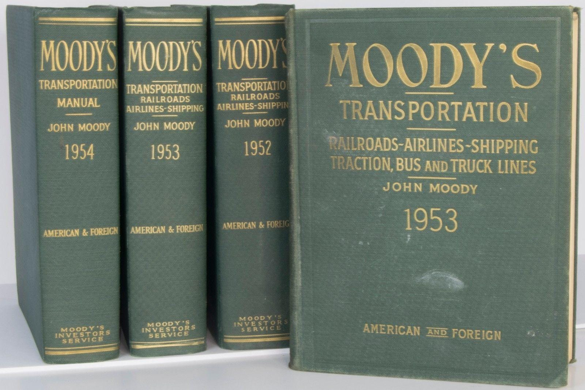
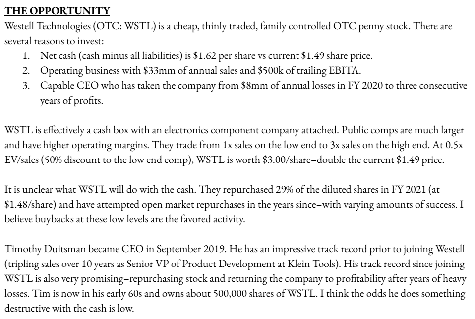

# Alone on the Bid

6 Nov 2025 · Joe Raymond  
[Original article](https://www.joekraymond.com/alone-on-the-bid/)

*Interview with The Mikro Kap*

I did a written Q&A with David Katunaric at <a href="https://www.mikro-kap.com/?ref=joekraymond.com" rel="noreferrer">The Mikro Kap</a>. It's the first time I've done something like this publicly.

David writes an entertaining and well-researched Substack covering uncovered small stocks. He has profiled a number of companies I own, follow, or have been involved in at some point. It's worth checking out.

You can find the interview <a href="https://www.mikro-kap.com/p/alone-on-the-bid?r=ys2n7&amp;utm_campaign=post&amp;utm_medium=web&amp;ref=joekraymond.com" rel="noreferrer">here</a>.

I have also reproduced the full Q&A below.

## Interview with David Katunaric

**DK:** For those who might not know you, Joe K. Raymond, could you briefly introduce yourself and give an quick overview of your investing strategy—what led you to pursue it, and what inspired you to start publishing case studies for the investing community this year?

> I bought my first stock on E-trade while sitting in the back of 10th grade English class. I made \$15 on it in an hour, which was double what I would have earned at my other job cleaning old gym equipment. I was hooked immediately.

> I like to invest in things with low downside and good upside. This usually manifests itself in small and illiquid securities. This post shares some background on what led me to my strategy: <a href="https://nam10.safelinks.protection.outlook.com/?url=https%3A%2F%2Fwww.joekraymond.com%2F160x-in-a-month%2F&amp;data=05%7C02%7Cjoe.raymond%40cald.com%7Cd078767ff9e04040056508de1d194149%7C3a7b077fbfdf4881990b536184b83750%7C0%7C0%7C638980191462179249%7CUnknown%7CTWFpbGZsb3d8eyJFbXB0eU1hcGkiOnRydWUsIlYiOiIwLjAuMDAwMCIsIlAiOiJXaW4zMiIsIkFOIjoiTWFpbCIsIldUIjoyfQ%3D%3D%7C60000%7C%7C%7C&amp;sdata=lZHrUTPd1Pgmp56xT%2BAs%2Fb4ONIjx%2FgVdaptoJE4jyog%3D&amp;reserved=0&amp;ref=joekraymond.com" rel="noopener noreferrer">160x in a Month</a>

> I believe the philosophy you need to know about investing can be found in a few books (maybe even a few chapters). Once you have the right framework (which I define as fundamental value investing focused on upside/downside analysis), investing is mostly about pattern recognition and being able to quickly compare different situations—both past and present. That's why I think it's useful to look at as many case studies as you can. You want to know what worked, what didn't, and why.

> I’ve gotten to know a number of obscure stock investors who have been doing it for a long time, and I’ve collected a lot of fun stories. A couple friends of mine who write online encouraged me to share some of these stories publicly. So, I created a personal blog. It's a small niche, but the response has been surprisingly enthusiastic. It has been a fun and serendipitous experience.

**DK:** How has your approach evolved since you first started investing, and what experiences shaped those shifts? For example, from meeting Charlie Munger at 22, to your time as an investment analyst at SMP, and now in your current role as Portfolio Manager at Caldwell Sutter Capital.

> Prior to meeting Charlie, I was trying to figure out the same stocks everyone else was trying to figure out. It really didn't occur to me to look at smaller companies. Charlie inspired me to find a less crowded niche, which led me to inactively traded and tightly owned securities.

> I'm a fan of Tim Ferris' concept of finding "a category of one." I try to just keep drilling down until there's nobody else left. In reality, there's always somebody else (which keeps it fun and interesting). It's a never-ending pursuit.

**DK:** During your time as an investment analyst under Larry Goldstein, what was the key lessons you took away? And what would you highlight as the one thing Santa Monica Partners does that truly sets it apart from other investment firms?

> Larry is a highly determined analyst. He will call a company's management every day until they call him back. Then he will spend three hours on the phone getting answers to his questions. A bit of this rubbed off on me from my time working for him (as he expected of me what he would do himself). I tend to be introverted and keep to myself, so this forced me to expand my comfort zone and develop confidence as an analyst/shareholder.

**DK:** Larry Goldstein is well known for his (almost) “never sell” approach—Balchem being the standout example. What’s your view on that style compared to pursuing higher turnover, maximizing IRR, and minimizing opportunity cost? In your experience, when does “cheap + higher turnover” work better than “quality + low turnover,” and vice versa? And how do you personally balance price and valuation against comfort with the business and its management?

> Every situation is different. You have to look at your opportunity set and decide what's best using rational common sense and the opportunity cost framework.

> If you have a \$10,000 portfolio, you can probably find enough interesting tiny situations to where you're constantly bouncing in and out of your best ideas. That would be better than just sitting on a single stock (even if it's something like Balchem).

> For example, I’ve been doing a low risk special situation this year that has produced a 50%+ annualized return net of taxes. But it’s not something you can get six figures into easily. It would be silly to be a "never sell" investor when you have something else that’s producing such a high IRR (assuming your net worth is small enough for it to matter). But if you have \$20+ million, you are much less nimble and it makes sense to hold longer.

> Generally speaking, I don't buy a stock unless I'm comfortable owning it for at least a few years. This eliminates companies that don't earn a decent ROE over a full cycle. It also eliminates situations with self-dealing management. I tend to err on the side of holding. Base rates suggest owning stocks over time is a good idea. So, unless I have a very compelling reason to sell, I usually don't. Time is your friend as these sorts of businesses pile up earnings and compound in value.

> Of course, for every rule there is an exception. I'm currently bidding for a stock that has breakeven operations and unsavory management. But it trades for 10% of net cash. It's in the U.S. and it's a Delaware corporation (jurisdictions I'm comfortable with). So, I'm willing to sacrifice on the business quality and the people if the price is sufficiently cheap.

> **This is where the pattern recognition comes into play and why case studies are so important.**

> How much leeway should you give on something like this? Well, it's useful if you can compare it to other similar situations from the past. In this case, I wouldn't want to pay 50% of net cash, but I would probably pay 20%. At 10% I'm happy to buy every share that becomes available (sadly, there aren't many).

**DK:** What has your experience as a broker in illiquid OTC stocks taught you about investing—things you didn’t fully appreciate before? How does the OTC market differ from other “exchanges,” and what does it take to actually succeed in that environment?

> A friend of mine says in order to earn high returns in small stocks you just have to read more and care more than everyone else. I think that’s true. And I think anybody who commits to that can put up good numbers without taking a lot of risk.

> Being a broker is interesting because you’re close to the market. You learn how buyers and sellers think and act. You see how market makers think and act. You know the mechanics of how the OTC market functions. And you get to interact with dozens of other microcap investors, many of whom have extensive experience in these sorts of stocks.

> An interesting question is where do mistakes come from? I think mistakes come from blind spots. Now, imagine a specific stock where you have analyzed the company forwards and backwards, both quantitatively and qualitatively. You have read all the annual reports and modeled out the historical financials. You have attended the annual meeting and interviewed management. So, you know the company well and the people involved. Now on top of this, let's say you also know who is selling shares and why they are selling them. You know their knowledge of the company and how they are looking at things.

> If you have 10 different bets like this, **what are the odds you lose over time? **I would argue very low.

> Being a broker has allowed me to get closer to the market, gain insights I otherwise wouldn’t have, and further reduce blind spots.

**DK:** Do you ever invest outside of common equities—things like creditor claims, preferreds, warrants, or bonds purchased during Chapter 11 situations, similar to some setups you’ve highlighted in your case studies? How do you go about sourcing those ideas, or do they usually stem from your stock research?

> We own or have owned preferreds, warrants, and bond-like securities. Often, these have involved some sort of conversion feature or some other interesting twist that we think offers returns on par with other equities we're buying. I've never bought bonds in bankruptcy but have purchased new equity out of bankruptcy.

> Ideas come from everywhere. Friends, clients, looking through lists of stocks, reading news/press releases, etc. If you look at every security on your chosen exchange, you will see when a new name pops up that you don’t recognize. Like everything else, this knowledge compounds over time. 

**DK:** What are your favorite “metrics” or signals for determining that few investors are paying attention to a company—that you’ve truly found something obscure? And how important is it to be “first to the room” versus simply being the smartest one in it?

> I always love when a ticker doesn't have a bid. These sorts of securities are usually hard to buy. But it's good to be the only bid when some trust officer somewhere has to wind up an estate. It might only happen once every few years but it's an exciting occurrence.

> **It's important to remember you don't get any points for obscurity (or complexity) in this business**. Sometimes the best sorts of situations involve a fatigued "value stock" that many people know the name of, but few are up to date on or have recently considered. Some examples from my own experience (*I and/or my advisory clients own shares in all three stocks mentioned below*):

> <u>MCRAA</u> - A boring old boot manufacturer in North Carolina. Perennial "value stock." COVID and poor operating results pushed the price down to \$18/share in July 2020. This was less than liquidation value and sub 5x normalized EBIT. People knew the company, but nobody wanted to be pitched the stock. Too boring, poor recent results,cash-hoarding management, etc. **The stock goes on to produce a 38% IRR over the next three years.**

> <u>MCCK</u> - An HVAC manufacturer in Massachusetts. Price falls to \$20 in June 2023. This equates to 55% of heavily depreciated book value, 78% of net current asset value, and 3x EBIT. Too illiquid and boring to excite anyone. Plus, the control shareholder likes to invest in precious metals. **Fast forward two years and the stock has more than doubled due to strong operating results and big gains in the precious metals portfolio.**

> <u>WSTL</u> - Electronic communications manufacturer. About a year ago, WSTL traded for less than its net cash. The company was thought of as a "value trap" with breakeven operations and constant share dilution. Here's what I wrote in an internal memo:

> **WSTL has since more than tripled in price. **Operating results have been stronger than expected and the company has repurchased additional blocks of stock.

> As these three examples show, you don't have to be "first in the room" or even the smartest in the room to make money without taking a lot of risk. Sometimes it's just about following the same stocks for years and remaining open to any changes in price/value that create opportunities. Neglect is your friend.

**DK:** What’s the most obscure stock you’ve ever come across—the kind that made you stop reading and think, *I can’t believe what I’m seeing*?

> There are a lot of these. I don't want to name any current names (for compliance reasons, and also because I'm bidding!). But I'll give some examples (with obscured details). I recently bought shares in the following:

> -A \$500k market cap with \$50mm of book value and \$1.7mm of average annual earnings (0.3x earnings and 1% of book value).

> -A profitable bank with a multi-decade history at 10% of tangible book value.

> -An insurance company that earns 16% ROE and trades for 4x earnings with 6% dividend yield.

> On average, these four stocks might each trade twice per year. So, they are **very **thin and obscure. But the values are undeniable.

> SIMA is a good case study that was written up publicly and you can trace the results. Dan Schum wrote up SIMA in 2016 when it was trading for \$0.65 per share (1x earnings and 18% of cash). A few years later, the controlling family forced out minority shareholders at \$10. Here's Dan's original post: <a href="https://nam10.safelinks.protection.outlook.com/?url=https%3A%2F%2Fwww.nonamestocks.com%2F2016%2F09%2Fsima-is-cheapest-stock-i-know.html&amp;data=05%7C02%7Cjoe.raymond%40cald.com%7Cd078767ff9e04040056508de1d194149%7C3a7b077fbfdf4881990b536184b83750%7C0%7C0%7C638980191462191692%7CUnknown%7CTWFpbGZsb3d8eyJFbXB0eU1hcGkiOnRydWUsIlYiOiIwLjAuMDAwMCIsIlAiOiJXaW4zMiIsIkFOIjoiTWFpbCIsIldUIjoyfQ%3D%3D%7C60000%7C%7C%7C&amp;sdata=0gd71Pi0twogUrKfTwP5XBUfToS4reAic4DOcD9jvWU%3D&amp;reserved=0&amp;ref=joekraymond.com" rel="noopener noreferrer">NoNameStocks: SIMA is the cheapest stock I know</a>

**DK:** There’s no doubt the U.S. micro-cap opportunity set was far richer when investors like Buffett and Goldstein first started out. What do you think is today’s equivalent of Buffett flipping through *Moody’s* or *Walker’s Manual*?

> I’m not sure I fully agree that U.S. microcap opportunities were much greater for Warren and Larry. 

> Buffett had to sift through thousands of pages in the Moody's Manuals to find Western Insurance. The few obscure stocks I mentioned above took equal effort. It's not like stocks at 1x earnings have ever been easy to find.

> U.S. markets generally were cheaper then (in the 1950s for Warren and 1980s for Larry). You didn't have to be investing in microcaps to find good values and put up great numbers. Today, most U.S. stocks trade at historically high multiples. But you can still find tiny companies with clean balance sheets at 5-10x earnings if you look carefully. So relatively speaking, carefully selected microcaps might look a lot better today than they did when Buffett and Goldstein were trafficking in them.

> And while you may have fewer investable U.S. microcap stocks to choose from, I think the people trying to dig these up is also fewer. Almost every annual meeting I go to includes the same 3-4 people in attendance. And all 3-4 of these guys have great records!

**DK:** You were a varsity baseball player, so I’m sure the terminology resonates—what are your thoughts on the investing equivalents of batting average and slugging percentage? And how do you separate luck from genuine skill when it comes to those occasional outsized winners?

> I was a singles and doubles kind of guy when I played baseball. I only hit one homerun in my entire college career.

> Generally speaking, I invest in a similar way. I don't like to lose money, so I mostly stay away from stocks with bad balance sheets, operating losses, new products, expensive valuations, rapid unpredictable growth, etc. I don't want to put myself in a situation where I could permanently lose more than 2-3% of my total capital in a single position.

> That said, the best investors I know find a way to hit for both average and power. They are like Shohei Ohtani with a 1.000 OPS. They find the good growing businesses with able and honest insiders at 5x earnings. Their hit rate is 80% and they have multi-baggers too. You can get both if you're patient and turn over enough rocks.

**DK:** What do most investors get wrong about micro-caps? What’s one common misconception you often see among people who invest in this space? And in your view, what qualities make for a truly good micro-cap investor?

> There are lots of ways you can go wrong in microcaps. I think many people assume you need to find something that will grow from a microcap to a smallcap or midcap in order to make money. There is an obsession with 10-baggers and 100-baggers. This can lead people to take more risk.

> Pretty much all of my microcap investments are still likely to be microcaps five years from now, and I'm fine with that. If you pay 6x earnings for something with a net cash balance sheet and honest insiders, you don't need any growth at all to earn an excellent return (17% earnings yield plus cash returns plus multiple expansion). I find it much more useful to think about the downside first. If you buy things sufficiently cheap, the multi-baggers will come naturally without trying to sniff them out.

> I've also seen people make mistakes trading microcaps. Unless I have something really great that I'm convinced nobody else has figured out, I'm content to sit on the bid. By contrast, I think a lot of people chase the offer when they like something. They push the price up higher and higher. Then a few quarters down the line when things don't pan out exactly how they expect, they commit the same error on the way down. "Sloppy in, sloppy out," as they say. You can use this to your advantage if you're on the other side of the trade.

**DK:** Have you noticed any common patterns among your best-performing and worst-performing investments? And is there a short case study from your own investing journey that highlights those lessons?

> My worst performing investments have been situations where I'm buying a stock based on earning power, and those earnings end up being illusionary. PMD and CMPD come to mind (both 50% losses). I thought the companies would earn more than they did, and there wasn't much asset or residual value left over when earnings disappointed.

> My best stocks have been those where I have asset value protection coupled with compelling future earning power. For example, my best-performing investment to-date was ECTM, which I bought below liquidation value and ended up selling two years later 8x higher (plus dividends that covered my basis). I might do a case study on this one at some point.

> So the best ones are the ones where downside is low and upside is big. Ted Weschler's Dillard's investment is another example of this on a larger scale.

**DK:** If you had to give one piece of advice to me—or to anyone reading this who resonates with your approach—what would it be?

> I find there's too much time spent talking and thinking about things that don't matter (what the market is doing, what the economy is doing, what other investors are doing, etc.). I'm guilty of this unproductive behavior too. The reality is, if you're a long-term fundamental investor, only three things matter:

> The business

> The people

> The price

> **You should spend 95% of your time thinking about these three things. **And if you're comfortable with all three, when taken together, then you should buy the stock. It's incredibly simple, but of course hard in practice.

**DK:** Where can people find you and learn more about you and your work?

> My personal blog is joekraymond.com and I'm on Twitter <a href="https://x.com/joekraymond?ref=joekraymond.com" rel="noreferrer">@joekraymond</a>.
