# An Early Buffett Partnership Investment

21 Jan 2026 · Joe Raymond  
[Original article](https://www.joekraymond.com/an-early-buffett-partnership-investment/)

*Commonwealth Trust Co. of New Jersey*

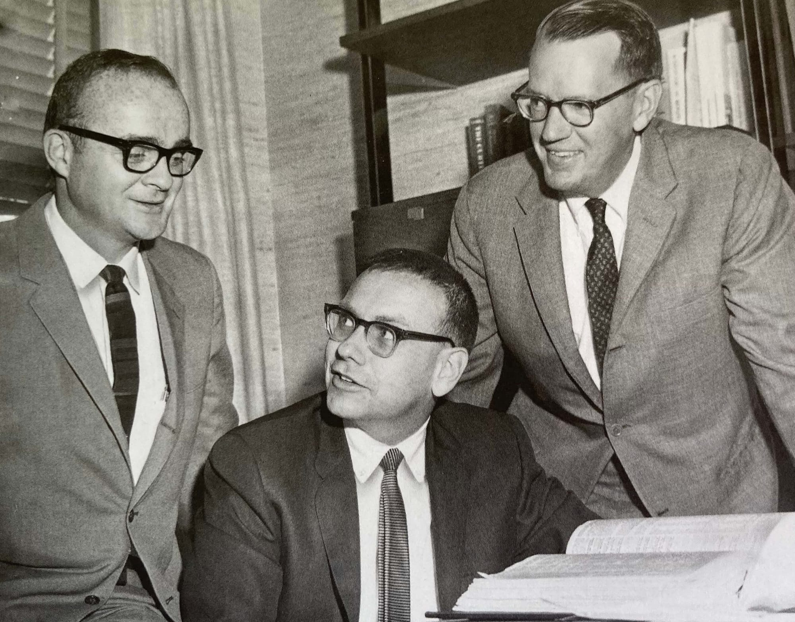

The first investment Buffett disclosed in his partnership letters was Commonwealth Trust in 1958.

Warren described Commonwealth as *"a typical situation"* for him at the time.

It was *small*, *cheap*, and *thinly traded.* Buffett made it a **10-20%** **position** for the various partnerships he was managing.

**This was a big (and bold) bet for the new money manager.**

How many new funds would put 20% of their capital into an obscure stock that trades twice a month?

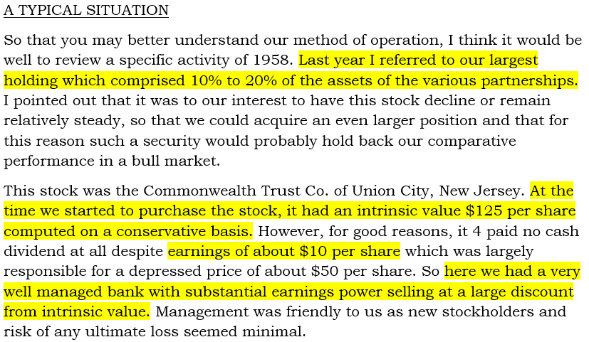

*WEB Letter to Partners 1958*

Buffett started buying Commonwealth at **\$50** and thought it was worth **\$125.** Here's a table with valuation ratios:

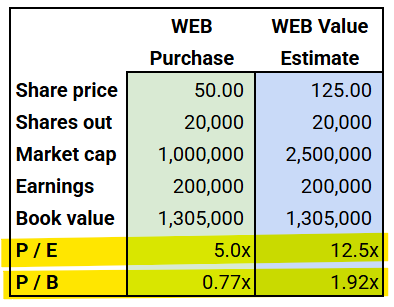

For those who like source documents, here's a screenshot of the 1958 Moody's Manual on Commonwealth Trust:

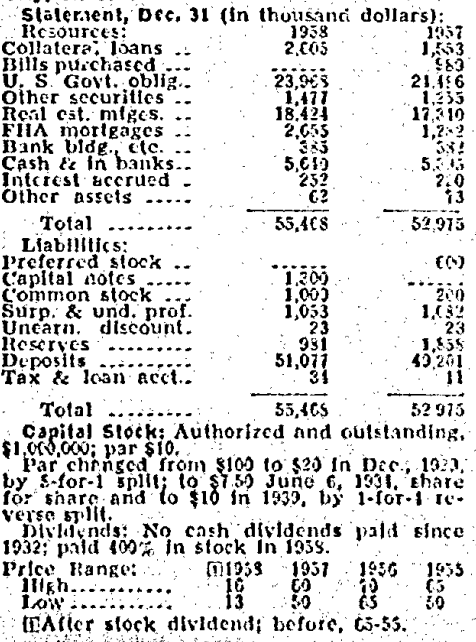

*1958 Moody's Manual*

A couple of things stand out.

The first is the price.

**Warren was paying 5x earnings and 80% of book value.** Seems like a good deal for a bank earning 20% on equity.

The second is the nature of the bank.

Commonwealth Trust had \$50 million of deposits and only \$20 million of loans, most of which were residential mortgages. It also had \$21 million of government securities.

**The asset mix appeared highly conservative**, at least from a credit perspective.

While the assets looked solid, there was little equity in the business (\$2 million of equity on \$53 million of assets). You don't see this sort of leverage today, but it was common practice amongst small thrifts in the '50s.

Here's the financial track record of Commonwealth leading up to Buffett's purchase:

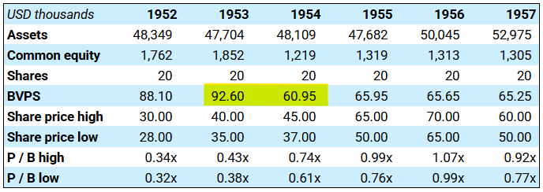

A sharp increase in reserves, coinciding with rising interest rates, caused a big hit in 1954. This was magnified by the fact that Commonwealth's equity was only 4% of assets going into the year. **Book value per share fell 34%.**

By the time Buffett was buying in 1957, interest rates were moderating, reserves were healthy, and earnings and equity were about to resume their growth.

Plus, Warren thought Commonwealth would eventually sell to another bank. He didn't know if this would happen in one year or ten years.

**But he didn't really care.**

Earnings and capital would continue to compound while he waited.

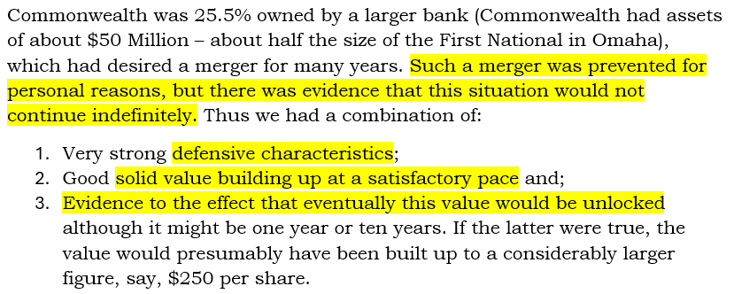

*WEB Letter to Partners 1958*

Over a period of about one year, **Buffett bought 12% of the bank at an average price of \$51 per share.**

His block grew in value as he added shares. More shares meant more influence on a potential merger.

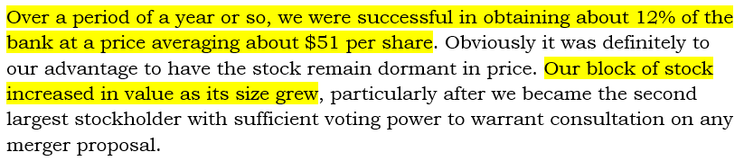

*WEB Letter to Partners 1958*

The stock seldom traded, so he must have found some sizable blocks to get up to 12%.

At least one other bidder entered the scene and pushed the price from \$50 to \$65, where Buffett was neither buyer nor seller.

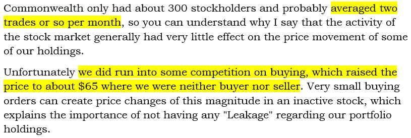

*WEB Letter to Partners 1958*

## Quick Flip Above Market

Warren didn't hold long.

**He sold his shares for \$80 apiece about a year after buying them**.

This was a 25% premium over the prevailing market price at the time and represented a profit of 57% for the partnerships.

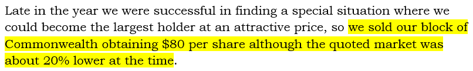

*WEB Letter to Partners 1958*

Buffett said the buyer at \$80 could expect to do well over time and that he was selling to recycle the proceeds into a better opportunity (Sanborn Map).

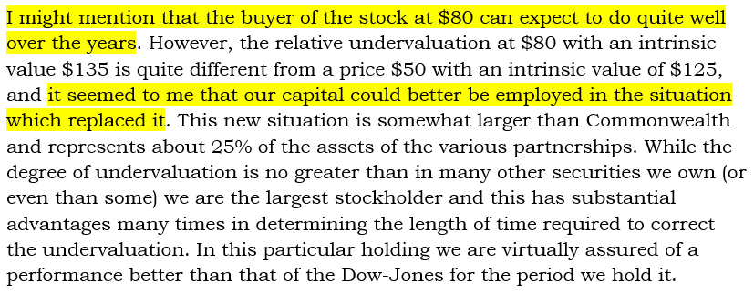

*WEB Letter to Partners 1958*

Was he right? Did the buyer at \$80 do well over the years?

## What Happened Next

About a year after Buffett sold, Commonwealth Trust merged with Hudson County National Bank (HCNB). It was a share-for-share deal, and the combined bank kept the Hudson County name.

Here's an old *New York Times* clipping announcing the merger:

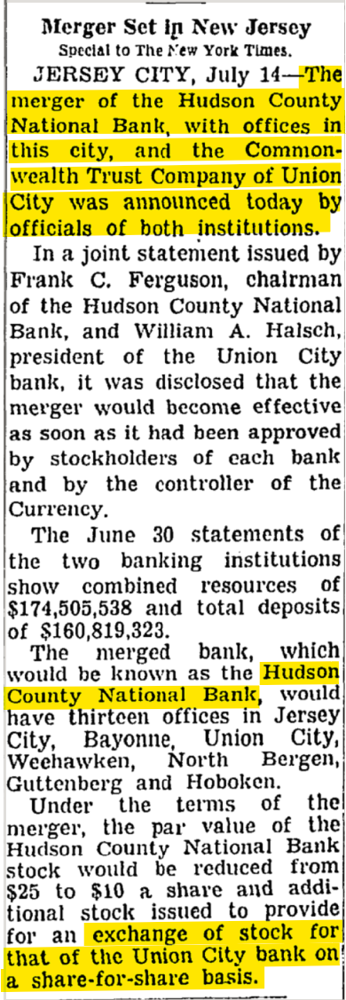

*NYT July 14, 1960*

The transaction closed on November 4, 1960.

**How did the owners of the new combined bank fare?**

Over the next eight years, HCNB grew its book value from \$135 to \$183 per share (4% CAGR) and paid \$57 per share of dividends. The average stock price in 1968 was \$228 (1.25x book value).

So, the buyer from Buffett at \$80 in 1958 had \$228 by 1968 plus \$58 of dividends.

**Including dividends, the total annual return was in the mid-teens.**

Had Buffett held his shares, the \$51 per share he paid in 1957 would have grown 4.5x over the next 11 years while also paying out 114% of his cost basis in dividends.

Here are the financials from 1958 to 1968:

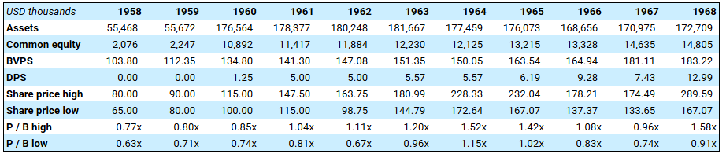

This is a good example of successful value investing.

Corporate performance was mediocre, but big follies were avoided. Equity grew slowly and dividends were paid.

**A cheap entry price and average exit price produced a mid-teens IRR over more than a decade.**

HCNB merged with Garden State National Bank in 1969, which later became part of Fidelity Union Bancorporation of Newark (FUBN). FUBN was later swallowed up by Wachovia, which was absorbed by Wells Fargo during the GFC.

## These Don't Exist Anymore!

The biggest pushback I get on these old stories is that these sorts of investment opportunities aren't available here in 2026.

**Information is instant and markets are too competitive.**

Surely tiny bank stocks presented better opportunities in 1957 than 2026, right? Where can we find decent, safe businesses at 5x earnings in today's market?

Here's an example of a bank we have been buying over the last year. **I would argue it's even better than Buffett's Commonwealth Trust**.

I'm not going to name names. But I will share (obscured) numbers.

We started buying this bank in June of 2025 at \$28.50 per share. Here are the figures:

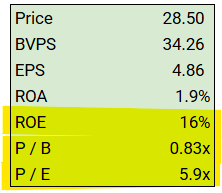

This is a small community bank with a 100+ year history. Low-cost deposits have been building up for decades. Loans consist primarily of residential mortgages. The bank owns all of its branches.

It earns a teens ROE despite being overcapitalized, and in the last three years it has repurchased 11% of its outstanding shares.

In my opinion, **this is just as good, if not better, than Commonwealth Trust was.**

It's even more attractive, relatively speaking, when you consider market levels. The S&P 500 traded for **13x** earnings in 1957 vs **28x** in 2025.

The market is more than twice as expensive today than it was then, **yet we're getting a better deal on our little bank than 27-year-old Warren Buffett was!**

It's like he always says, nobody is going to tell you about these obscure gems.

You have to find them, figure them out, be patient enough to buy them, and be comfortable owning a stock 99% of other investors haven't heard of.
