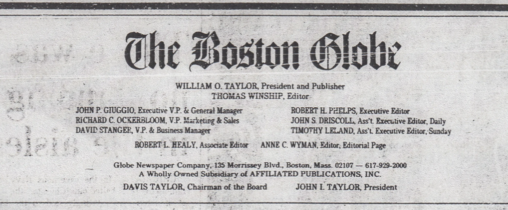
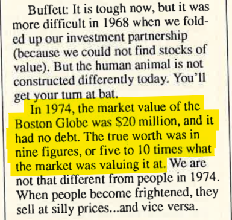
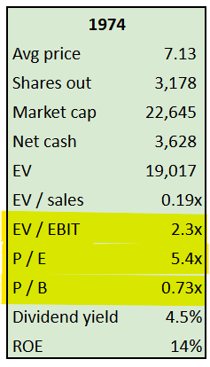
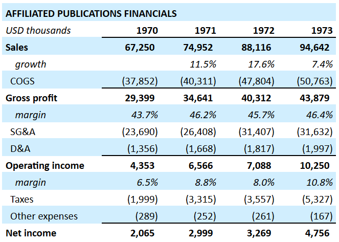
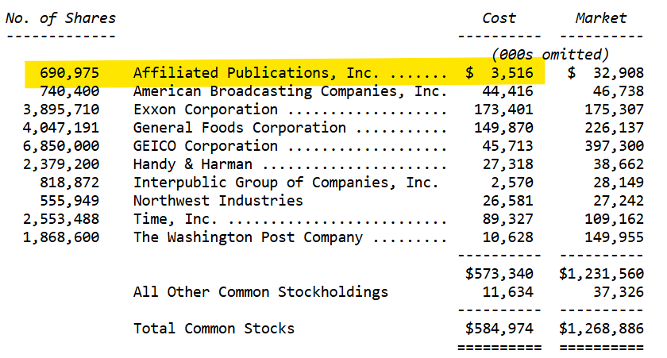
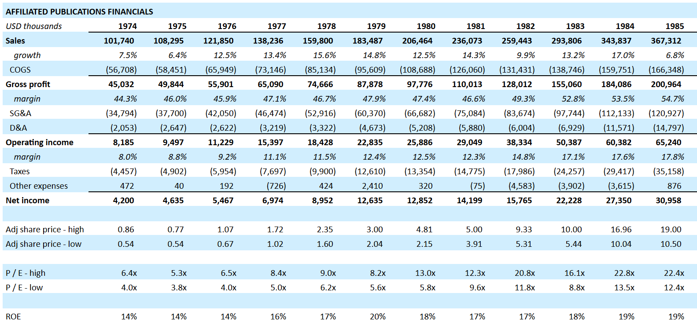
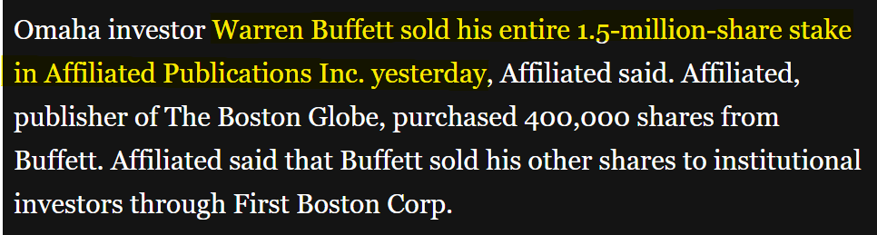
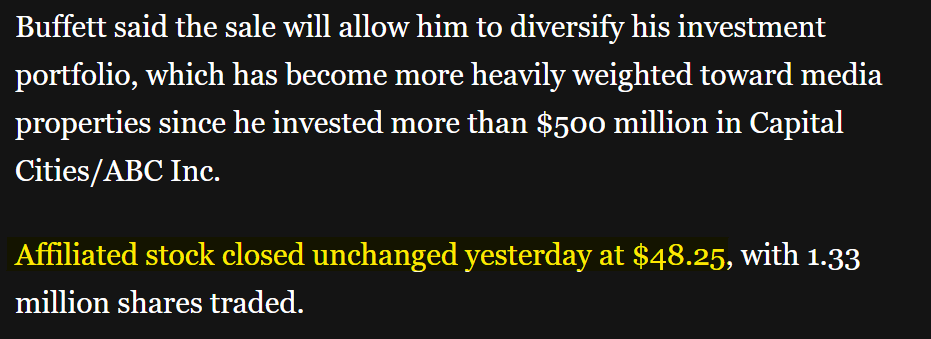

# Buffett's Boston Bet

2 Sep 2026 · Joe Raymond  
[Original article](https://www.joekraymond.com/buffetts-boston-bet/)

*Affiliated Publications, Inc.*

I was going through my files the other day and found an article that contained notes from the 1989 Berkshire Hathaway annual meeting.

At the meeting, a shareholder from Florida asked Warren, *"Does it concern you that value investing has become so popular and there will be fewer good values to invest in?"*

Here was Buffett's response:

*Source: 1989 Berkshire AGM Notes*

I thought it was interesting that, out of all the potential examples he could have used, Warren decided to highlight *The Boston Globe* as an outstanding investment opportunity in 1974.

A lot has been written about Buffett's other media investments, including *The Washington Post*, Cap Cities/ABC, and various advertising agencies. But I've rarely seen anyone discuss the details of *The Globe* investment.

So, I decided to pull the filings and see what the numbers actually looked like when Buffett was buying Affiliated Publications.

## Background

*The Boston Globe* was founded by six local businessmen in 1872.

It struggled financially until Charles Taylor took over. Under Taylor's watch, *The Globe* became the dominant daily newspaper in New England. Taylor introduced various innovations such as Sunday editions, illustrations, and expanded advertising sections.

For most of its history, *The Globe* was a private company controlled by the Taylor family. Then in 1973 Globe Newspaper Company merged with Affiliated Publications and went public. Affiliated traded on the American Stock Exchange under the symbol AFP.

*The Globe* had six morning editions (Monday through Saturday), five evening editions (Monday through Friday), and a Sunday edition.

Boston at the time was a two-newspaper city. The other player of size was *The Boston Herald*. *The Herald* was founded in 1846, 26 years before *The Globe*. It was merged with numerous smaller papers over the years and was controlled by the Hearst organization in the 1970s.

Historically, *The Herald* cultivated a more populist style and eventually adopted the tabloid format in 1981, while *The Globe* developed a reputation as Boston's newspaper of record.

## Buffett's Investment

AFP first showed up in Berkshire's annual report in 1974 when it broke the \$1 million market value reporting threshold.

Here was the valuation on AFP in 1974 when Buffett was buying it:

*Source: Moody's Industrial Manual 1975*

In addition to \$3.6 million of net cash, AFP owned its 500,000 square foot facility in downtown Boston.

Here's the operational track record of Affiliated up to that point:

*Source: Moody's Industrial Manuals*

So, Buffett was paying **2.3x** **EV/EBIT**, **5.4x** **P/E**, and **0.73x P/B** for a business that had doubled operating profits in the last three years and appeared to be performing well at the time. In that historical context, the price looked very low for a high-quality asset.

*"The true value was in the nine figures, or five to 10 times what the market was valuing it at,"* as he said at the 1989 annual meeting.

A \$100 million valuation would have equated to 9.4x trailing EV/EBIT and 21.0x P/E. I don't know if Warren actually thought *The Globe* was worth that much at the time or if it was hyperbole used in hindsight. Either way, AFP looked inexpensive based on the historical financial information available from that period.

Berkshire ended up acquiring 8% of Affiliated Publications in the mid-1970s for a total cost of **\$3.5 million**.

*Source: 1984 Berkshire Hathaway Annual Report*

## What Happened Next

Affiliated grew both circulation and advertising revenue at a healthy rate while simultaneously expanding margins and producing ample free cash flow.

**Revenue increased 12% per year from 1974 to 1985, and the operating margin expanded from 8% to 21%.**

Free cash flow was used to pay dividends and make acquisitions. Around a quarter of the company's earnings were paid out in dividends, and the remainder was reinvested organically or in acquisitions. Affiliated bought a variety of media assets, including radio stations in New York, Ohio, and California, and a cable company in Oregon.

Returns on these purchases appear to have been satisfactory, as the company's overall return on equity increased from 14% in 1974 to 19% in 1985.

One acquisition that may have bothered Warren was the 1976 purchase of *The Transcript* in North Adams, Massachusetts.

AFP issued 200,000 shares for this acquisition, diluting shareholders by about 6%. I don't know what the valuation was on *The Transcript*, but AFP's stock was expensive currency, trading for an average P/E of 5x in 1976.

Here's a financial summary of the period:

*Source: Moody's Industrial Manuals*

It's interesting to note that Affiliated didn't trade above 10x earnings until 1980. It could have been purchased at a single digit earnings multiple for six years from 1974 to 1979. And even after that point, it frequently traded back down into single digit territory.

## Buffett Exits

Warren enjoyed the twin engines of earnings growth and multiple expansion.

EPS (adjusted for splits and stock dividends) grew from \$0.13 in 1974 to \$1.33 in 1985 (24% CAGR). Cumulative dividends paid were \$1.35 per share (nearly 100% of the average adjusted share price of \$1.41 in 1974). The stock traded for \$48 in 1986 (36x P/E).

Berkshire's \$3.5 million turned into more than \$70 million (before dividends).

**Based on those assumptions, I estimate his IRR on the initial 1974 purchases was around 44%, including dividends.**

The investment ultimately worked out well, but the exit may be just as interesting as the purchase.

Buffett ended up selling his stake in 1986 back to the company and a group of other institutional investors. The public rationale for the sale was to diversify away from media, where Berkshire was already heavily invested. I suspect a bigger problem was that the valuation had grown too rich.

Here's how *The Washington Post* reported the sale at the time:

*Source: "Buffett Sells Stake in Publishing Firm" Washington Post April 15, 1986*

*The New York Times* purchased Affiliated Publications for **\$1.1 billion** in 1993 (a similar valuation to Buffett's sale in 1986).

The newspaper business got significantly worse in the 1990s and 2000s, and *The New York Times* sold *The Boston Globe* to John Henry, owner of the Red Sox, in 2013 for only **\$70 million**.

This represented a 94% decline in value over two decades and is a striking example of how technological change can reshape the economics of even once-dominant media assets.
