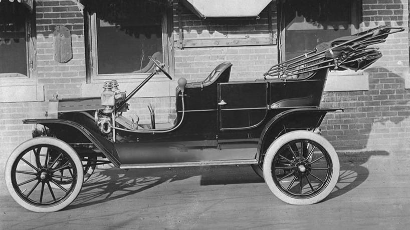
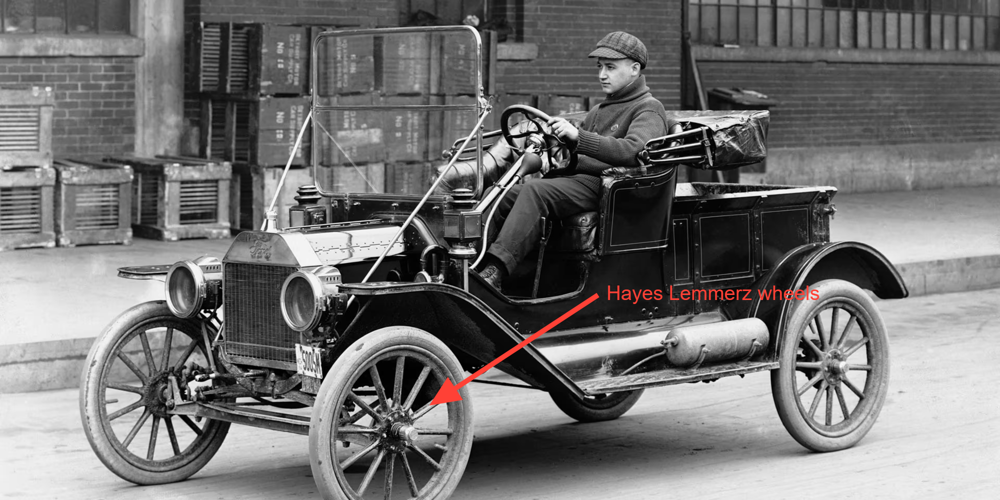
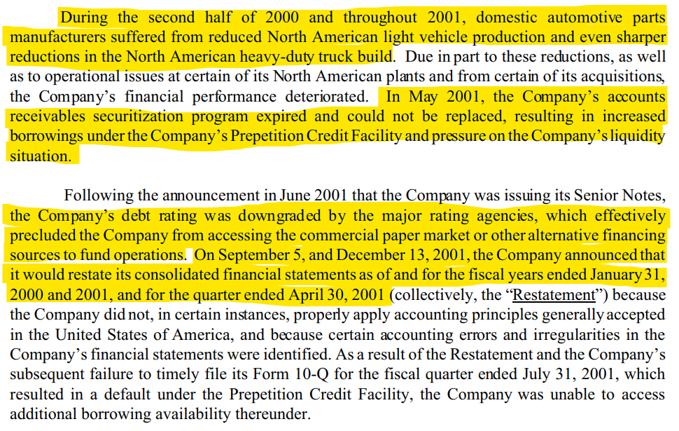
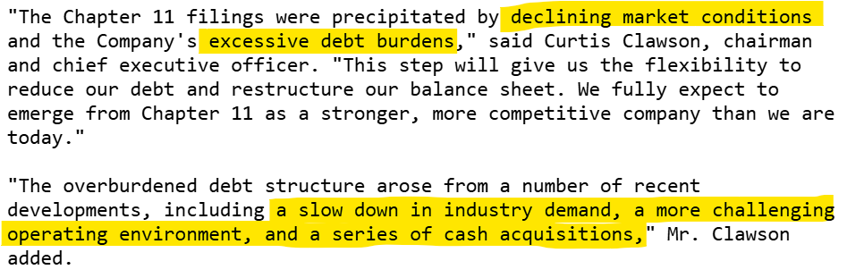
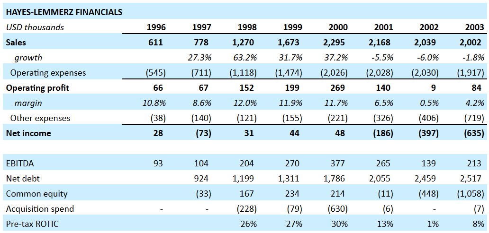
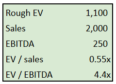
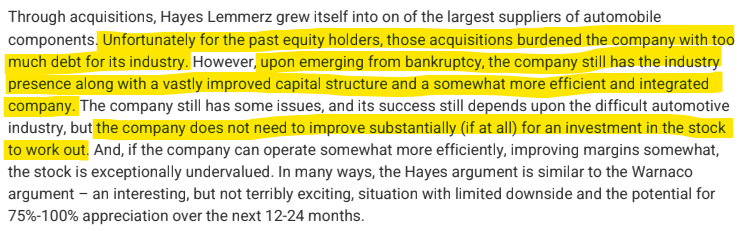
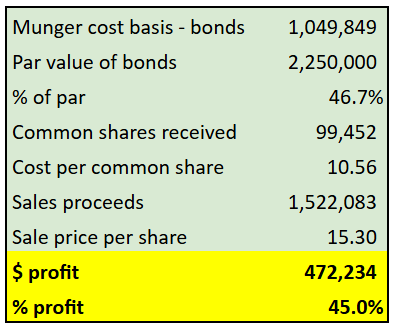
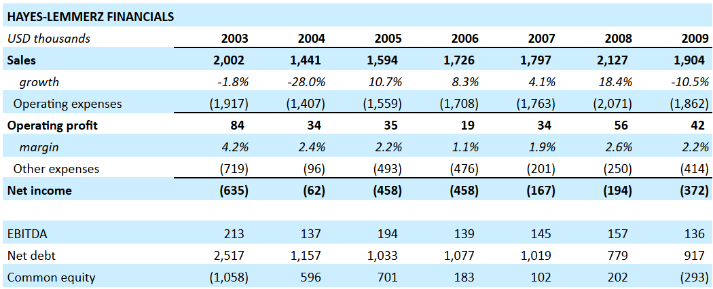
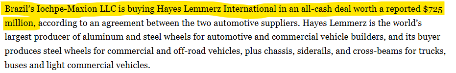

# Charlie Munger the Cigar Butt Investor

15 Jul 2025 · Joe Raymond  
[Original article](https://www.joekraymond.com/charlie-munger-the-cigar-butt-investor/)

*A 45% puff out of bankruptcy*

Warren Buffett and Charlie Munger can't be fit into style boxes.

They aren't "quality" investors, or "growth at a reasonable price," or even "deep value." They are at their core oddsmakers and common-sense businessmen. **What matters is upside, downside, and probabilities.**

Despite their reputation for investing in high quality companies, Charlie implied in <a href="https://www.youtube.com/watch?v=F6s2HAzMeL0&amp;t=1368s&amp;ref=joekraymond.com" rel="noreferrer">an interview</a> in 2016 that he and Warren would happily buy stakes in poor businesses if the price was sufficiently low:

*"We prefer to make our money in association with people of merit, but if a marketable security was available in gobs on a horribly mispriced basis in some lousy business, I think we might still buy it. When things are cheap enough, it sets the juices running."*

Interestingly, if you look at what Charlie actually did with his own money, **he did a fair amount of investing in mediocre (or worse) companies.**

Today's story is about a cheap, "lousy" security Charlie bought in his personal account. He made 45% on it in about a year, although in the long run the company ended up back in bankruptcy.

## Hayes Lemmerz International

Hayes Lemmerz (HAYZ) was an auto parts supplier with a long and storied history. The company made its first wooden spoke wheel for Henry Ford's Model T in 1908.

*1908 Model T*

For decades, Hayes surfed the persistent (but cyclical) wave of widespread global automobile adoption. By the year 2000, the company was the largest manufacturer of automotive wheels in the world. It also supplied brake components and other aluminum structural parts. Sales were north of \$2 billion and EBITDA was \$200 million.

The company made a series of acquisitions in the late 1990s using mostly debt. Then in the early 2000s along came a cyclical slowdown. Sales declined and margins evaporated. Debt was downgraded. Financing became scarce. The financials had to be restated.

Things got ugly.

*Source: Reorganization Document*

This is a relatively common pattern, variations of which you see over and over:

1.  The company makes multiple large, "transformative" acquisitions using debt. These purchases seem like a good idea in the moment and the stock responds by going higher.
2.  At some point, cyclical end markets slow down and demand softens.
3.  Volumes decline, efficiencies deteriorate, margins compress.
4.  The acquisitions look bad in hindsight. Big goodwill impairments are made.
5.  The receivables securitization program expires and can't be replaced.
6.  Debt is downgraded; financing becomes hard to secure.
7.  Financials need to be restated.

Talk about a hairy situation!

This isn't See's Candy or Costco with a pristine balance sheet and top tier management. This is a messy stock with a bad balance sheet, poor track record, questionable management, and mediocre profitability.

The company entered Chapter 11 bankruptcy protection in December 2001 due to "declining market conditions" and "excessive debt burdens" caused by "a series of cash acquisitions."

*Source: 8-K December 6, 2001*

Here's what the financials looked like leading up to bankruptcy:

*Source: SEC Filings & Annual Reports*

## The Investment

Charlie started buying Hayes Lemmerz bonds in 2002.

According to his foundation filings, he paid **\$1,049,849** for bonds with par value of **\$2.25 million** (47% of par).

*Source: Alfred C. Munger Foundation 990 2002*

Allowed claims in the reorganization plan totaled \$2.2 billion, and Charlie was paying less than 50% of face value of the bonds he was buying. If we do some back-of-the-envelope math and give the allowed claims a 50% haircut (on par with what Charlie paid for the bonds), our rough proxy for enterprise value is **\$1.1 billion**.

This is oversimplified (there were various claims of differing seniority and treatment), but I think it paints a fair picture.

Sales were about **\$2 billion** and projected EBITDA was around **\$250 million** at the time (0.55x sales and 4.4x EBITDA). This seems like a somewhat cheap price for a decent (albeit distressed) asset. HAYZ had earned 20% on tangible capital in 2000 before things turned south. Cleaner public comps traded around 6.5x EBITDA and didn't look expensive themselves.

There were other things to like too.

Bankruptcy can be a great antidote to poor capital allocation, excessive leverage, and dispersed focus. It forces management to cut the fat and focus on the healthy, profitable business segments.

Charlie talked about this in his 1994 speech at USC:

*"I've had many friends in the sick business fixup game over a long lifetime. And they practically all use the following formula – I call it the cancer surgery formula: They look at this mess. And they figure out if there’s anything sound left that can live on its own if they cut away everything else. And if they find anything sound, they just cut away everything else. Of course, if that doesn’t work, they liquidate the business. But it frequently does work."*

Hayes fit the playbook.

Acquisitions stopped in bankruptcy and divestments/liquidations ensued. Profits were prioritized over revenue growth and margins were expected to improve.

At the same time, capacity had come out of the industry. Assets that look cheap in bankruptcy on trailing numbers are sometimes even cheaper on future numbers due to the rationalization of the industry and improved focus on profitability.

The investment case for the new common equity was <a href="https://www.valueinvestorsclub.com/idea/Hayes-Lemmerz/0071592134?ref=joekraymond.com" rel="noreferrer">written up</a> on Value Investors Club by brian755 on June 27, 2003. The stock price at the time was \$11.55 – slightly higher than Charlie’s cost basis of \$10.56.

*VIC post by brian755 June 27, 2003*

So, this was a decent company with a strong position in a mediocre industry. The balance sheet had been improved and focus restored. The valuation was a pedestrian 4.4x EBITDA.

It was still hairy though. There was still \$725 million of debt after bankruptcy (2.9x debt to EBITDA) and a large pension liability. And there were many moving parts and pieces (due mainly to the rapid growth from acquisitions in the late 1990s).

## Outcome

Charlie received 99,452 shares of new common stock in the bankruptcy (bringing his basis to \$10.56 per common share).

He sold these shares for \$15.30 in 2003. The proceeds were **\$1,522,083** — good for a **\$472,234 profit** (45%) in about a year.\

*Source: Alfred C. Munger Foundation 990 2003*

Hayes Lemmerz new common shares went as high as \$24 before coming back down and eventually falling back into bankruptcy in 2009. Here's what the numbers looked like from 2003 to 2009:

*Source: SEC Filings*

Profitability never returned to 1999/2000 levels and debt came due in the depths of the financial crisis.

The entire company was sold in 2011 for \$725 million.

*Source: American Machinist October 9, 2011*

## Risk, Return, Duration

Whether you're buying Coca-Cola at 10x EBITDA or Hayes Lemmerz at 4x, the game of investing boils down to three things:

1.  Risk
2.  Return
3.  Duration

As investors, we are trying to maximize our return while prudently managing our risk – and doing so for a long time. This is how you reliably turn a small pile into a big one.

Charlie must have thought the potential for a quick puff in HAYZ was worth the downside risk presented by the bad balance sheet and mediocre business quality (which ultimately pushed the company back into bankruptcy).

This risk/return math is closely tied to personal comfort. Some people are fine investing in levered companies if the upside is sufficiently attractive and odds favorable. Others won't touch a stock with more than a minor amount of debt.

Most bankruptcy situations in my experience involve mediocre, cyclical companies with lots of debt. Occasionally, you might be able to find a post-bankruptcy situation with a clean balance sheet and decent quality – reducing downside significantly.

Once in a lifetime, you might hope to find a great business in bankruptcy (like <a href="https://www.joekraymond.com/from-bankruptcy-to-1-000-bagger/" rel="noreferrer">Toys R Us</a>).

## Postscript

*-I never discussed or confirmed the details of this investment with Charlie. The conclusions drawn here are based on my own interpretation of foundation filings and financial reports. Any errors belong solely to me.*

*-It's possible Charlie received some cash in the restructuring too. I don't know which exact claims he owned, and some received cash payment on top of new common shares.*

*-Hayes was likely a tiny position for Charlie (as measured against his net worth). I still find it interesting because Charlie is thought of as a "quality purist." This is a false narrative. HAYZ was messier than probably 85% of other publicly traded opportunities at the time.*
