# From Bankruptcy to 1,000 Bagger

13 Jun 2025 · Joe Raymond  
[Original article](https://www.joekraymond.com/from-bankruptcy-to-1-000-bagger/)

*46% CAGR for 18 years*

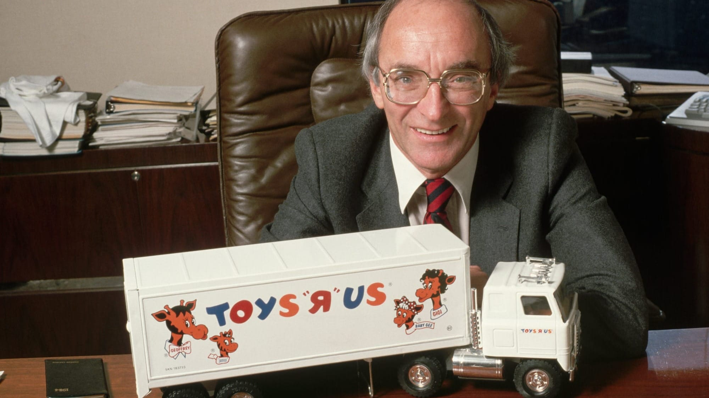

Toys R Us was one of the best bankruptcy investments of the 20th century.

Those who bought the trade claims made over **1,000x on their money in 18 years**, if they held on. This equates to an annual return of **46%**.

I teamed up with business history expert, <a href="https://x.com/turtlebay_io?ref=joekraymond.com" rel="noreferrer noopener">Turtle Bay</a>, on this one. We poured through old financial filings, bankruptcy documents, newspaper articles, and magazine stories. We crunched the numbers.

We even spoke with the investor who was “first on the scene” in 1974.

Here we share the little-known story.

## Charles Lazarus

Toys R Us was founded in 1948 by Charles Lazarus.

Lazarus was one of the most accomplished retailers of the 1970-1990 period, yet his name is virtually unknown to both entrepreneurs and investors today. His track record rivals those of Sol Price, Sam Walton, and pretty much any other revered retail entrepreneur you can think of.

Charles was born in 1923 in Washington D.C. and grew up in a middle-class family with several siblings. His father owned a used bike shop, and the family lived in an apartment above the store. It was a modest upbringing.

Like most of his generation, Charles joined the war effort. He was a sergeant doing cryptography in China during World War II—where he showed early signs of leadership. He had 40 direct reports despite being only 19 years old.

After the war, Charles came back to Washington and converted his dad's old bike shop into a children's furniture store. The idea was spurred by his insight into the upcoming baby boom.

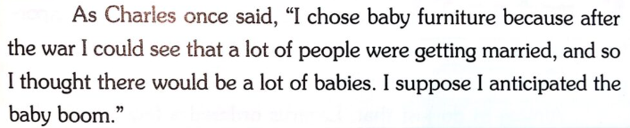

*Source: Charles Lazarus by Anne Koopman*

He invested \$2,000 of his own savings (\$35,000 in 2025 dollars) and borrowed \$2,000 from the bank.

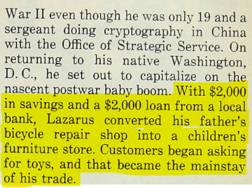

*Source: Business Week February 19, 1979*

Charles was energetic and ambitious. His initial store was profitable, but he wanted more. **He saw the potential of large-scale discount stores and decided to move in that direction.**

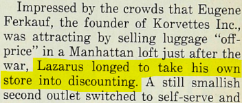

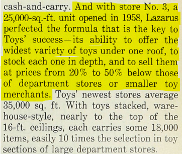

*Source: Business Week February 19, 1979*

This mirrors many other retail success stories, both before and after Toys R Us.

*-Sol Price sees the success of Fedco and decides to start FedMart, and later Price Club.*

*-Jim Sinegal sees the success of Price Club and starts Costco.*

*-Bernie Marcus and Arthur Blank do something similar with Home Depot.*

Customers want a large selection of in-stock items they can take home today at rock-bottom prices. Large, efficient warehouse-style discount stores provided the best solution in the late 1950s when Charles was building the foundation of his empire.

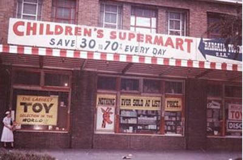

*An early iteration of Toys R Us*

By 1966, Lazarus had grown his store count to four. Annual revenues were \$12 million (\$118 million in 2025 dollars).

Like many young entrepreneurs who achieve early success, Charles wanted some liquidity. He wanted to take some chips off the table. He decided to sell Toys R Us to Interstate Stores—a publicly traded retail conglomerate.

**Interstate paid \$6.0 million cash plus a \$1.5 million earnout** (\$74 million in total comp in 2025 dollars). This equated to **0.62x** sales.

At the age of 43, Lazarus was rich.

More importantly, **Charles was to be given complete autonomy to continue to run and expand Toys R Us**. He would be compensated with a healthy salary, bonus, and stock options. Toys would be kept separate from the rest of Interstate's operations (legally, physically, and financially).

It seemed like a good deal for the budding young operator.

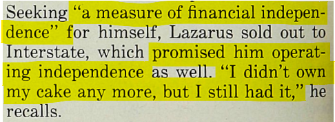

*Source: Business Week February 19, 1979*

## Interstate Stores

Interstate Stores was an acquisitive retailer with department stores and discount stores across the country.

Sol Cantor was the Chairman and chief architect of Interstate. He had purchased the White Front discount store chain on the West Coast in 1959 and its Midwest and East Coast-equivalent Topps Discount in 1960. These discount stores were growing rapidly in the 1950s and 1960s as Americans moved to the suburbs.

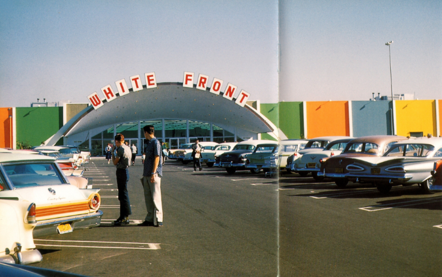

*White Front store in California 1960s*

At its peak in 1969, Interstate was producing revenues of \$589 million with \$11 million of net income. But by the early 1970s, discount stores were starting to crack. Over expansion and increased competition, coupled with a sharp and sudden recession, caused many locations to turn unprofitable. Topps and White Front weren't immune to this. Both started bleeding red ink and pushing Interstate into financial trouble.

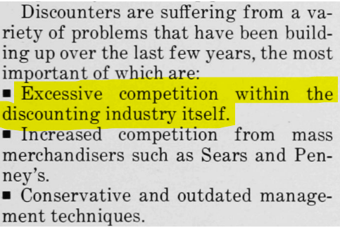

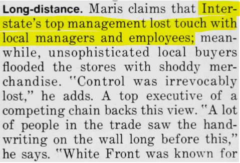

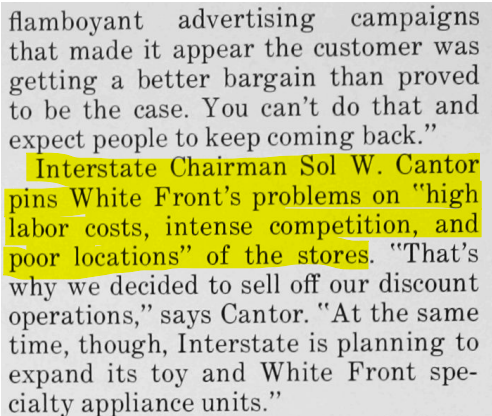

*Source: Business Week February 10, 1973*

Here's a segmented income statement for the discount division:

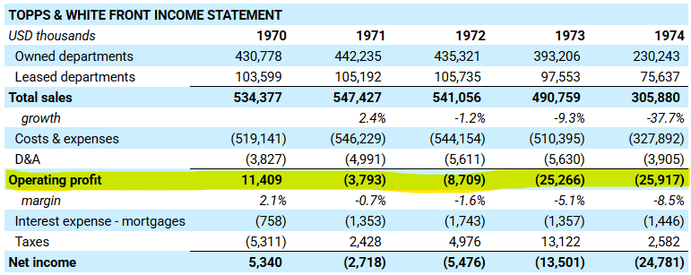

*Source: Interstate Stores 10-Ks*

**A business that had earned more than \$11 million pre-tax in 1970 was now losing more than \$25 million each year.**

In late 1973, Interstate decided to shutter the discount division and restructure its department stores.

In May 1974, the company filed for Chapter 10 bankruptcy.

Meanwhile, while the discount department stores were hemorrhaging cash, **Charles' toy division was performing beautifully.** Here’s what the remaining business (Toys R Us and a few remaining department stores) looked like during the same period:

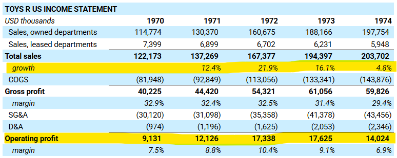

*Source: Interstate Stores 10-Ks*

These numbers are especially impressive given Interstate's problems in the discount store segment during this period. Toys R Us was effectively subsidizing the losses of the other divisions. It wasn't getting the attention and capital investment it deserved, **yet it was still growing in the double digits.**

## The Opportunity

With the benefit of hindsight, Interstate's Chapter 10 bankruptcy restructuring presented a "once in a lifetime" kind of opportunity.

Here you had a bulky retail conglomerate with three main divisions: department stores, discount stores, and toy stores. The company went bankrupt due to the first two (department stores and discount stores). The department stores were being pared back, and the discount division was liquidated. **Meanwhile, the toy division was a gem producing huge profits with excellent future growth prospects.**

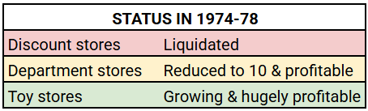

The appeal of Toys R Us in the mid-1970s wasn't a secret. A number of smart investors had the insight and participated in the bankruptcy.

Let's start with Larry Goldstein.

Larry was with Burnham & Company at the time. He was the investment banker working on the merger of Child World and Children's Palace in the early 1970s. He knew all of the major toy retailers and had visited most of these companies and met with management. He had kicked the tires and collected the scuttlebutt, **making him well-prepared to take advantage of the Interstate bankruptcy.**

Larry wrote a report for *Barron's* in 1975 titled "Revolution in Toy Retailing." The report came out early in the bankruptcy and outlined the attractive prospects for Toys R Us.

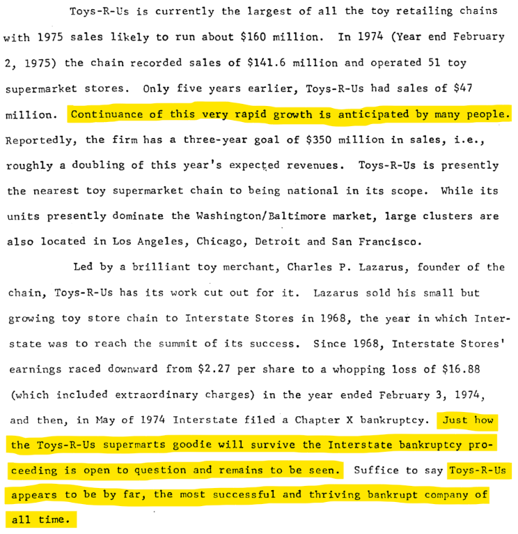

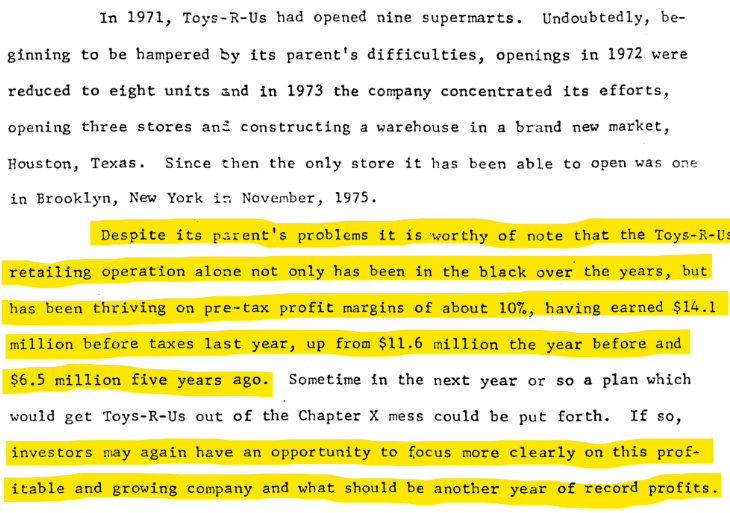

*Source: Barron's December 1975*

*Barron's* was a widely read financial publication in the mid-1970s. A private report on Toys R Us was also produced and circulated further amongst high net worth individual and institutional clients. **So, while it was somewhat obscure, the Interstate opportunity was far from unknown.**

Buying it, however, did require a little creativity.

## Papering the Trade

Shortly after writing his report, Larry started buying Interstate Stores convertible debentures and creditor claims with the idea that they would eventually turn into new common stock post-bankruptcy.

Here's the story in his own words:

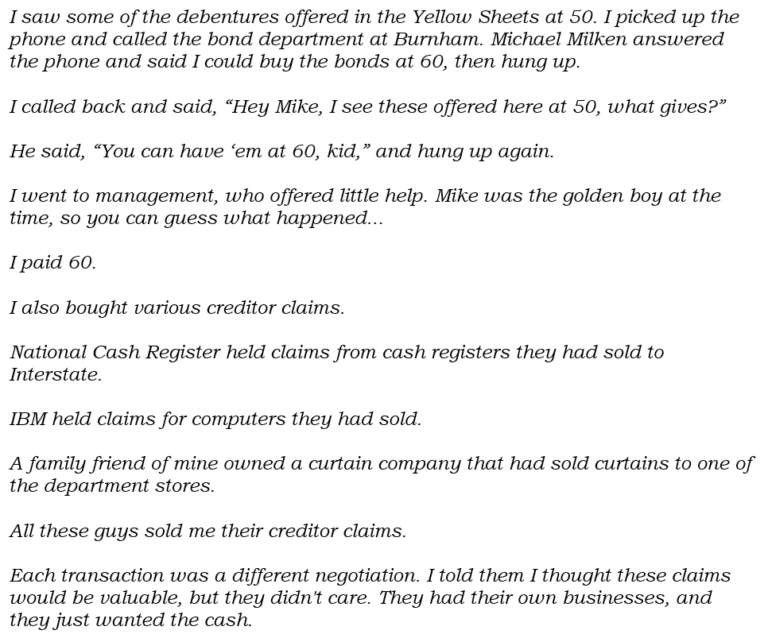

*Source: Call with Larry Goldstein February 25, 2025*

All told, Larry cobbled together the equivalent of 2 million shares of new, post-bankruptcy Toys R Us stock. He paid between \$0.25 and \$2.50 per share, and **his average cost came out to about \$1.00**.

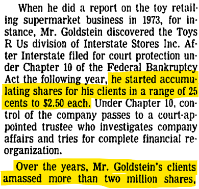

*Source: Wall Street Journal June 12, 1979*

At \$1.00, **Toys common stock was being created for about 1x EBIT**—an attractive price for any business, let alone one with a skilled entrepreneur and long runway ahead of it.

Toys continued to grow during bankruptcy, despite being starved of resources it could have used to grow faster.

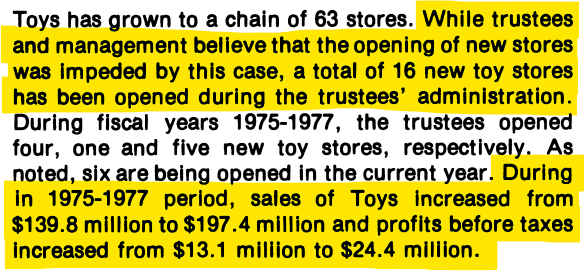

*Source: SEC Reorganization Document*

When the new common shares started trading OTC in 1978, they were selling for \$8 a share. **Larry was up 8x in less than four years and the stock still traded for only 5x earnings.**

Larry wasn't the only one accumulating Toys stock during the bankruptcy. Michael Price, George Soros, and Tim Bliss were all holders. The Sears family office was also involved. Milton Petrie (another excellent retailer) made more money than anybody on Toys R Us (Petrie will have his own future post).

## Toys 1978 to 1994

What happened next is one of the best retail runs in American history.

Free from the burden of bankruptcy and the loss-making discount division, Interstate was renamed Toys R Us and Charles Lazarus was made CEO.

From 1978 to 1994, Toys grew its revenues from \$274 million to just shy of \$8 billion—good for a CAGR of 23%. EPS did even better, compounding at 26%.

The P/E ratio, which started the period around 5x, ended 1994 above 25x.

Adjusted for splits, **the stock 100-bagged, going from \$0.40 to \$40.00 over the 16-year period** (33% CAGR).

Here's a financial snapshot of the incredible run:

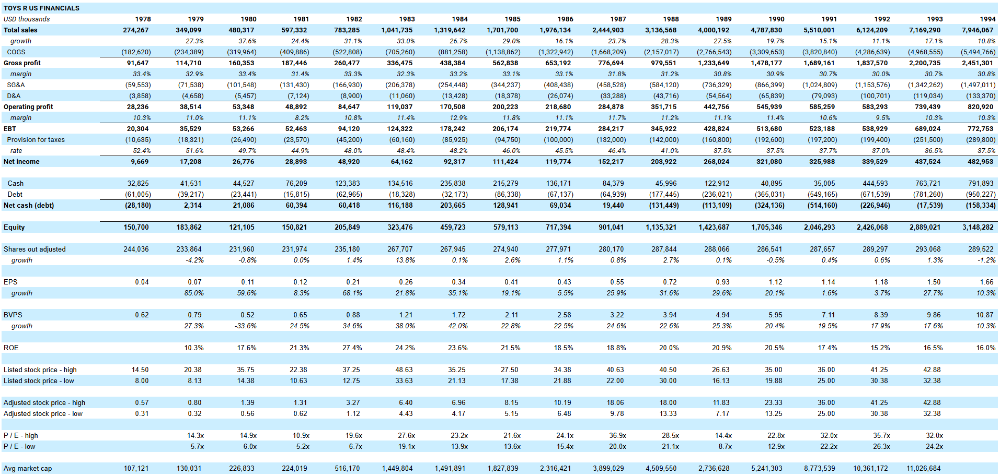

*Source: Interstate & Toys R Us 10-Ks & Annual Reports*

How did they do this?

Toys R Us dominated toy retailing by providing **the widest selection of goods all under one roof at prices lower than the alternatives**. As Charles used to say, *"If the toy exists, we have it and the price is right."* Their scale and efficient distribution gave them a cost advantage, which was passed along to customers in the form of lower prices.

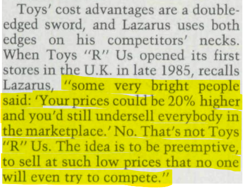

*Source: Forbes February 22, 1988*

Given their strength in distribution and reach, Toys also had significant bargaining power over manufacturers. Mattel, Hasbro, and others would send inventory to Toys R Us throughout the year and accept payment after the holiday season. This significantly reduced working capital requirements, which was important for a company that does most of its business in one quarter.

Toys R Us was also an early adopter of computer aided inventory management and POS technology. Their warehouses were considered "best of breed" in terms of efficiency—which was critically important given the seasonality and fickleness of demand (which toys will be most popular this Christmas?).

A couple stories from Larry on Charles Lazarus and his approach to business:

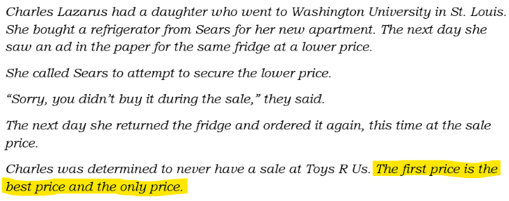

*Source: Call with Larry Goldstein February 25, 2025*

On toy selection, Larry had this to say:

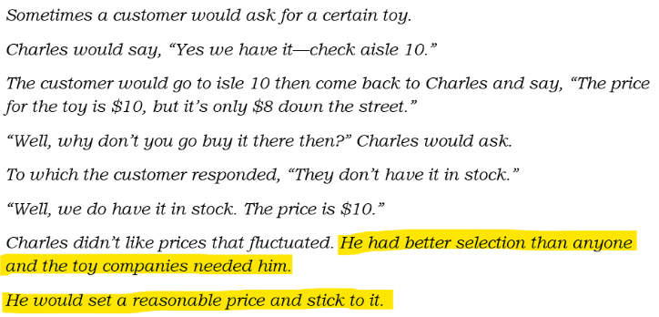

*Source: Call with Larry Goldstein February 25, 2025*

Toys' success was the product of a bunch of little "common sense" things working together well. **They surfed the retail wave as good as anyone in my view from the mid-70s to mid-90s.**

## Moving On

When people think about Toys R Us today, they mostly think about its failure. At what point did Toys lose its luster? And why did this happen?

**Things change fast in retail.**

Norman Ricken, the President of Toys R Us and long-time partner to Lazarus, stepped down in 1989. Norm saw the trend in competition and decided to move on. Walmart was the biggest threat at the time, and the internet wasn't far off either.

Larry had gotten to know Norm over the years, and they were close friends. A couple years after Norm's departure, Larry decided to start selling his stock.

Those shares he was buying in bankruptcy for \$1 had an adjusted cost basis of \$0.04 after multiple stock splits. He started selling shares around \$40 in 1992, **good for a 1,000-bagger.** The \$3,000 worth of debentures Larry bought from Michael Milken in the mid-70s had turned into \$3 million in less than 20 years.

The mid-90s was the peak for Toys R Us. Sales and profitability started to level off and eventually decline. Private equity came in and leveraged the business. Things proceeded to unravel.

The fate of Toys R Us shows the power of retail competition. **You have to ride the wave, or the wave will consume you.** This can happen incredibly fast.

Here's a headline from 1985:

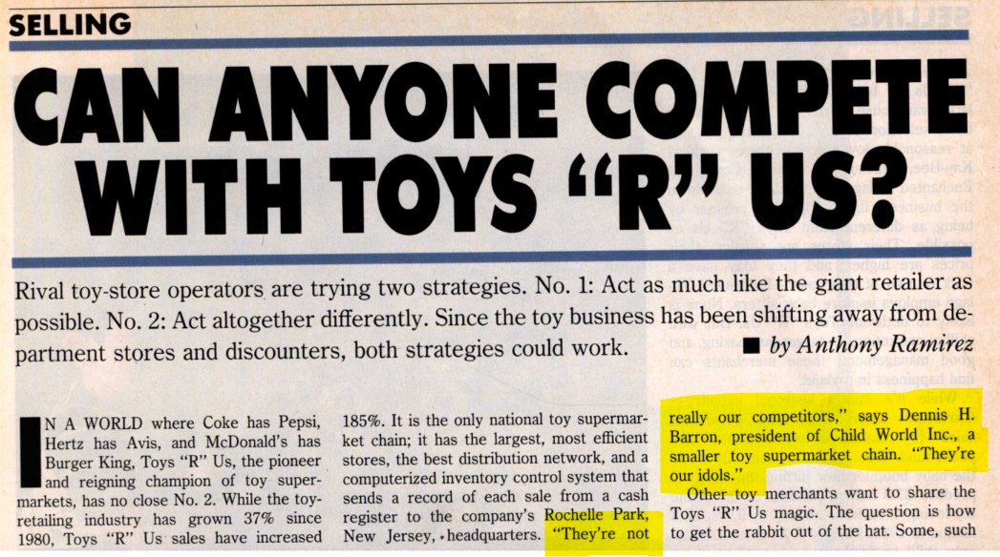

*Source: Fortune October 28, 1985*

Then only 15 years later in 2000:

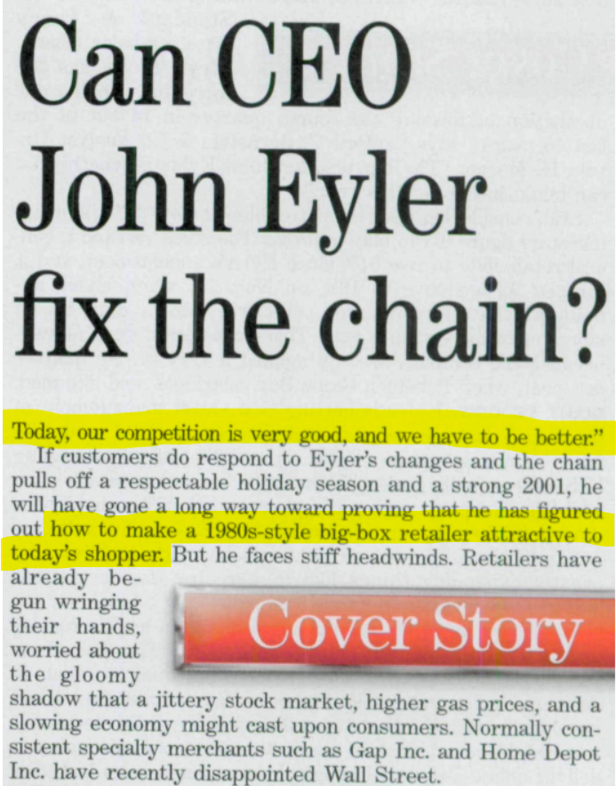

*Source: Business Week December 4, 2000*

**In less than two decades, Toys R Us went from being an "idol" to a dinosaur.**

You see this time and again in retail. And Lazarus knew the perils of retail competition well. Here's what he said in 1988:

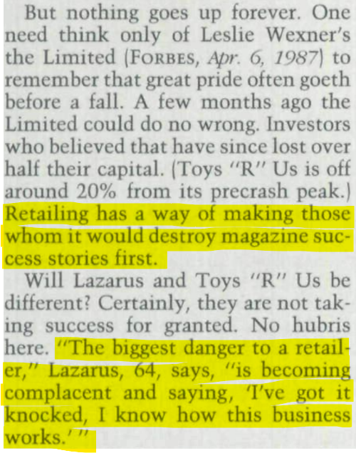

*Source: Forbes February 22, 1988*

As Charlie Munger so eloquently put it at the DJCO meeting in 2023: *"In thinking about Alibaba, I got charmed by their position in the Chinese internet and didn't stop to realize, **'they're still a god-damn retailer.**'"*

In many ways, toy retailing is even harder than general retail. It is heavily seasonal (you make all your money in Q4).

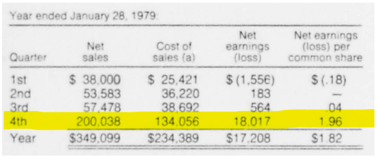

*Source: Toys R Us 1979 Annual Report*

Plus, you're dependent on the fickleness of kids. What will be the hot toy this year? Do kids still care about G.I. Joe? Barbie? If you don't make the right call, you're left with a big pile of tough-to-move inventory and scant profits for the year.

Retailing isn't for the faint of heart. **Fortunes seem to be made and lost every couple of decades.** Toys R Us is another example of this.

## Postscript

*A few author notes:*

*-By 1975, Larry had met with all of the toy retailers except Charles Lazarus. CL was harder to reach because he was the head of a division of Interstate—not the head of the whole company. Division leaders rarely meet with Wall Street (both then and now). Larry sent Charles a draft of his "Revolution in Toy Retailing" article which includes the line, "Led by a brilliant toy merchant..." Larry said it was this agreeable terminology that finally secured an invite to visit. The two then had a multi-decade, mutually beneficial business relationship.*

\-*Larry Goldstein was certainly at the "right place, right time" when it came to the Interstate bankruptcy and his knowledge of the toy business. **I've found that good investors consistently gravitate towards the most compelling situations.** They have a nose for opportunity. Larry could see the growth potential in big box toy retailing and his natural curiosity led him to learn about the industry and strike up relationships there.*

*-Larry bought ISC creditor claims from Karpel Curtain Company. The son-in-law of the founder was Nathan Fisher. Nate and Larry were good friends, and Toys R Us wasn't the only investment where their paths crossed. A random lunch with Nate one afternoon is how Larry first learned about thrift conversions—a future case study.*

*-Time and again we see the power of a couple big winners on an investment career. Let's imagine an investor put 5% of their portfolio into Toys at \$10 per share in 1978, shortly after the new common stock started trading post-bankruptcy. By 1990 this investment would have grown 50-fold. **The entire portfolio would have compounded at 7.9% even if the other 95% went to zero.***
