# Getting Rich on Rocks

26 Aug 2025 · Joe Raymond  
[Original article](https://www.joekraymond.com/getting-rich-on-rocks/)

*36% CAGR for 19 years*

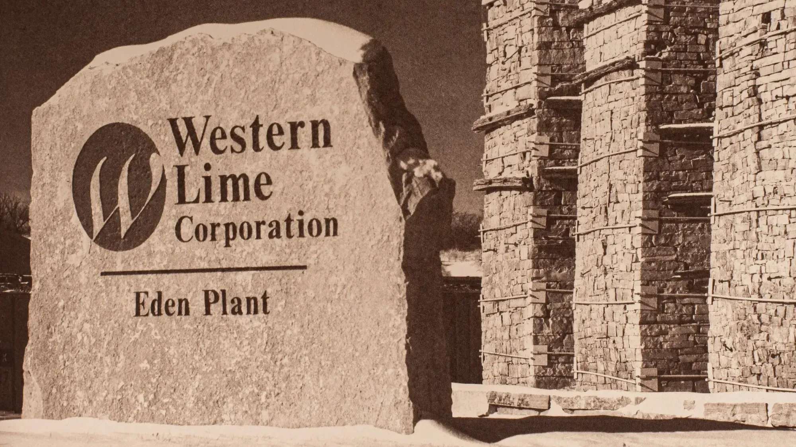

ChatGPT tells me there are only two stocks that have delivered returns of more than 35% per year over the last 19 years:

Nvidia – 39% CAGR

Netflix – 36% CAGR

I'm not sure where it gets its data. There are probably others around the world it missed. But let's go with AI's answer for the moment.

35% per year for 19 years results in a **300x** return.

This is a Hall of Fame result. It's an incredible feat in only two decades for a single stock.

The founders and early employees of these sorts of companies are billionaires. Books are written about them. Their faces grace glossy magazine covers. They stand almost alone at the pinnacle of capitalistic achievement.

The fact is, there just aren't many stocks that compound at more than 35% per year for two decades. It's too high of a rate for too long of a period.

**But what if I told you there was an obscure OTC stock that returned more than 35% annually from 1993 to its acquisition in 2012?**

You almost certainly haven't heard of this company. Its executives aren't on the covers of any magazines and haven't written any bestselling books. And its shareholders quietly made their fortune without anybody noticing.

To make matters even more interesting, this was an aggregates business. That's right, **the company sold rocks.**

How could a small OTC-traded rock company produce returns on par with some of the best-performing tech companies of all time?

Let me tell you about Western Lime.

## Western Lime Corporation

Western Lime Corporation (WLC) was founded in Green Bay, Wisconsin in 1871.

The company provided limestone for construction, agriculture, infrastructure, and other projects. WLC supplied much of the materials in the buildout of Milwaukee and the surrounding Midwest in the 19th and 20th centuries.

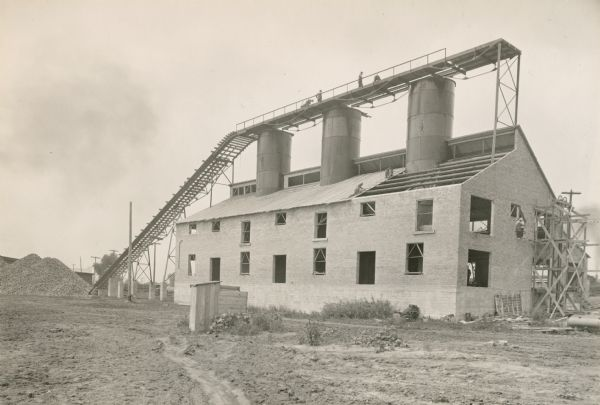

*Western Lime Factory Green Bay, WI 1910*

In 1921, several family-owned lime companies in the region combined under the Western Lime banner. William Nast emerged as general manager and the Nast family remained at the helm for the next 90 years.

The company produced modest profits over the decades, riding the waves of industrial activity and construction in Wisconsin and neighboring states.

## WLC in the 1990s

Western Lime was an unremarkable business in the '90s.

Growth was around 5-6% per year, and ROE hovered around 10%. Decent, but not particularly noteworthy.

**What *was* noteworthy was the price.**

For much of the '90s, WLC traded between \$150 and \$160 per share. Trades were *very* infrequent. The stock only changed hands a few times a year.

At \$155 per share in 1993, Western Lime had a market capitalization of only \$2 million. The company earned \$1.3 million after-tax that year, **good for a P/E ratio of 1.7x**.

Shareholders' equity was \$12.7 million, so the **P/B was 0.16x**.

The company had no debt and paid a small quarterly dividend.

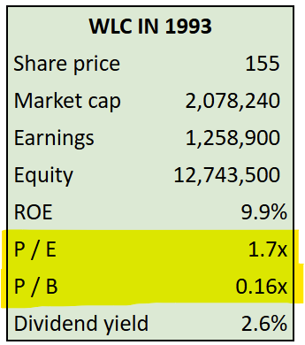

Here's a snapshot from the 1997 *Walker's Manual of Unlisted Stocks*:

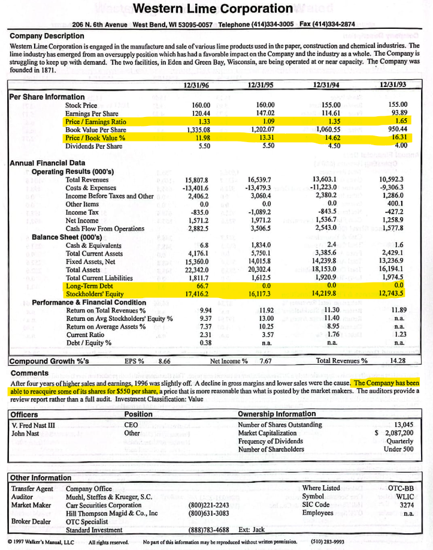

*Source: 1997 Walker's Manual of Unlisted Stocks*

It didn't take any fancy math to figure out this was a good investment, if you could get shares.

In addition to being incredibly cheap, the company itself was repurchasing shares in private transactions at \$550 (**more than triple the OTC price**). I don't know if anyone was arbing this, but I bet somebody was.

So, *who was buying this incredibly cheap stock those rare days when it traded*?

A number of interesting people were, including one firm you've probably heard of.

## Tweedy, Browne & Knapp

I don't know when Tweedy, Browne started buying WLC.

I imagine they sat on the bid for years (maybe decades), slowly accumulating shares whenever available. Perhaps an occasional block came through. If anyone out there knows the details, I'd love to hear them.

**By 2010, Tweedy owned 27% of Western Lime's outstanding shares.**

Here's an ownership table from the time:

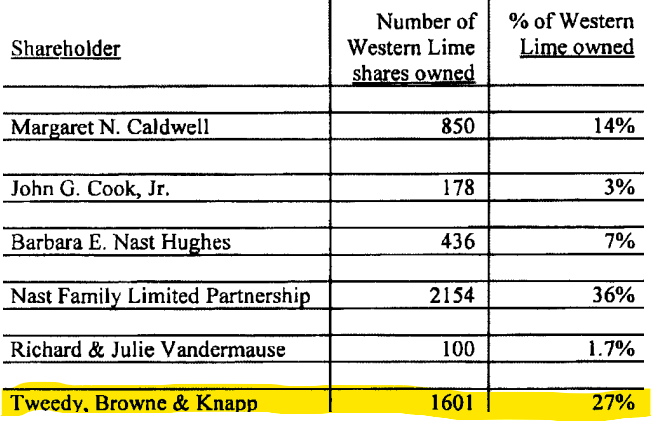

*Letter from Tweedy, Browne & Knapp October 21, 2010*

By this point, word had started to get out on WLC. It was no longer a completely undiscovered stock selling for less than 2x earnings. It was then trading for \$5,600 per share.

Which was still very cheap.

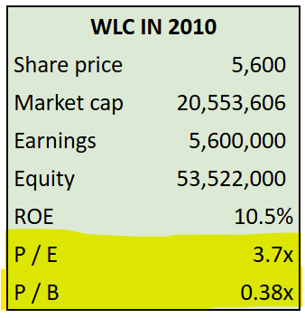

Performance had been solid from 1993 to 2009.

Net income grew at 13% per year, the share count was cut in half, and the P/E multiple more than doubled from 1.7x to 3.7x.

**The result was a 25% CAGR before dividends from 1993 to 2009.**

Here's a financial snapshot of the period:

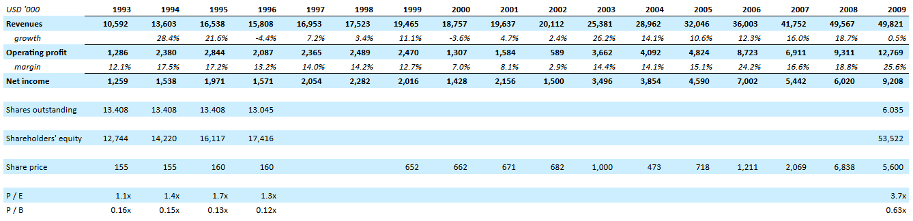

## The Letter

We owned some WLC shares here at Caldwell.

In late 2010, we received a string of correspondence between the company and Tweedy, Browne. It was sent to all shareholders. And it made for compelling reading.

The company had offered Tweedy **\$7,600 per share** to acquire their 27% interest (36% above the prevailing \$5,600 share price).

This equated to about **5x trailing earnings** and **86% of tangible book value**.

Tweedy responded with a textbook treatise on value investing and its application to WLC:

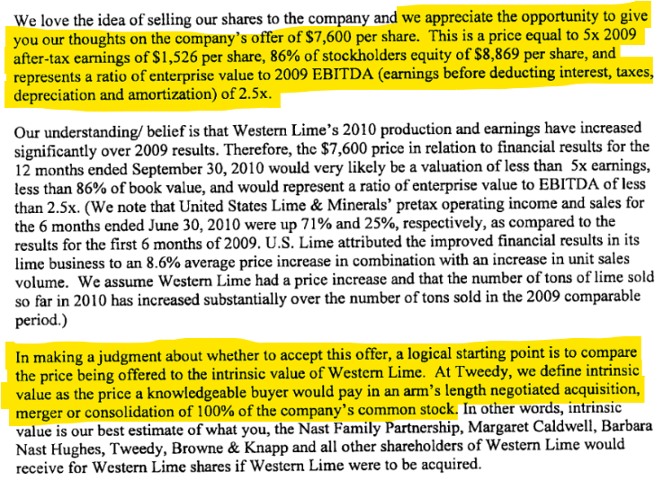

*Tweedy Letter to WLC October 2010*

Tweedy pegged the intrinsic value of WLC at somewhere between \$24,000 and \$33,600 per share. This equated to 8.5x EBITDA (15.9x earnings) on the low end and 11.9x EBITDA (22.0x earnings) on the high end. Keep in mind these numbers were based on 2009 financials, which were depressed due to the GFC.

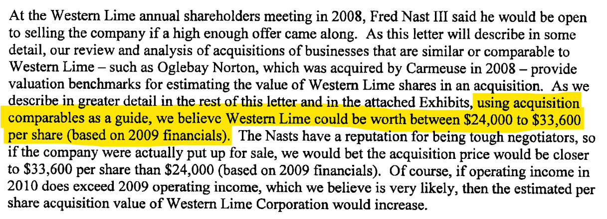

They also shared additional thoughts on their investment approach and willingness to own illiquid, tightly held stocks.

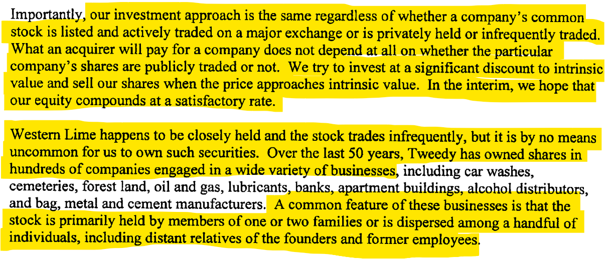

Tweedy ultimately rejected the bid, saying that they would much rather *buy* shares at \$7,600 than *sell* them.

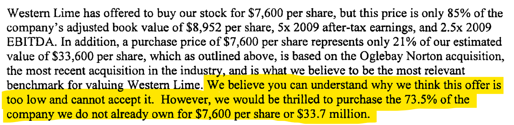

Instead, they offered to help market the entire company for sale:

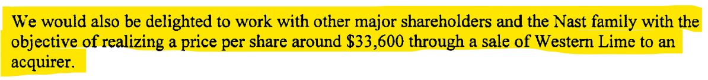

Alternatively, they offered to assist in taking the company public:

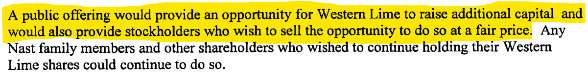

Or to help structure a management buyout:

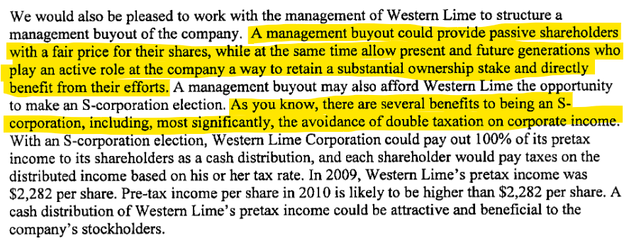

The company responded with various reasons why it didn't want to sell, IPO, or do a management buyout. For those who have dealt with non-marketed, family-controlled companies, these are pretty common responses:

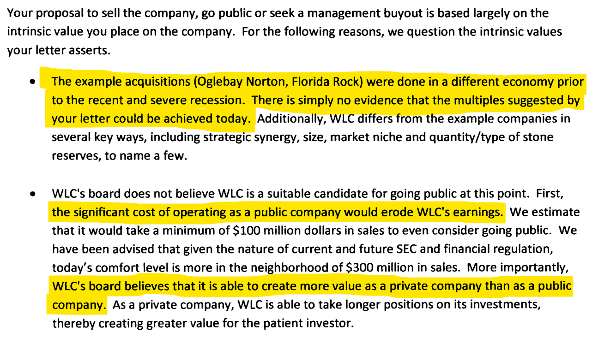

*WLC's Response to Tweedy's Letter*

What's interesting is that the company upped their bid to **\$10,300 per share** based on *"an independent valuation of WLC's stock"* which includes *"a discount for lack of marketability of minority blocks of stock."*

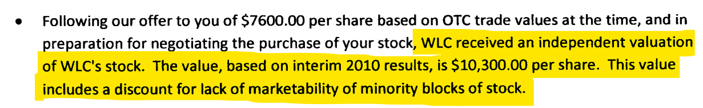

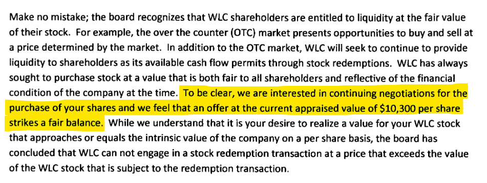

**This represented a 36% increase over the prior \$7,600 offer (which itself was a 36% premium over the prevailing OTC price).**

This must have been tempting.

WLC traded for less than \$200 per share 15 years prior. The current market was around \$5,600. The company was offering \$10,300. And they showed no signs of getting serious about selling the entire company or uplisting the stock.

In other words, there was no other clear "catalyst" on the horizon, *other than this seemingly juicy offer from the company*.

**But Tweedy stuck to their core principles and refused to sell below intrinsic value.**

They declined the bid and continued to hold their shares. As did Caldwell.

## Endgame

Western Lime ended up selling to Graymont a little over a year later in March 2012.

Here was the unceremonious press release:

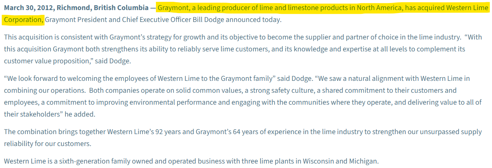

*Graymont Press Release March 30, 2012*

Shareholders received **\$52,000 per share**.

That's more than 5x the price offered to Tweedy less than two years prior, and a ***36% CAGR from the 1993 price of \$155 (before dividends)***.

Tweedy, Browne's 27% stake brought more than \$80 million in proceeds. I don't know what their cost basis was, but I imagine it was in the six figures.

## Final Musings

You can find weird things in the outer edges of markets.

These stories aren't limited to relics of a long-ago past. Look at what happened with SIMA in the last decade. Or PCHM. And others I won't mention.

One of the main reasons I started this blog is that there are so many neat stories like Western Lime that go untold. The data is lost. People who know the details retire and eventually pass away. As they go, so does any trace of the incredible outcomes from these completely unknown stocks.

Of course, most people don't seriously consider these sorts of securities. They are too weird. Too illiquid. Too "risky." Even of those who do dabble in these stocks, many view it as a hobby suitable only for small personal accounts or IRAs.

**But you can put real money to work in this kind of stuff if you stick with it.**

WLC is one of the most illiquid stocks I've ever studied, yet Tweedy was ultimately able to build an eight-figure position. Eight figures here and eight figures there, before you know it you're talking about real money!

It took decades to completely play out, but they earned an excellent return with minimal risk on every share bought along the way.
