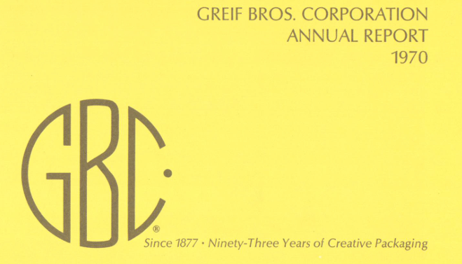
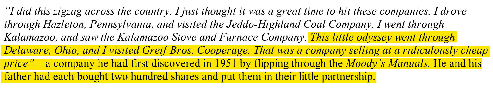
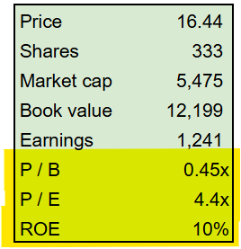
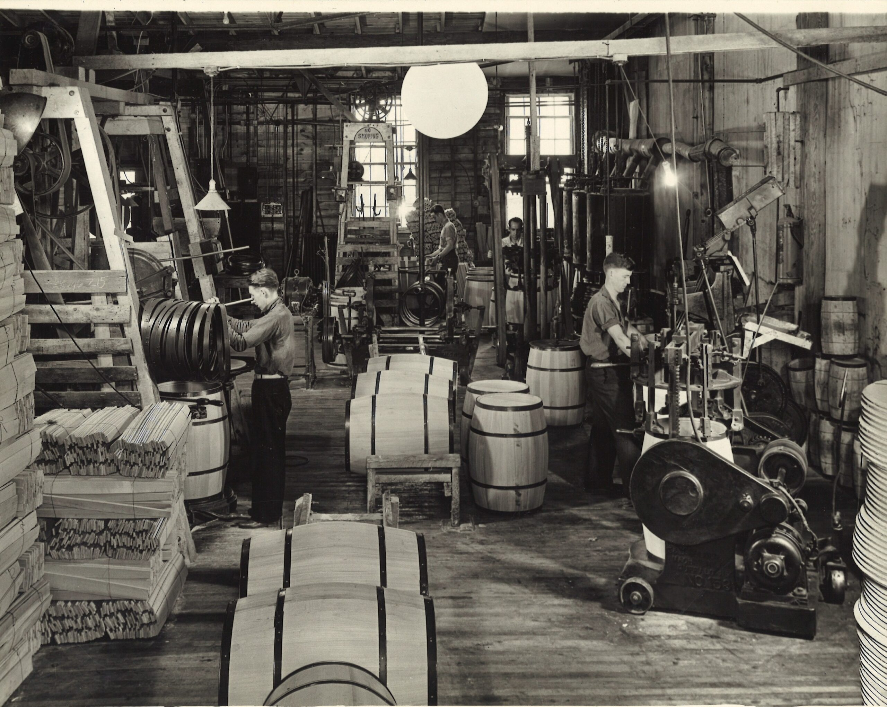
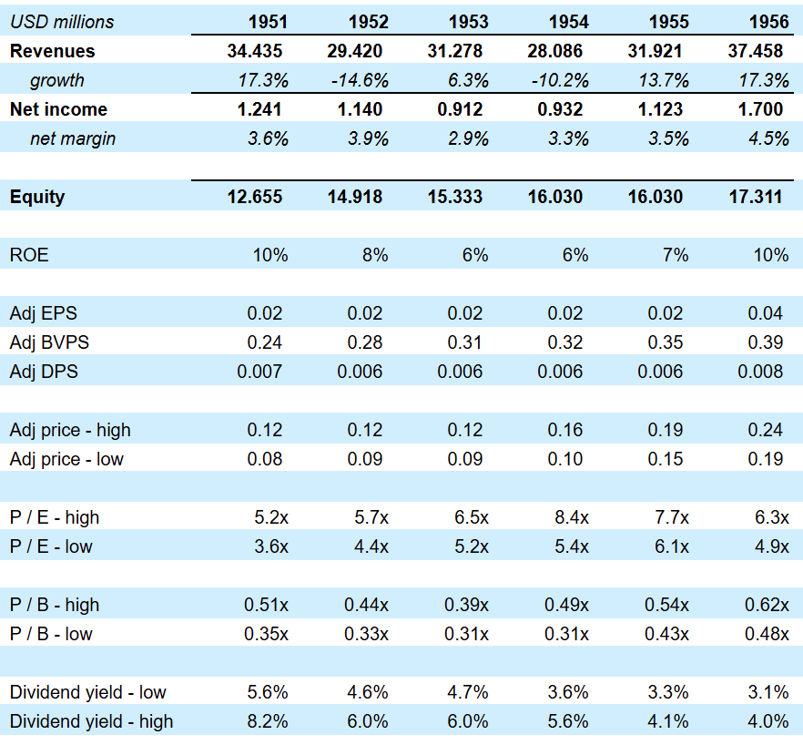
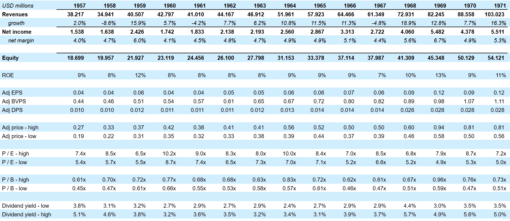
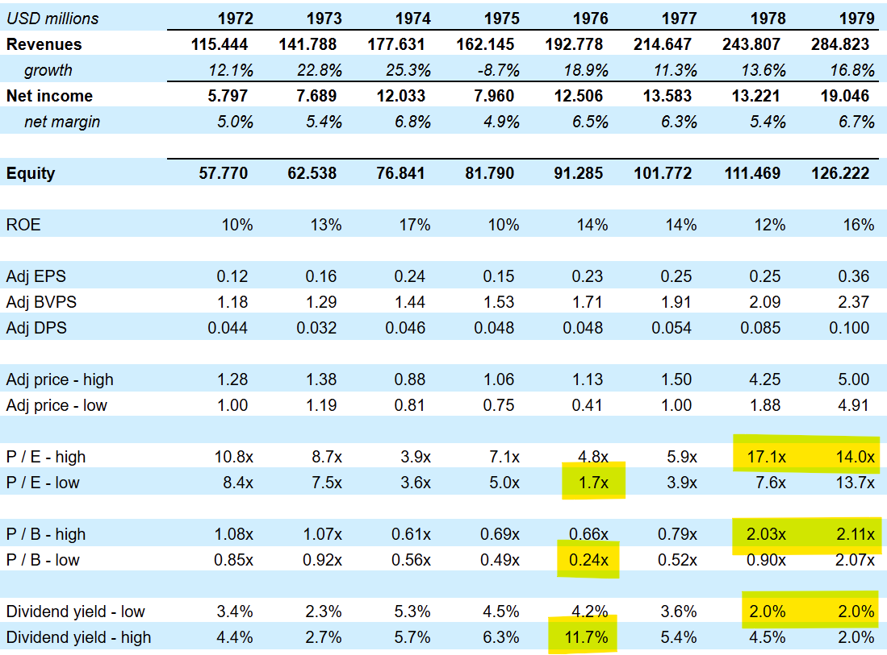
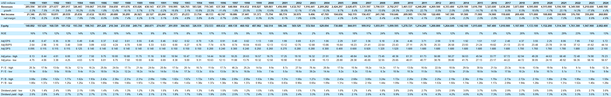

# Greif Bros. Cooperage

18 Jun 2026 · Joe Raymond  
[Original article](https://www.joekraymond.com/gre/)

*Tracing a 1951 Buffett investment to modern day*

I had lunch a few weeks ago with the founder of an investor relations firm.

He told me he used to head the IR effort for Greif, Inc. Grief is still public and trades on the New York Stock Exchange under the ticker GEF.

The company used to be called Greif Bros. Cooperage. It was owned by Phil Carret, Walter Schloss, and Warren Buffett back in the 1950s.

Given its long, uninterrupted history and neat historical shareholder base, **I thought it would be interesting to trace GEF's performance from the 1950s to today.**

What I found is a surprisingly successful display of long-term compounding, although outcomes varied materially over different periods.

## The Investment

Buffett discovered Greif in 1951 while flipping through his *Moody's Manual*.

He described it at the time as a *"ridiculously cheap"* stock. He visited headquarters, met with management, and ended up buying 400 shares with his dad.

From *The Snowball:*

*Source: The Snowball*

The average stock price in 1951 was \$16.44, so Buffett's outlay was around \$6,500 for his 400 shares (\$83k in 2026 dollars). Here's the valuation:

*Source: Moody's Manual 1951*

For a market cap of \$5.5 million, Buffett was getting \$12.2 million of book value and \$1.2 million of post-tax earnings. The company had a strong balance sheet with \$2.6 million of net cash. The dividend yield was 6.7%.

Greif was a simple business. It manufactured wooden barrels and kegs primarily for bulk packaging and shipping. Here's a look at one of their factories at the time:

*Greif Factory 1940s*

This was a stable, slow growing business based on available historical data, earning mid-single-digit net margins, and producing an unlevered return on equity of 8-12%.

Plus, the company owned 239 manufacturing plants and thousands of acres of timberlands carried on the books at cost–likely significantly below market value after the inflation of the 1940s.

**So, Buffett paid less than 0.5x understated book value and 4.4x post tax earnings.**

GEF did appear *"ridiculously cheap"* as Buffett described it at the time. Of course, such conditions can persist for extended periods or deteriorate further. Companies trading at discounted valuations may face structural, operational, or industry-specific challenges, and there is no assurance that such valuation gaps will narrow over time.

## Quick "Puff"

I don't know when Buffett sold his shares, but I doubt he held for long. He thought of Greif as a *"cigar butt"*–a cheap but mediocre security good for *"renting"* but not owning long-term.

Within five years, Grief had advanced to around \$35 per share (113% appreciation) while also paying \$4.90 of cumulative dividends (30% of his cost basis). **This equates to an IRR of 20%.**

*Source: Moody's Manuals*

## Longer-Term

*The following analysis is hypothetical and is intended solely to illustrate how long-term compounding may have impacted returns under specific assumptions. It does not represent actual investor experience and does not reflect fees, taxes, transaction costs, or behavioral factors that would likely affect realized outcomes.*

How would Warren have done if he held onto his Greif stock?

For many decades, corporate performance was decent but unspectacular. The company continued doing what it had always done: making modest profits, paying out dividends, buying back shares, and continuing to stockpile cash.

By 1971, Greif had revenues of more than \$100 million and post-tax earnings of \$5.5 million. The average share price that year was \$167.95 (adjusted for a 5 for 1 stock split in 1969). This was more than 10x the price Buffett paid 20 years earlier, **good for an IRR of 15% including dividends.**

For most of the 1950s and 1960s GEF remained a cheap stock, trading for between 0.50x and 0.75x book value and 5x to 10x earnings. The company earned 8-12% on equity and maintained a net cash balance sheet.

The stock traded at relatively low valuation levels during much of this period and value accumulated over time, although outcomes varied depending on timing, holding period, and market conditions.

*Source: Moody's Manuals*

## The 1970s

GEF traded at significantly discounted valuation levels in the mid-1970s, trading as low as **0.25x book value and 2x earnings**.

Then, only a couple of years later, the multiple re-rated significantly higher.

In 1978, GEF surpassed 2x book value and 15x earnings. It represented a substantial re-rating in valuation for such a simple and well-capitalized company. **The stock price advanced more than 10x from its low in 1976 to its high in 1979.**

Some investors may have viewed this as a point to reassess valuation relative to fundamentals.

*Source: Moody's Manuals*

If Buffett had kept his 400 shares from 1951, he would have had 16,000 shares in 1979 after numerous stock splits. The market value would have been \$320k (nearly 50x his cost basis of \$6,500). **Including dividends, his IRR would have been 18% for the 28 years.**

## 1980 to Present

Greif has traded mostly between 1x and 3x book value since 1980, only occasionally dipping below book value in periods of turmoil (1982, 1999, 2002, 2009, and 2020).

Corporate performance has continued to be decent but unremarkable. Given the higher valuation on the stock since the late 1970s, the return has been lower (8% IRR from 1979 to 2024).

*Source: Moody's Manuals & SEC Filings*

All told, Warren's 400 shares he bought with his father in 1951 would have turned into 64,000 shares today after stock splits.

The market value of their \$6,500 investment would be **more than \$4 million** today. Plus, they would have received **more than \$2 million** in cumulative dividends.

*This article is intended as a historical case study and should not be interpreted as a recommendation, endorsement, or solicitation with respect to any security, investment strategy, or holding period. Historical periods referenced reflect specific economic and market conditions that may not be repeatable.*

## Postscript

-GEF has two classes of common stock. They have different voting and dividend rights. For the purposes of this article, I treated the two as equal economically and presented the results of the Class A shares as those are the ones Buffett bought in 1951.

-While *The Snowball* cites Buffett discovering Greif while flipping through his *Moody's Industrial Manual*, other sources suggest he may have learned about it from his father. <a href="https://jasonzweig.com/philip-carret-buy-em-cheap-and-hold-em/?ref=joekraymond.com" rel="noreferrer">This article</a> by Jason Zweig reports that Phil Carret bought GEF in the 1940s on Howard's recommendation. Carret held his shares (4% of the Class A stock) until his death in 1998, likely achieving the hypothetical long-term returns cited in this article.
