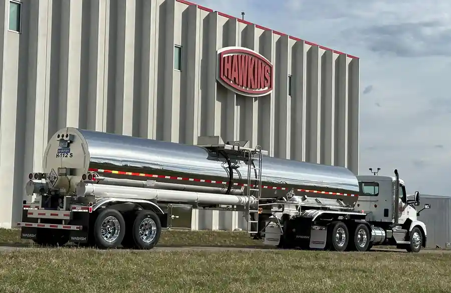
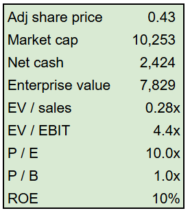
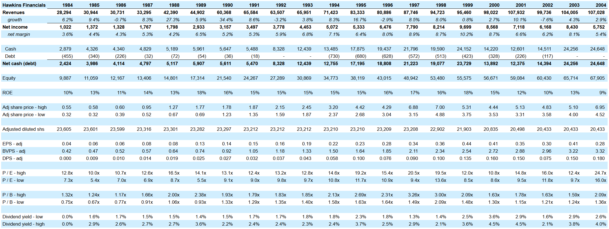

# Hawkins Chemical Company

30 Jul 2026 · Joe Raymond  
[Original article](https://www.joekraymond.com/hawkins-chemical-company/)

*A Midwestern Stockbroker's Long-Term Case Study*

I recently visited the office of a long-time Midwestern stockbroker.

We'll call him Dee.

Dee's office is on the fifth floor of an old tower in a mid-tier city. It has the feel of an older, traditional brokerage practice: magazines in the waiting room are several years old, and pictures on the walls have yellowed with age.

It would be an unusual setup for a modern financial firm, ***but it fits the character of a long-standing, old-school investment practice**.*

You see, Dee has been trading obscure OTC stocks for nearly 50 years.

In fact, some of his clients are families that owned Berkshire Hathaway shares **** 80 years ago, ***before Buffett got involved***.

Suffice to say, Dee and his clients have an extensive history studying and investing in illiquid stocks.

I have learned that these sorts of people have an almost endless supply of stories and case studies. And what's interesting is that people rarely ask to hear about them.

***With a little prompting, the stories begin to emerge.***

I asked Dee to share examples of notable investments from his long career. He shared multiple stories and was generous with his time.

*Dee’s examples are anecdotal and are not intended to represent typical investor experiences or outcomes.*

Some developed over shorter periods, while others took many years to unfold. One historical case study that stood out was Hawkins Chemical.

## Hawkins Chemical Company

Hawkins Chemical (HWKN) was founded by the Hawkins brothers (Kent and Howard "Curly" Hawkins) in Minneapolis in 1938.

They started out selling and distributing industrial chemicals to manufacturing plants. *"Lead generation"* meant chasing smokestacks on the Minnesota horizon.

A few years into the venture, Kent left and the business became the sole proprietorship of Curly.

Curly faced many early challenges, including big ones like the Great Depression and World War II, as well as other smaller and more typical entrepreneurial challenges like inadequate financing and employee mishaps.

Despite it all, ***Curly managed to grow Hawkins' annual revenues from zero to \$300,000 within its first decade.***

Then, in 1955, the company entered into an agreement to serve as sales agent for Vel-Tex Chemical, a manufacturer of industrial bleach, which later proved commercially important to Hawkins’ development.

The two companies operated together for the next 16 years until 1971, when Hawkins acquired Vel-Tex outright.

## IPO

Hawkins went public in 1972.

The company had \$9 million in annual revenues at the time (compared to the \$300,000 cited in 1948).

***This represented an impressive sales CAGR of 15% for the preceding 24 years.***

HWKN was solidly profitable, but growing in the chemical distribution business required large and ever-increasing capital investment in additional capacity and inventory. Howard was tired of borrowing money and decided to test the public markets.

In his own words:

> "In the previous ten years we had grown by leaps and bounds, increasing our bulk capacity from barely fifty-thousand gallons to more than a million... The problem was money. Or, more accurately, not enough money for our purposes. Though we were making money, we needed more if we wanted to make the capital investments we believed were necessary to grow. I was tired of going to the bank, tired of owing other people money. Like most folks who have started their own business, I was also concerned about the future from an estate-planning point of view." - From <u>Life in a Putty-Knife Factory</u> by Howard Hawkins

Margolis & Company completed the offering, selling half a million dollars' worth of stock at \$4.00 per share on the local OTC market.

The Hawkins family and employees retained a majority of the stock, Howard had a public market for his shares for estate-planning purposes, and Hawkins Chemical was able to pay off all debt and invest for future growth. The transaction appeared to address several objectives at once.

***After the IPO, HWKN maintained a net cash balance sheet (more cash than total debt) for the next 44 years until 2016.***

Howard never regretted going public. As he said 23 years later in 1995:

> "We've never felt a great deal of pressure from the market to perform a particular way. We've never felt compelled to put on a dog-and-pony show for the financial community. We believed then and we believe today that if the company serves its customers and takes care of business, the stock will take care of itself." - From <u>Life in a Putty-Knife Factory</u> by Howard Hawkins

## The Investment

Dee told me he bought his first Hawkins shares in 1978 for \$3.75 apiece.

It is striking when an investor with a 50+ year career can recall the precise time and price of an investment made decades earlier.

Ordinary details may fade, but certain investment details can remain vivid.

I was only able to find financial and market data for Hawkins going back to 1984, so we will use that as our starting point. I suspect Dee's results were even more favorable buying six years prior, though I can't confirm this.

Here was the valuation on HWKN in 1984:

*Source: Moody's OTC Industrial Manual*

The company traded for 10x earnings and 1.0x book value, earned a 10% return on equity, and had 25% of the market cap in net cash. The EV/EBIT was 4.4x.

*These valuation metrics may have appeared attractive to some value-oriented investors at the time, but they did not eliminate the risks associated with an illiquid OTC security.*

In addition to trading at a relatively low valuation based on selected historical measures, the company appeared to have reasonable growth prospects and scalability.

The company had compounded revenues at about 10% in the 12 years since the IPO. Operating margins in 1984 were only 6% and ROE was 10%. One could reason that a larger, well-run chemical company could reach double digit operating margins and 15%+ unlevered ROE.

HWKN shares traded infrequently over the counter. The founding family and early employees owned a majority of the shares. There was little marketing of the stock after the initial IPO.

All of these factors likely contributed to the lower valuation at the time.

## 1984 - 2004

*The following analysis is hypothetical and is intended solely to illustrate how long-term compounding may have impacted returns under specific assumptions. It does not represent actual investor experience and does not reflect fees, taxes, transaction costs, or behavioral factors that would likely affect realized outcomes.*

*This case study should not be viewed as representative of outcomes from long-term investments in illiquid, thinly traded, family-controlled, or undervalued securities, many of which may underperform, remain difficult to sell, or result in losses.*

Hawkins grew sales from \$28 million in 1984 to \$107 million in 2004 (7% CAGR, a little slower than the 10-15% rate achieved over the prior three decades).

Margins expanded and income grew faster than sales, increasing from \$1.0 million in 1984 to \$5.8 million in 2004 (9% CAGR).

Return on equity averaged 14% for the two decades, and cash was always greater than debt.

7% sales growth, 9% earnings growth, 14% ROE.

These operating results reflected steady, but not extraordinary, growth.

**Shareholder returns over this period exceeded what the operating metrics alone might suggest.**

HWKN stock advanced from \$0.43 per share in 1984 to \$5.73 in 2004. The company also paid a cumulative \$1.49 per share of dividends. ***Under these historical assumptions, the annualized return was approximately 17%.***

How was the buy-and-hold shareholder return so much better than the high-level operating metrics would suggest?

Three main reasons:

1.  Cumulative dividends paid totaled 346% of the 1984 price
2.  Repurchases reduced the outstanding share count by 13%
3.  The P/E multiple expanded from 10x to 20x

These additional tailwinds could not have been known in advance. The company had not paid a dividend or repurchased much stock to that point, and future valuation multiples are always uncertain.

**While these specific outcomes could not have been forecasted, this case study illustrates how multiple factors—including dividends, repurchases, operating performance, and valuation changes—can affect long-term historical returns.**

That is one reason some investors study value-oriented situations.

In this historical example, a low valuation, positive returns on equity, and control ownership may have contributed to a range of outcomes that were not knowable in advance, including dividends, repurchases, and multiple expansion.

No spreadsheet can model the future with perfect precision. That is one reason investors often emphasize a margin of safety. As Ben Graham said, *"The function of the margin of safety is, in essence, that of rendering unnecessary an accurate estimate of the future."*

The company grew organically and also completed a number of bolt-on acquisitions over time. According to Howard, these were not extensively planned deals. They mostly developed naturally and involved people he knew who were doing their own estate planning. Valuation work was kept simple.

As such, Howard only bought companies he knew well that were in good shape and fit within Hawkins' growth plans (geography and product). He was prudent on price and avoided any big mistakes.

*Source: Moody's Manuals & SEC Filings*

## 2005 - 2026

HWKN traded for an average P/E of 15x in 2005. Not as cheap as most of the 1980s and 1990s, but not expensive either.

The company’s historical operating results remained generally favorable. Revenue grew in 17 out of the 21 fiscal years from 2005 to 2026, and three out of the four declining years were less than 3% (2009 being the sole outlier with a 9.6% decline in revenue).

This historical record reflected a period of stability and growth for the company, although such performance should not be assumed to continue or to be typical of comparable issuers.

Sales and earnings both increased tenfold over these 21 years. Net income grew from \$8.1 million in 2005 to \$81.5 million in 2026. Return on equity for the two decades averaged 14%.

Shares traded for an average of \$6 in 2005 and \$144 in 2026. \$8.35 per share of cumulative dividends were paid as well.

***Under these historical assumptions, the annualized return from 2005 to 2026 was about 18% inclusive of dividends.***

The return was aided by the market awarding an average P/E multiple of 36x to Hawkins in fiscal 2026.

For illustrative purposes only, **\$10,000** invested at the average price of \$0.43 per share in 1984 would have grown to be worth more than **\$3.3 million** at the average price of \$144 in 2026 with approximately **\$232,000** in dividends received, before considering taxes, transaction costs, brokerage commissions, bid-ask spreads, reinvestment assumptions, liquidity constraints, or investor-specific circumstances.

Under those assumptions, ***the 42-year annualized return would be a little above 17%***; however, this calculation is hypothetical, based on historical quoted prices and dividends, and does not represent any actual account performance or any assurance that comparable results could have been achieved or may be achieved in the future.

*This was an unusual historical outcome for a small, Midwestern, OTC-traded, family-controlled chemical company and should not be viewed as typical or expected.*

## Postscript

Howard "Curly" Hawkins wrote a book in 1995 called *Life in a Putty-Knife Factory*. A copy is available on Hawkins’ corporate website.
