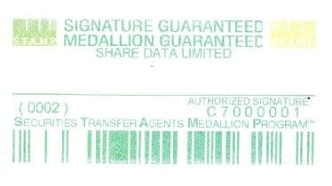
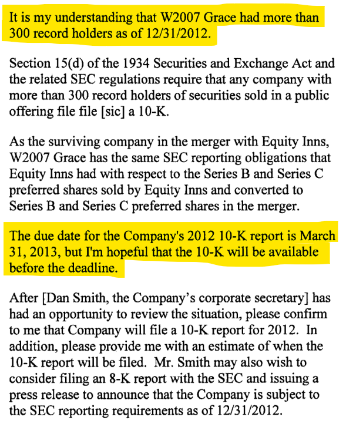
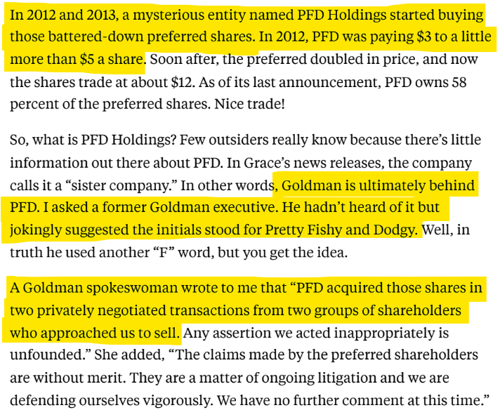
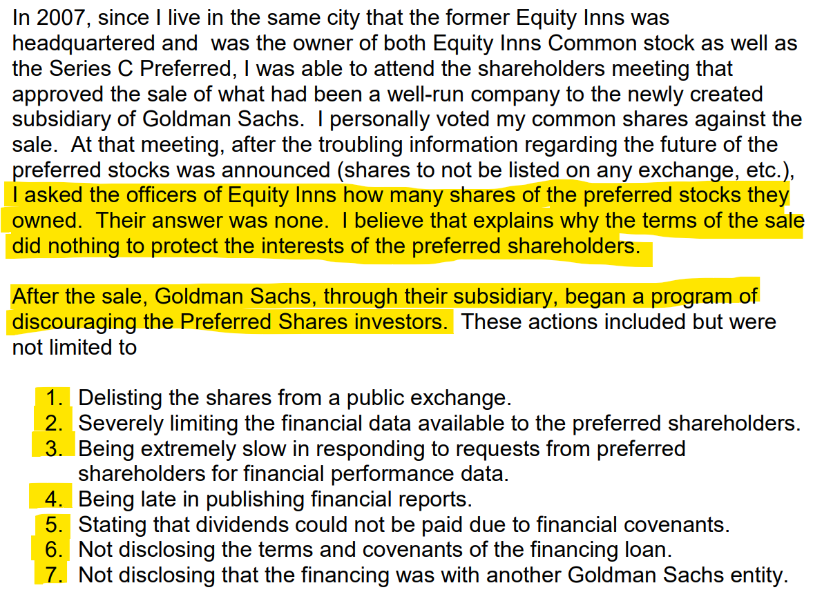
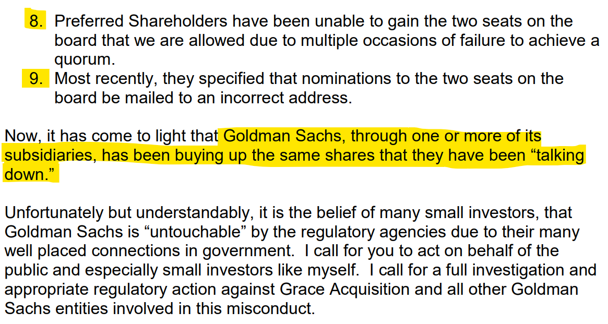

# Making 13x on a Preferred Stock

9 Sep 2025 · Joe Raymond  
[Original article](https://www.joekraymond.com/making-13x-on-a-preferred-stock/)

*Stranded securities, SEC rule technicalities, and taking on Goldman Sachs*

The year is 2011.

The global economy is still trying to find its footing. Security prices have rebounded from their lows. But there is still plenty of value to be found.

In the obscure corners of the market, there is *tremendous* value to be found.

Our protagonist in this story comes across a \$25 par cumulative preferred stock trading for \$2 per share. **That's 8% of par value – *good for a discount of 92%*.**

He thinks the preferred is money-good and should be worth **at least 10x** where it trades. So, he buys a boatload of it.

What happens next is fit for the big screen.

## W2007 Grace Acquisition Preferred

In October 2007, an affiliate of Goldman Sachs bought Equity Inns, Inc. for \$2.2 billion. They borrowed \$1.9 billion and put in \$250 million of equity.

*(For the remainder of this case I will use W2007 Grace and Goldman Sachs interchangeably, as GS owned 100% of the common equity of W2007 Grace.)*

Prior to the acquisition, Equity Inns was a public company based in Tennessee. It had nearly \$2 billion in assets and owned 130 hotels across the United States. It also had two issues of preferred stock outstanding that traded on the New York Stock Exchange (principal amount of \$145 million).

When Goldman took Equity Inns private, it chose not to redeem the preferred stock. **It left the preferred shares outstanding.**

Holders of both issues of preferred stock received equivalent preferred shares under the new name *W2007 Grace Acquisition Preferred* (the most non-retail-friendly name one could choose).

Since the company was no longer public, Goldman deregistered W2007 Grace from the SEC and ceased filing public financial reports (no more 10-Ks and 10-Qs). Then the financial crisis came along, and they stopped paying the preferred dividends.

Here's a summary of events so far:

1.  The equity is acquired and taken private
2.  The preferred shareholders are left stranded
3.  The old shares are exchanged for new ones with a strange name
4.  Financial reports are no longer filed
5.  Financial crisis strikes
6.  Dividends stop

You can imagine what happened. Both issues of Grace preferred got crushed.

**The Series C traded as low as a penny in 2008 (0.04% of par).**

## **Along Comes a Curious Investor**

In 2011, one of our clients here at Caldwell started buying Grace preferreds. We'll call him John (not his real name), and he gave us permission to share this story.

By this point, the price had recovered to around **\$2 per share (8% of par)**.

John is the kind of investor who gets intrigued by an obscure, OTC-traded preferred stock trading for less than 10% of face value. So, he buys a few shares and reaches out to the company requesting an annual report.

*"Sure, we'll send you an annual report,"* they say. ***"If you sign a nondisclosure agreement and pay 10 cents per page for the copy."***

John plays Goldman's game and satisfies their request.

When he receives the annual report, he sees a company that is *not* facing bankruptcy (as the preferred price would seem to suggest). He does some rough math on the value of the hotels and comes to the conclusion that there are plenty of assets to cover the debt and preferred shares, with some equity value left over.

Plus, he figures Goldman Sachs (an organization with deep pockets) wouldn't want to wipe out their \$250 million equity investment due to problems with a couple of small senior preferred issues outstanding.

**Thus, John decides the preferreds are worth closer to \$25 than \$0**. He starts buying aggressively.

## Creative Technicalities

John thought Goldman was treating preferred holders incredibly poorly by:

1.  Stranding the shares rather than redeeming them
2.  Going dark (no more public financial reporting)
3.  Suspending dividends
4.  Requiring NDAs and cash payment to receive financial reports

He suspected that Goldman was purposefully pushing the price of the preferreds down so they could repurchase the shares at a steep discount. *Why pay \$145 million for the preferreds if you can buy them at an 80%+ discount later?*

**John decided to fight fire with fire.**

He wanted to force W2007 Grace to file public reports again – partly because he thought it was the right thing to do, and partly because he thought it would cause the stock (which he now owned a significant amount of) to go higher.

In the United States, companies are required to file with the SEC if they have more than 300 *"shareholders of record."*

*"Shareholders of record"* are the registered names on the transfer agent's books. Those who hold shares at their broker (in *"street name"*) usually count as only one recordholder. If, for example, 500 different people own shares at Schwab in their brokerage accounts, the group as a whole counts as only *one* recordholder.

Now, something you should know about John.\
\
He is a sophisticated CPA with a tax practice, a large family, and even a few friends. Beginning in 2012, he gave away shares of W2007 Grace to anyone and everyone who was willing to accept a free share of Grace preferred stock.

**Then, John came down to our office and started divvying up the shares into 300 different trusts he had established, each to become a direct recordholder.**

These trusts had various beneficial owners (the recipients of his gifted shares) and tax IDs. And they would all count as separate shareholders of record, thereby forcing W2007 Grace to resume filing reports with the SEC.

Much of the day was spent shuffling papers around and signing stock powers. Our signature guarantee stamp got more exercise in three hours than it had in the preceding 10 years. We even ran out of the precious ink (which, we might add, is made by a single company and costs a fortune).

The deadline for counting recordholders is January 1st, so John made his maneuver during the final busy holiday weeks of December. This gave Goldman no time to do a reverse split or negotiate a separate solution.

## Goldman Complains

John sent W2007 Grace a letter a couple of weeks later on January 17th. It basically said, *"You'd better count your shareholders again."* And, *"I look forward to seeing the 10-K by March 31st."*

*Source: John's Letter to Grace January 17, 2013*

Unsurprisingly, Goldman didn't appreciate John's creativeness.

They requested a filing exemption from the SEC citing W2007 Grace's small size, minimal operations, and John's *"manipulative behaviors."*

John found this request for relief ironic.

In his view, Goldman had done everything in their power to screw over the preferred shareholders – many of whom were retirees relying on the preferred dividend for income. **And now they were crying foul to the SEC about having to file basic financial reports?**

Around this same time, Goldman was repurchasing blocks of the preferred shares in private transactions through a related entity.

*Source: <a href="https://www.propublica.org/article/goldman-the-muppets-and-the-mystery-of-pretty-fishy-dodgy-holdings?ref=joekraymond.com" rel="noreferrer">"Goldman, the Muppets and the Mystery of ‘Pretty Fishy &amp; Dodgy’ Holdings"</a> March 2014*

So, not only is Goldman hoarding financial information (requiring NDAs and cash payment for printing/postage), **but they are repurchasing shares at rock-bottom prices in block trades through a related entity.**

## A Flurry of Comment Letters

The SEC received more than 40 comment letters relating to Goldman's request for relief.

**All of them sided with John.**

You can find the letters <a href="https://www.sec.gov/comments/81-939/81-939.shtml?ref=joekraymond.com" rel="noreferrer">here</a>. They make for fun reading.

Perhaps my favorite comes from Frederick Shearin, a local retiree from Germantown, Tennessee who did a great job highlighting the course of events:

*Source: Letter from Frederick Shearin May 22, 2013*

It's hard to argue with the facts. And the facts made Goldman look pretty bad.

## SEC Comes Down on GS

In their investigation, the SEC found that W2007 Grace had more than 300 recordholders *even before John split shares amongst his 300 trusts.*

It turns out they had improperly undercounted by counting recordholders of each class of preferred stock separately. The rule, however, is that when multiple securities are substantially equal in terms and conditions, their recordholders must be counted together.

**Adding the Series B and C recordholders together produced in excess of 300 shareholders of record, even without John's trusts.**

Goldman agreed to pay a \$640,000 civil penalty and immediately begin filing Ks and Qs again.

Around this same time, shareholders brought a class action lawsuit against W2007 Grace, alleging oppression and breaches of duty – claiming information was withheld and that related-party transactions favored Goldman Sachs.

## Endgame

The class ended up settling with Goldman for **\$26 per preferred share** in late 2015. John, who started buying at \$2 and continued adding all the way up, made a considerable amount of money.

And it could have been more.

The class action attorney was quick to settle, perhaps incentivized by a sizable contingency fee. John believes they could have ultimately won par plus accrued unpaid dividends. This would have amounted to *more than \$40 per share*.

Regardless, **it was a big win for the little guy**.

John made many multiples on his money in less than five years. Mistreated preferred holders were made whole. The big bad Goldman Sachs was beaten.

## Postscript

*-A key takeaway from this case is that in the United States boards of directors typically have a **fiduciary** duty to common shareholders and a **contractual** duty to preferred holders. This is what produces a situation like W2007 Grace. What is more of a grey area is asking an investor to sign an NDA, while these same insiders who are suppressing information know all the facts and are buying with two hands as affiliates.*

*-In hindsight, it is clear Goldman made many mistakes here. One of the most interesting (and ironic) is that when they issued the W2007 preferred stock to replace the preexisting Equity Inns preferred stock, they chose against making the shares DTC eligible (probably to limit trading capability and push the price lower). This caused many brokers to put their client shares directly in their names and mail them stock certificates – which is likely a big reason why the company had more than 300 recordholders.*

*-To be clear, there were certainly risks associated with the Grace preferred shares in 2011. This was a highly levered hotel company coming out of the GFC. But gross operating cash flow remained positive through it all and the upside of par plus accrued more than compensated for the risk at \$2 per share.*
