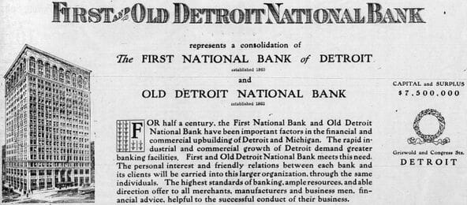
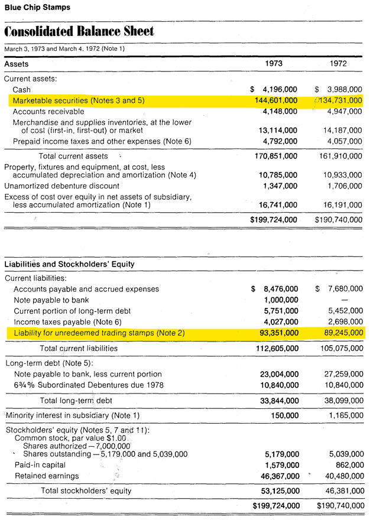
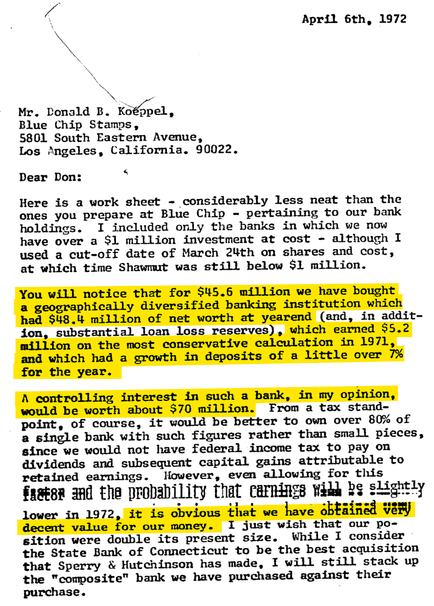
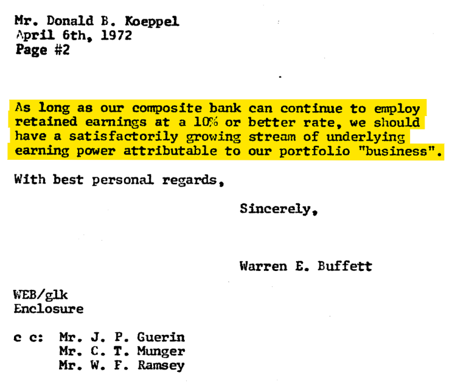
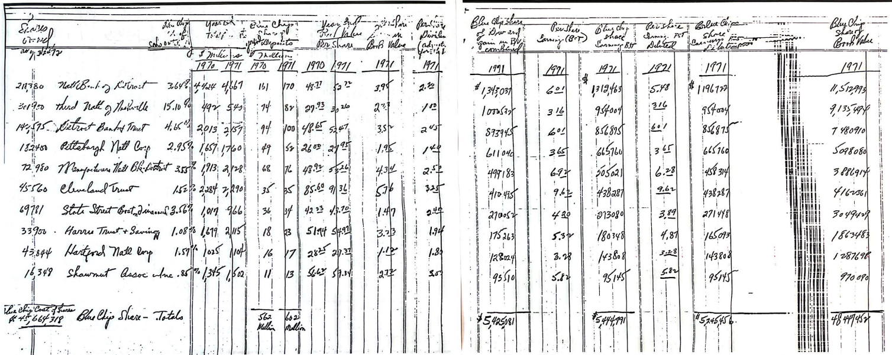
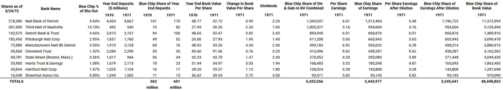
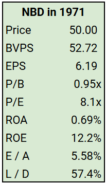
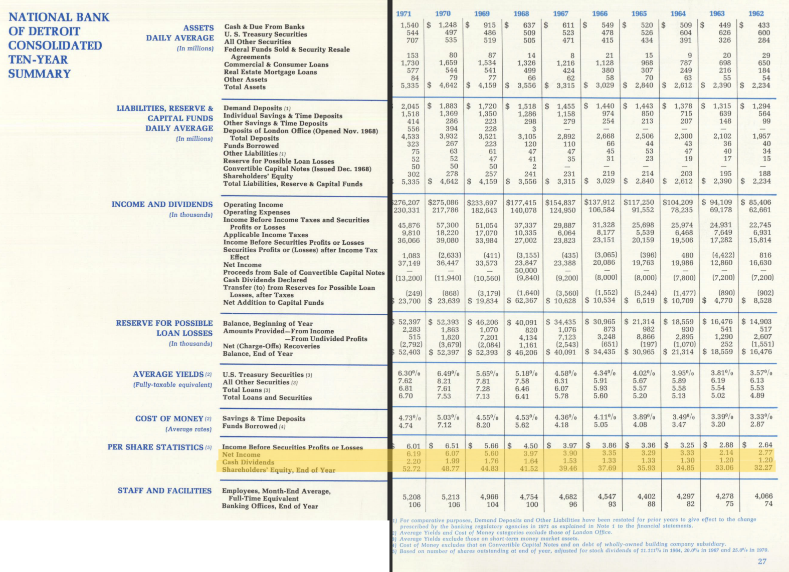
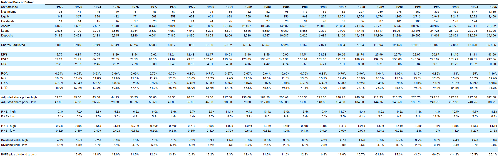

# National Bank of Detroit

14 Oct 2025 · Joe Raymond  
[Original article](https://www.joekraymond.com/national-bank-of-detroit/)

*A little-known Buffett case*

Warren Buffett is probably the most famous financial figure of all time.

There are dozens of books about him. Thousands of blog posts. Every inch of his career has been studied, and for good reason. *Nobody has done as well for as long in the field of investments.*

**But every once in a while, I come across something related to Buffett I haven't seen discussed before.**

Of course, just because something hasn't been discussed doesn't automatically make it interesting. The most obscure stories often aren't the best ones.

But finding an untold Warren Buffett story is sort of like finding an unknown stock. It gets me excited. It gives me additional insight into the best investor of all time. And it's something 99% of others haven't seen.

Today is one of those examples.

## Buffett's Bank Basket at Blue Chip

Avid students of Warren Buffett know the Blue Chip Stamps investment well.

I won't rehash all of the details here. For more background, check out chapters 32 through 43 of *The Snowball.* For those who like source documents, my friend Turtle Bay compiled the old Blue Chip letters <a href="https://www.turtlebay.io/notes?ref=joekraymond.com" rel="noreferrer">here</a>. It's a great resource.

Long story short, Buffett, Munger, and Guerin acquired control of Blue Chip Stamps in the late '60s. The main appeal of the stock was the cheap price in relation to the large amount of deferred revenue from stamp sales. By taking control of the company, Buffett & friends could invest this "float" in securities.

Blue Chip had \$89 million of stamp-related float in March 1972, \$134 million of securities, and \$74 million of common equities.

Here's a full balance sheet:

*Source: BCS 1973 Annual Report*

Buffett needed to keep Blue Chip's balance sheet liquid enough to handle stamp redemptions, but he knew he could do better than short-term debt instruments. Instead, he bought a group of solid companies at reasonable valuations.

**Nearly two-thirds of the stock portfolio was made up of 10 banks.**

Buffett wrote a letter to Blue Chip's President Don Koeppel on April 6, 1972 outlining the company's investment in these 10 banks.

Here's a full reproduction:

*Source: Warren Buffett Letter to Donald Koeppel April 6, 1972*

Buffett viewed the bank basket on a look through basis as a single wholly owned bank trading for **0.94x book** and **8.8x earnings** with a **10.7% ROE**. He thought this "bank" would earn a satisfactory return using BCS's float. And he thought the combined position as a whole, if it were a single operation, would be worth \$70 million to a private market buyer (**12.9x earnings** and **1.44x book value**).

Here's Buffett's full bank spreadsheet:

For those who can't read chicken scratch, here's a recreated version:

Blue Chip got out of most of these stocks within a decade. Nevertheless, I thought it would be fun to go through each of these banks and see how things played out over the long run.

**It turns out this is a great way to learn about bank investing.**

You could make an entire college course dedicated to starting with Buffett's bank basket in 1972 and tracing it through to the modern day. What happened to each stock and why? How did they perform? What went right and wrong?

This post will be dedicated to Blue Chip's biggest position in 1972 – National Bank of Detroit – which is an interesting (and moderately successful) story.

## Brief History

National Bank of Detroit (NBD) was founded in the depths of the Great Depression. By 1933, many Detroit banks had failed and been liquidated (including the city's two largest – First National and Guardian Bank of Commerce).

NBD was a fresh start backed by powerhouse General Motors. GM put capital into the new bank hoping to stabilize Detroit's financial system and support its industrial suppliers.

For the first 40 years, NBD remained primarily regional serving Detroit and surrounding communities. Regulatory limitations in Michigan restricted the bank from opening branches outside Wayne County.

## What it Looked Like in 1972

In March 1972, Blue Chip owned 218,380 shares of NBD (3.64% of the total outstanding) worth nearly \$11 million. This equated to about 8% of the securities portfolio, 15% of the stock portfolio, and 24% of Blue Chip's common equity.

All of this is to say **this was a sizable bet.**

The average price in 1971 (when Buffett was buying) was \$50 per share.

Here are the figures:

*Source: Moody's Manual 1972*

**So, NBD was a dominant regional bank with a 12%+ ROE trading at a discount to book value.** Loans to deposits was less than 60%, with the rest invested in conservative securities.

The 10-year track record was satisfactory:

*Source: NBD 1971 Annual Report*

You can see why Warren thought NBD was a good fit for Blue Chip's investment portfolio:

1.  It was a stable bank with a good track record over a long time period.
2.  The shares were liquid enough to sell if he had to (if there was a run on stamps, or if a better investment opportunity came along).
3.  The price was sufficiently cheap at 8-9x earnings to suggest a satisfactory return could be achieved over time.

## 1972 to 1995

The banking paradigm in Michigan shifted in 1972.

The state's banking code was amended to permit statewide branching and multi-bank holding companies. This let the big city banks like NBD open or acquire branches anywhere in the state.

National Bank of Detroit responded by creating a bank holding company called National Detroit Corporation in 1973. It then launched an acquisitions program to roll up smaller banks. By the mid-80s, many states had passed reciprocity laws allowing bank holding companies from approved neighboring states to buy or merge across state lines.

Merger mania ensued; NBD did its fair share, making dozens of acquisitions from the mid-70s to mid-90s.

Despite the feverish M&A activity, results weren't bad.

Book value per share grew from \$57.24 in 1972 to \$237.66 by 1995 (**6.4% CAGR**). The company also paid substantial and growing dividends over this period.

**Annual BVPS growth adjusting for dividends came in around 11-12%.**

Here's a financial snapshot of the 23-year period:

## Stock Swapping

The bank mergers continued throughout the late '90s and early 2000s.

In 1995, NBD completed an all-stock merger of equals with First Chicago Corporation. The two banks had complementary business lines in adjacent geographies. The surviving entity operated under the combined name *First Chicago NBD*.

Then in 1998 First Chicago NBD merged with Banc One – a Columbus, Ohio based bank. Every one share of FCNBD received 1.62 shares of Banc One and the combined company was renamed *Bank One* (with a "k" instead of a "c").

## JP Morgan Chase

Up until the Banc One merger, things had gone pretty well for NBD.

Despite the dizzying pace of M&A, earnings and book value continued to grow, and ROE remained in the teens. Acquisitions were made mostly at reasonable prices and catastrophic losses were avoided. Banking consolidation made the system more efficient, and customers were happy enough.

But Bank One's fortunes started to turn south in the late '90s shortly after the merger.

Earnings fell sharply in 1999 as growth slowed and anticipated cost savings failed to materialize. The credit card division from Banc One imploded due to bad loans and regulatory scrutiny. The stock fell by 50%. Analysts described Bank One as *"the sick man of big banking."*

**In 2000, a young executive by the name of Jamie Dimon was brought in to right the ship.**

And right the ship he did.

Dimon wrote off billions in bad loans and goodwill. He centralized operations and established new risk controls. Tech systems were updated and unified. The credit card business was rebuilt.

By 2003, Bank One stock had tripled from its 2000 low.

In 2004, JPMorgan Chase and Bank One decided to merge. They were the 3rd and 5th largest banks in the country at the time, respectively. William Harrison, Chairman and CEO of JPM, liked Jamie Dimon and thought he would be a good successor.

Thus, the \$58 billion deal was struck.

Each share of Bank One received 1.32 shares of JPM. Dimon was made President and COO for a year before taking the CEO title in 2005 and Chairman in 2006.

I won't go into detail on the last 20 years for JPMorgan Chase because the story is well-known and the data is readily available. Suffice to say, JPM today is the largest bank in America and Jamie Dimon is a billionaire (with a sparkling reputation to boot).

## Buy-and-Hold Results 1971 to 2025

Every **one** share of National Bank of Detroit Buffett purchased in 1971, if he had held for the next 54 years, would have turned into **14.58** shares of JPMorgan Chase today (as a result of multiple stock splits and stock-for-stock mergers).

NBD traded for an average price of \$50 per share in 1971 whereas JPM trades for \$310 per share today. As such, **every \$1,000 invested in NBD 54 years ago would be worth a little over \$100,000 today.**

Buffett's \$11 million stake would have grown to more than \$1.1 billion.

Astute readers will note that this *"only"* equates to a 9% annual return. The buy-and-hold investor would have also received growing dividends over the decades, **pushing the total annual return into the low-teens.** Buffett’s return on equity would have been even better given the leverage from the float.

A low-teens annual return for five decades in a single stock is great (especially for a 1972 start date – when stocks weren't particularly cheap).
