# Racing to Riches

28 Jul 2025 · Joe Raymond  
[Original article](https://www.joekraymond.com/racing-to-riches/)

*A needle in the pink sheet haystack*

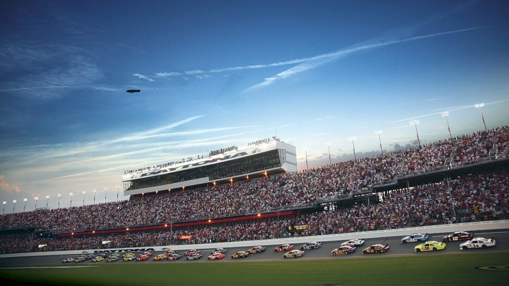

International Speedway traded for \$1 per share in 1976.

This equated to **5x trailing earnings** and **0.75x tangible book value**.

Sales were growing in the double digits, and operating margins were 25%+ and expanding. Advanced ticket sales meant cash flow was better than reported earnings. Net debt was effectively zero.

This is what an investor would have seen at the time:

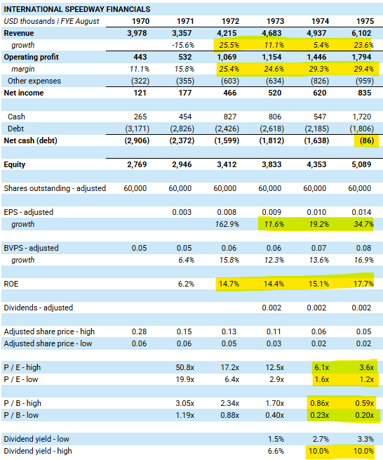

*Source: Moody's Manuals & ISC Annual Reports*

A company with these fundamentals in the S&P 500 today might trade for 20x or 30x earnings, maybe more. **But back in the mid-70s you could get ISC for less than 5x earnings.**

Stocks in general were much cheaper back then. Plus, ISC was family-controlled and tightly held (not on a national exchange). Information was scarce and liquidity limited.

Eventually, value finds its way out – especially for a fast-growing, high-quality asset like International Speedway. 20 years later in 1993 ISC broke \$100 per share. Then \$200 and later \$300.

**The stock grew more than 200-fold in 20 years (30%+ CAGR) before dividends.**

Here's the little-known story.

## Background

Bill France Sr. ("Big Bill") founded NASCAR in Daytona Beach in 1948. Stock car racing started gaining popularity in the late 1930s, and Big Bill recognized the opportunity to formalize a regulated racing body.

NASCAR was founded as a sanctioning body for stock car racing. It didn't own tracks or teams. It sanctioned races, enforced rules, awarded points and prizes, and created championships. It had few tangible assets and mostly acted as a "toll road" or "royalty" on the increasing popularity of the sport.

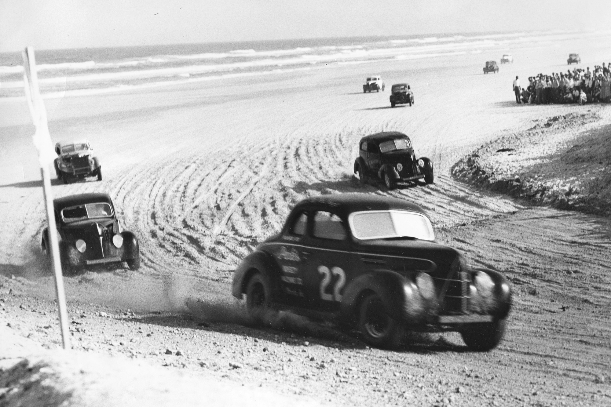

*NASCAR Race Daytona Beach 1948*

International Speedway was incorporated in 1953 as a separate company (also owned by the France family) to build, own, and operate racetracks. This business was more capital intensive than NASCAR. Daytona International Speedway was its crown jewel (opened in 1959 – replacing the old sand track).

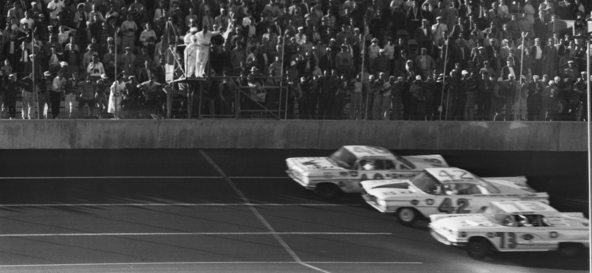

*Photo Finish at the First Daytona 500 in 1959*

ISC remained majority-owned by the France family. Over the decades, some shares trickled out and traded over the counter (likely through small offerings and registrations by insiders). By the 1970s there was a legitimate (although still very small) public market for the stock. It could be bought by patient bidders.

Bill France Jr. ("Little Bill") took over as president in 1972. This is when the story really gets interesting.

## 1972-1988

The 16 years from 1972 to 1988 represented phase one of International Speedway's strong growth.

Starting from a small base, NASCAR was growing in popularity in the 1970s and 1980s. Widespread TV adoption and use helped transform the sport from a southern spectacle to a national and later international one. In 1984, Ronald Reagan was the first president to attend a race.

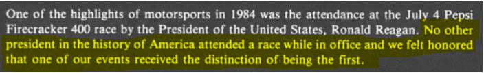

*Source: ISC 1984 Annual Report*

ISC rode this wave of increased popularity and grew multiple lines of revenue. Attendance went up every year. This drove food, beverage, and souvenir revenue. Then sponsors and TV deals came. It was a flywheel.

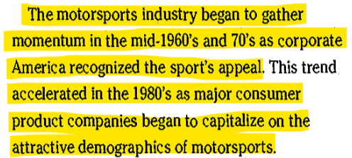

*Source: ISC 1997 Annual Report*

ISC had two main venues during this period: Daytona (built in 1959) and Talladega (1969). Every year the company would add additional seating in the form of grandstands and suites. And every year demand grew faster than capacity. Advance ticket sales helped finance the capex. The balance sheet never had any net debt after 1975.

The company grew revenue at an annual rate of 14.6% over this period and EPS grew at 20.0%. It also paid dividends every year starting in 1973 and began repurchasing shares in 1980.

It was a beautiful financial record:

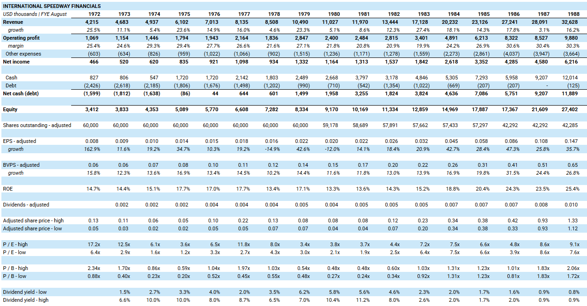

*Source: Moody's Manuals & ISC Annual Reports*

ISC stock would have been a great buy at any point during these 16 years. It never traded for more than 13x earnings and averaged about 5x. **The stock went from \$1 in 1976 to \$20 in 1988 (28% CAGR before dividends).**

## 1988-1996

Larry Goldstein had lunch with "Little Bill" one afternoon in September 1988. The two had been introduced by a mutual friend.

Bill spoke passionately about the nuances of the track business – it's positives, negatives, opportunities, and risks. ISC had recently acquired part of Watkins Glen out of bankruptcy and now had four world-class raceways (Daytona, Talladega, Michigan International, and Watkins Glen). Capacity expansion projects were planned, and price increases were likely. Demand continued to outstrip supply.

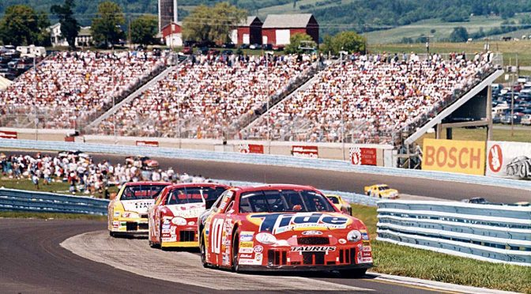

*Watkins Glen International*

The day after their meeting, Larry gave his broker an order to buy 1,000 shares of ISC at \$16.75 per share (equivalent to \$1.12 adjusted for a later stock split). He continued to buy the stock over the next decade whenever it was available.

Let's get some perspective on this purchase decision.

ISC had gone up 10x in the preceding 10 years. Revenue had quadrupled and the operating margin was north of 30%. The P/E multiple was higher than it had been for most of the last 20 years.

It would have been easy for an investor to feel like they "missed it" and pass on ISC. Who likes paying a 10-year high stock price and multiple? **But passing would have been a huge mistake.**

Larry's first purchase in 1988, even after the meteoric rise of the business and share price, was still under 8x earnings. He didn't mind paying the all-time-high at the time. He saw continued strong business prospects and was happy to pay 7.6x growing earnings.

The positive business momentum proved persistent. NASCAR continued to gain popularity, increase capacity, raise prices, and opportunistically add venues. By the mid-1990s, ratings were through the roof, and sponsors were knocking down NASCAR's door.

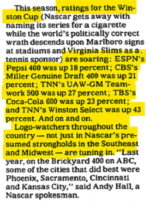

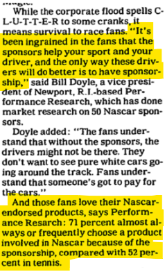

*Source: New York Times July 18, 1995*

From 1988 to 1996 sales compounded at 14.7% and EPS grew at 17.9%. The stock went from \$1.12 (split adjusted) to \$23 (45% CAGR). The company also paid a dividend every year.

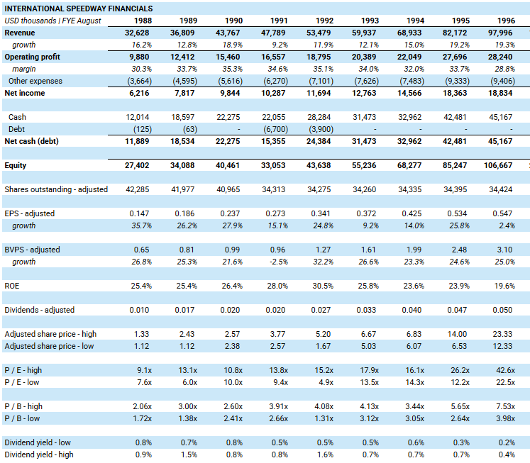

*Source: Moody's Manuals & ISC Annual Reports*

## 1996-2007

ISC went fully public in 1996 at \$20 per share (25x forward earnings). The whole kit and caboodle – bankers, road show, IPO, national stock listing. Much different than when it was "public" on the pink sheets.

The fundamentals had never looked better. Record attendance, TV, hospitality, and sponsorship revenues. Operating margin was consistently above 30% and the balance sheet remained net cash. The outlook was strong.

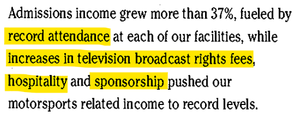

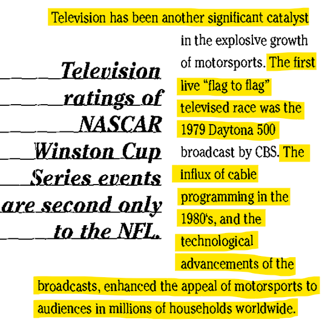

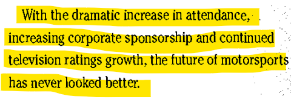

*Source: ISC 1997 Annual Report*

The IPO of a sleepy OTC stock is almost always good news for the prior OTC shareholders. Larry discusses the experience in his partnership letters:

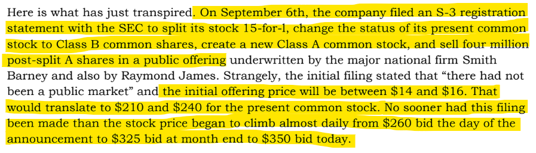

*Source: SMP Letter to Partners October 8, 1996*

Those shares Santa Monica was paying \$16.75 for eight years prior had an adjusted cost basis of \$1.12 vs an IPO price of \$20 (43% CAGR before dividends).

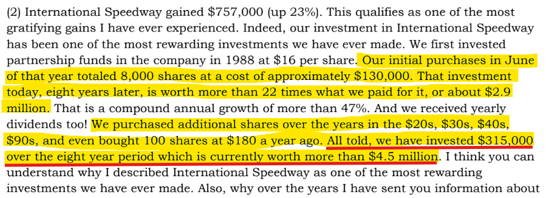

*Source: SMP Letter to Partners October 8, 1996*

ISC used the proceeds from the IPO (along with internal cash and borrowings) to make acquisitions and expansions. In 1997, it acquired the 50% of Watkins Glen it didn't own along with Phoenix International Raceway. Then in 1999 ISC merged with Penske Automotive, becoming the de-facto leader in American racing venues.

By the early 2000s, ISC looked a lot different than it did pre-IPO.

Sales growth slowed to single digits by 2002 (compared to the consistent double-digit growth seen throughout the 1980s and '90s). The company had taken on over \$400 million of debt in the Penske merger, which was a big deal for a company with \$100 million of EBIT (and that had been debt-free for the 23 years prior).

The valuation wasn't great either. The P/E ratio rarely dipped below 20x after the IPO.

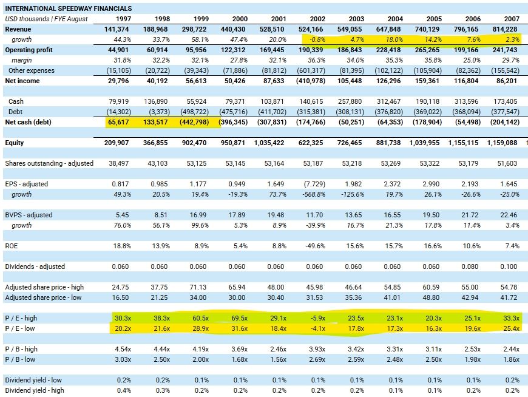

*Source: ISC Annual Reports*

## 2008-2019

The GFC marked the official end of ISC's multi-decade string of growth. Sales peaked in 2007 at \$814 million and didn't return to that level. The stock fell from a high of \$60 to a low of \$16 before rebounding and then hovering in the \$30s for most of the 2010s.

NASCAR's core customers were hit particularly hard by the GFC. These were working class Americans concentrated in the Southeast. Limited disposable income reduced attendance. Decades of capacity expansion finally resulted in empty seats. The flywheel worked in reverse. Fewer ticket sales, less concessions and merchandise revenues, fewer and lower sponsorship rates. Operating deleveraging ensued.

The company was taken private by the France family in 2019 at \$45 per share.

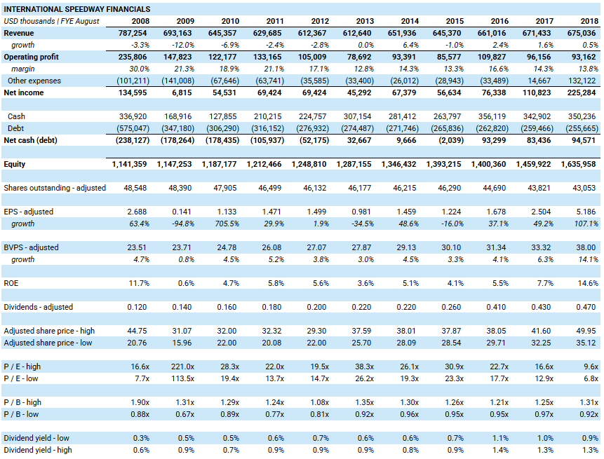

*Source: SEC Filings*

## The Lifecycle of an Obscure Gem

It's interesting to zoom out and observe the full lifecycle of International Speedway and its investment prospects.

Basically, the entire time ISC traded OTC from 1972 to 1995, it was a solid investment. You could have bought it at any point over these more than two decades and you would have earned a strong return.

The hypothetical investor who bought in 1976 at \$1 would have an adjusted basis of \$0.15 per share compared to an IPO price in 1996 of \$20 (27% CAGR before dividends). \$10,000 would have turned into \$1.3 million.

Then ISC became a poor investment after it went fully public.

The reason for this is twofold:

1.  The growth prospects were much better when the company was smaller in the 1970s, '80s, and early '90s.
2.  The multiple was much lower when it traded OTC.

The average P/E multiple from 1972 to 1995 when the stock traded OTC was **7.9x**. This was a great price for a high return company with healthy growth prospects and a capable family in control.

From 1996 to 2018 the average P/E multiple was **29.4x**. Much less attractive, especially in light of slower growth.

Interestingly, while ISC was one of the best U.S. public market investment opportunities of the second half of the 20th century, pretty much every institutional investor missed it (due to ownership constraints, limited liquidity, family control, etc.). Rather, **the institutional crowd remembers it for the dud that it was after it went fully public**.

I think ISC was cheap for four primary reasons:

1.  The stock was hard to buy (limited liquidity).
2.  It wasn't registered with the SEC and traded OTC.
3.  It had a controlling shareholder.
4.  The company made no effort to tell the story (no quarterly calls, public reports, conferences, etc.). The annual report consisted of only a few sentences and financial statements.

Assets of ISC's caliber don't come along that often. But the structural factors that led to its underappreciation are still around today, and I believe they will continue to be around for the foreseeable future.

It is difficult for institutions to own unlisted, illiquid, controlled companies. This leaves room for the enterprising individual.

## Postscript

*-I try not to cherry pick dates and stock prices when I do these case studies (which is easy to do when studying the past), but it's hard to ignore the potential money that could have been made on ISC with a well-timed (and perhaps a little bit lucky) buyer. Let's say you were a small individual investor imitating 1950s-era Warren Buffett, and you were going through every stock in the Moody's Industrial Manual in 1975. You would have found ISC, and it would have traded between 75c and 25c that year (1.2x to 3.6x earnings). Let's say you paid the midpoint 50 cents per share and put in \$10,000*. *22 years later, right after ISC's IPO, your stock would have an adjusted cost basis of 3.3 cents per share vs a market price of more than \$25! **The \$10,000 would have turned into \$7.6 million.***
