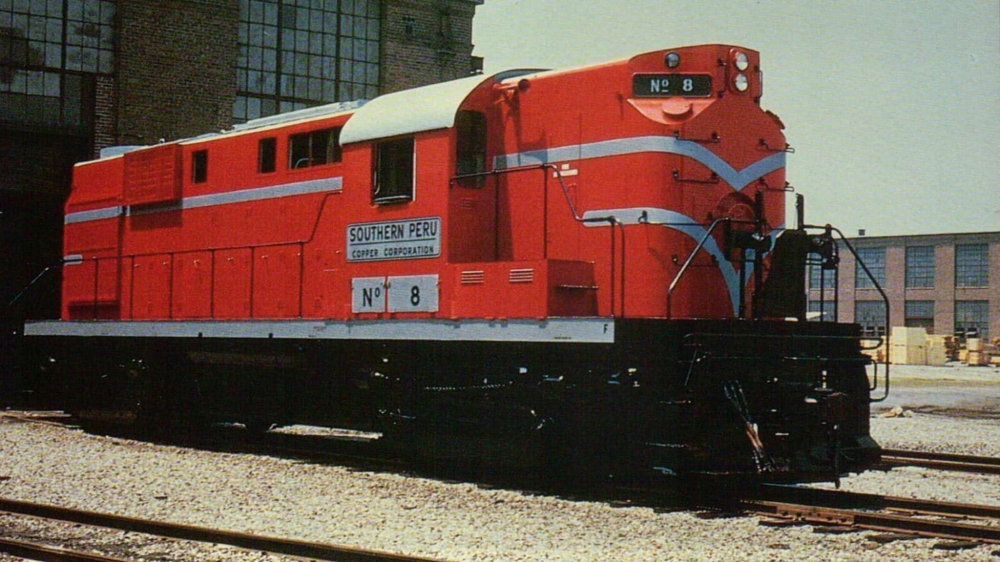
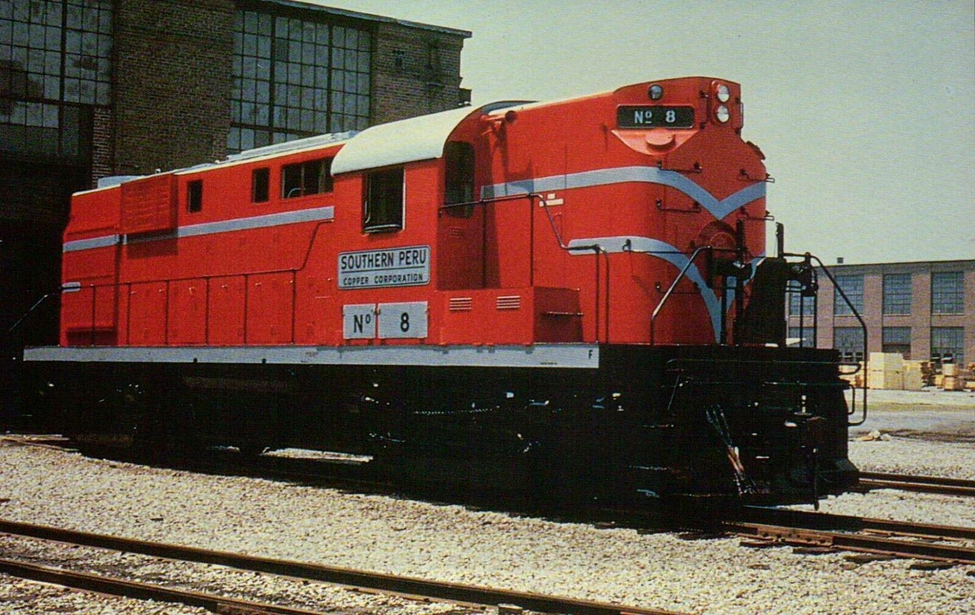
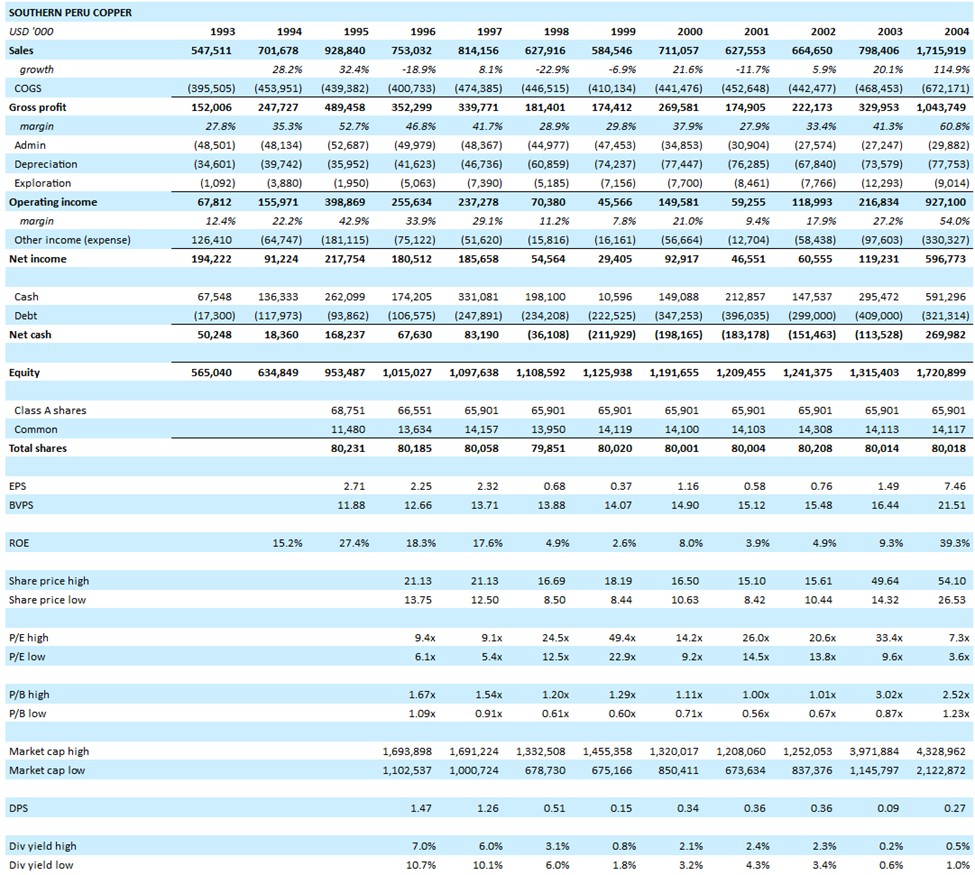
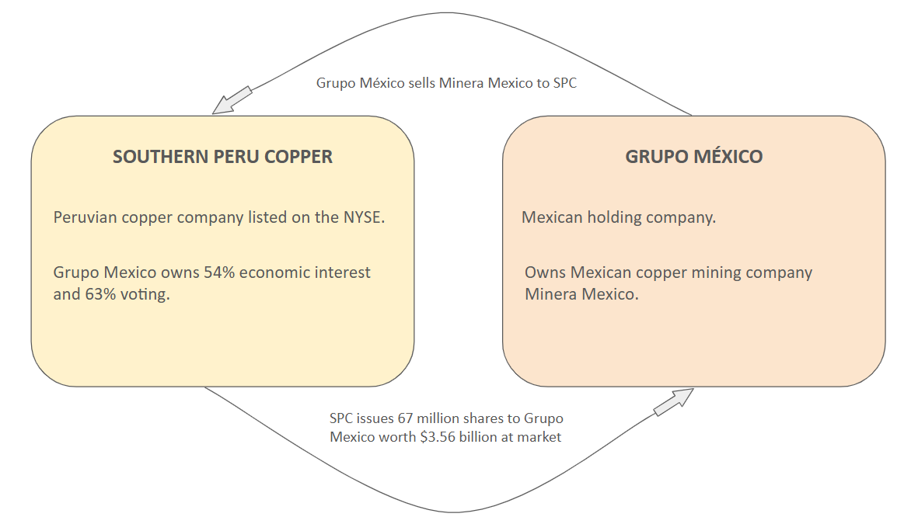
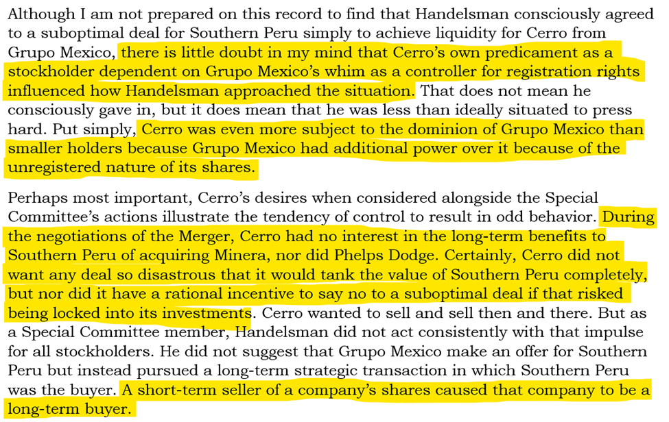

# Southern Peru Copper

30 Jun 2025 · Joe Raymond  
[Original article](https://www.joekraymond.com/southern-peru-copper/)

*The biggest corporate recovery in Delaware corporate history*

Secretive billionaires, skewed incentives, long legal battle, 10-figure award, life-changing fees.

**Southern Peru Copper is a historic case and a fascinating story.**

## Setting the Stage

In the early 2000s, Southern Peru Copper (SPC) owned and operated two copper mines in Peru. The company also owned a railroad connecting the two mines and various processing plants and housing facilities for employees.

*SPC Engine No. 8 Built 1959*

Profitability was mixed, depending largely on the price of copper. The company made money most years and had a large and growing tangible net worth. The average ROE from 1994 to 2004 was 13.8% – fluctuating from a low of 2.6% in 1999 to a high of 39.3% five years later in 2004.

Here’s a financial snapshot:

*Source: SPC SEC Filings*

## The Transaction

Grupo Mexico is a Mexican holding company listed on the Mexican stock exchange. It is controlled by Germán Larrea, a billionaire businessman and the second richest person in Mexico.

Back in the early 2000s, Grupo Mexico controlled 63% of SPC’s voting power.

Grupo Mexico also owned a Mexican copper mining company called Minera Mexico. In 2004, Grupo Mexico wanted to sell this asset to SPC.

In exchange for Minera Mexico, Grupo Mexico’s opening proposal was to be paid \$3.1 billion in shares of SPC stock. By the time a deal was struck, SPC had agreed to pay \$3.56 billion worth of its stock for Minera Mexico, more than Grupo Mexico’s original ask.

Here’s a visual:

Minera Mexico was a second-rate asset with worn out equipment, marginal profitability, and a bad balance sheet. It was mired in financial difficulties. A physical inspection of the facilities revealed large, broken-down equipment with no spare parts to repair them. The company had defaulted on its credit facilities and had stopped all but critically necessary capital expenditures. Some (pessimistic) estimates pegged the value of these assets at only a couple hundred million dollars.

Yet, SPC was giving up over ***\$3.56 billion*** in stock for this worn-down asset.

## Special Committee

As is customary in these sorts of related party transactions, SPC’s board of directors formed a special committee of independent directors to evaluate the proposed terms of the deal. It was made up of an interesting and highly qualified group of four directors with the following resumes:

1.  Ph.D. in finance from the Wharton School.
2.  Lawyer with an MBA who managed AeroMexico Airlines.
3.  Co-founder of an investment banking firm where he advised on M&A and financing transactions.

The fourth member of the special committee, Harold Handelsman, may be the most intriguing of all.

Handelsman was an accomplished lawyer who represented the Pritzkers – a wealthy Chicago family and some of the best investors of the 20th century. The Pritzkers had a 14% stake in SPC through Cerro Holdings, which was a founding member of SPC.

How could a special committee comprised of such sophisticated and accomplished professionals, including a representative of the Pritzker family (who owned a lot of SPC stock), approve such a bad deal for SPC shareholders?

It’s an interesting case of counter-intuitive incentives.

Let's look at things from Handelsman's perspective.

SPC was trading at an all-time high of \$55 per share in 2004. Cerro had a cost basis of only \$1.32 per share and was sitting on a large paper gain. The price to book value ratio had expanded from less than 0.6x in 2001 to more than 2.5x in 2004. As fundamental investors, the Pritzkers were looking to sell the richly priced stock and take their profits.

But there was a problem: *Cerro had founder shares with a restrictive legend.*

These shares couldn’t be sold without registration rights granted by the company. And the company was controlled by Grupo Mexico. Part of the deal was that **upon approval of the Minera Mexico merger, Cerro would receive registration rights and be able to sell their shares.**

So, the Pritzker’s incentives (and, by extension, Harold Handelsman’s) were different from the average minority shareholder: they wanted to get the deal done so they could sell their shares. While a lower price for Minera Mexico would have been preferable, their top priority was removing the restrictive legend from their stock certificates.

As the Court explained:

*Source: Delaware Court of Chancery Opinion December 2011*

Fascinating!

Here you have an accomplished and reputable lawyer representing a highly capable, ethical family with a significant SPC stockholding, *yet they are supporting an action that is unfavorable to SPC shareholders.*

The trial evidence proved both the special committee and its advisors got lost in a perspective-distorting “controlled mindset” that allowed Grupo Mexico to dictate the terms and structure of the deal. The special committee members who testified admitted that they were taken aback by Goldman’s valuation of Minera Mexico.

**Incredibly, Goldman Sachs was unable to value Minera Mexico at more than \$2.8 billion, no matter what methodology it used.**

The Court found that Goldman *“helped its client rationalize”* the transaction, and that the *“focus was on finding a way to get the terms of the Merger structure proposed by Grupo Mexico to make sense, rather than aggressively testing the assumption that the Merger was a good idea in the first place.”*

## Arguments

After the Proxy was issued, an SPC shareholder brought the situation to Ronald Brown, Jr. (“Chip”) – a since retired partner at Prickett, Jones & Elliott, P.A. (“Prickett Jones”).

Prickett Jones took the case on a contingency basis, meaning the firm would only be paid if it was successful in obtaining a recovery for SPC and would earn nothing if the case was lost.

There was nothing in the Proxy regarding Minera Mexico’s stand-alone value. To the contrary, **the Court found that both SPC’s Proxy and Grupo Mexico’s road show to investors obscured Minera Mexico’s value**. What was disclosed in the Proxy, however, was the fact that Grupo Mexico was receiving more value for Minera Mexico than it had originally proposed to SPC. For a related party transaction, this raised red flags.

Years of discovery ultimately revealed the large gap in value in the “give” and the “get” of the transaction.

Going into trial, the plaintiffs’ argument was straight forward: SPC holders were giving up more value in SPC shares than they were getting in Minera Mexico’s operations. **SPC was giving \$3.56 billion of stock for assets that were worth less than \$2 billion at Goldman’s midpoint valuation estimate.**

Defendants relied heavily on a “relative valuation” of the two companies. They argued a DCF of each company was the only way to perform an “apples-to-apples” comparison (rather than simply looking at the value of SPC shares received based on the prevailing share price and comparing it to the intrinsic value of Minera Mexico).

Trial evidence, however, showed the cash flows for Minera Mexico had been dressed up, and no such effort was made for SPC. Grupo Mexico had hired consultants and engineers to optimize and update Minera Mexico’s mining plans. Projections for Minera Mexico assumed the deal would close and financing for expansion and capital expenditures (from SPC) would be available, notwithstanding its current financial difficulties.

In contrast, no updates or optimization was performed for SPC, despite the special committee being advised that opportunities were available. Even beyond updating or optimizing SPC’s mining plans and projections, the special committee was also made aware that SPC was outperforming its current projections, yet no adjustments to SPC was made in the “relative valuation” model of the two companies.

The defendants’ strategy also ignored an important fact: **SPC was actively traded on the New York Stock Exchange and the trading price was there for everyone to see**.

If the stock was overpriced at \$55, Grupo Mexico could start selling shares in the market. How can anyone argue that stock compensation is worth anything less than the prevailing market price where the shares can be sold?

## Decision

In October 2011, more than seven years after the transaction occurred, Chancellor Leo Strine of the Delaware Chancery Court awarded more than **\$1.2 billion** in damages to SPC. With interest accruing from the date of the transaction, the award grew to **more than \$2 billion**.

Chancellor Strine also awarded legal fees of 15% of this amount, or **more than \$300 million**, to Prickett Jones and its co-counsel, to be paid out of the recovery.

SPC (still controlled by Grupo Mexico) objected to the fee award arguing, among other things, it amounted to 66x the plaintiff lawyers’ hourly rates, greatly exceeding “lodestar” multiples awarded in federal security actions.

Chancellor Strine rejected the arguments explaining that **Delaware courts award fees based on the benefit achieved, not the number of hours billed.**

On appeal, both the judgment and the award of legal fees were affirmed by the Delaware Supreme Court.

For Chip Brown, it was an extraordinary capstone to his already very successful career.

## Betting on Yourself

My friend [Dirtcheapstocks](https://dirtcheapstocks.substack.com/) wrote a [neat post](https://dirtcheapstocks.substack.com/p/the-greatest-lawyer-to-ever-live) a few months ago about betting on yourself. One of the points of his post is finding nonrecourse leverage (and/or skewed odds) and using it to your advantage.

In a case like this, the risk plaintiff lawyers took betting on themselves was considerable: years of work – including repeated travel to Peru, Mexico and throughout the United States to conduct discovery – without compensation and over a million dollars of advanced expenses.

There was no certainty of success of recovery.

To put the risk in perspective, since Southern Peru has been decided (thirteen years ago), only **seven** stockholder representative actions have resulted in post-trial judgments awarding money damages. One of those cases is currently on appeal, and four of those cases were reversed on appeal.

There is no question the risk proved worthwhile. A historic fee for a historic result. No other risk/reward system has produced such results.

## Postscript

*-While Chip has retired, Marcus Montejo is a partner at Prickett Jones who second chaired the Southern Peru litigation and continues to practice. For those interested, Chip and Marcus participated in an oral history of the case for the University of Pennsylvania Carey Law School which is available along with related court documents* <a href="https://www.law.upenn.edu/_ingredients/templates/details/news.php?id=8632&amp;from=%2Flive%2Fnews%2F8632-in-re-southern-peru-copper-corp-shareholder&amp;ref=joekraymond.com" rel="noreferrer"><em>here</em></a>*.*

*-We have worked with Marcus and recommend him highly. Two years ago, Marcus won a* [*landmark case*](https://www.businessdisputeblog.com/2023/10/delaware-supreme-court-rejects-confidentiality-restrictions-of-section-220-demand-inspection/?ref=joekraymond.com) *in front of the Delaware Supreme Court that showed DE public companies that had gone “dark” can’t require an NDA from shareholders to view basic financial information that would ordinarily be available publicly in a 10-Q or 10-K filing.*

*-There has been recent noise about companies – particularly controlled companies – moving incorporation away from Delaware in favor of other, more management friendly states like Nevada and Texas. Delaware has decades of well-established case law supporting minority shareholders' rights, so I view this trend as negative and something to keep an eye on.*

*-Likewise, there continues to be coordinated attack on the Delaware Court of Chancery’s exercise of discretion to award substantial attorneys’ fees for substantial benefits achieved. There are currently proposals from certain academics to cap fee awards based on “lodestar.” Michael Hanrahan, a senior partner at Prickett Jones,* <a href="https://corpgov.law.harvard.edu/2025/05/15/the-delaware-courts-multi-factor-approach-to-attorneys-fees-is-no-black-box-a-response-to-professors-pritchard-and-erickson/?ref=joekraymond.com" rel="noreferrer"><em>has criticized these efforts</em></a>*. Among other reasons they are problematic, a cap on fee awards gives defendants significant leverage to settle cheaply. For example, a cap on fees of 4x lodestar would have eliminated the economic incentive for the plaintiff lawyers in Southern Peru to recover any more than approximately \$120 million for SPC. It’s a good thing for SPC that Delaware doesn’t have any such cap – the recovery for SPC was more than 14.5 times that amount, even after netting out the \$304 million fee award.  *

*-Southern Copper still trades on the NYSE under SCCO. It is now 90% owned by Grupo Mexico. Interestingly, the stock has compounded at 13% since this transaction in 2004 (before dividends). Had the Pritzkers held on, their basis would now be \$0.22 (after multiple stock splits) vs a market price of more than \$100.*

*-At issue in Tornetta v. Musk, Del. Ch., C.A. No. 2018-0408-KSJM, was a challenge to Elon Musk’s compensation package, which had a nominal value based on a then current Tesla stock trading price of approximately \$55 billion. The Court of Chancery awarded \$345 million in fees to plaintiffs’ counsel after accepting defendants’ argument that the value of Elon Musk’s voided compensation package to Tesla was \$2.3 billion. The case is on appeal. If it stands, it will overtake the values at issue in this case as the largest award.*
