# Stumbling Onto a Goldmine

28 Oct 2025 · Joe Raymond  
[Original article](https://www.joekraymond.com/stumbling-onto-a-goldmine/)

*Larry Goldstein's first thrift conversion*

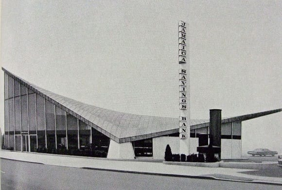

Larry Goldstein was close friends with Nate Fisher.

I've written about Larry and Nate before...

Nate's father-in-law ran the Karpel Curtain Company (KCC). Larry bought KCC's trade claims in the Interstate Stores bankruptcy in 1974 **which went on to grow in value 1,000-fold over the next 20 years**. It's one of the most incredible investment stories you'll ever read. I wrote about it in detail <a href="https://www.joekraymond.com/from-bankruptcy-to-1-000-bagger/" rel="noreferrer">here</a>.

One sunny afternoon in the late-80s (more than a decade after the Interstate Stores transaction), Larry and Nate were having lunch together on Long Island.

After eating, Nate asked Larry if they could swing by the bank so he could make a deposit. Larry was enjoying the good weather and friendly company. *"Sure,"* he said, *"Let's do it."*

They walked into the bank and up to the counter to grab a deposit slip.

Larry noticed on the counter a copy of the bank's most recent quarterly balance sheet. **It was one of the cleanest, most secure bank balance sheets he'd ever seen.**

It had a mountain of equity to complement its deposits. On the asset side sat a huge pile of T-bills. A far cry from the typical tiny bank with modest deposits, minimal equity, and mediocre loans.

Larry being who Larry is, **he wanted to learn exactly how and why this little bank was so flush with cash and equity.**

He looked around the lobby and saw on the other side of the room a thick wood door with a big brass knob and the word "PRESIDENT" emblazoned across the front.

Larry walked over to the door and knocked.

A man in a suit opened the door and asked how he could help.

*"You have a beautiful balance sheet,"* Larry said. *"I'd love to know how and why this came to be, and if there are any other banks out there like yours!"*

The president invited Larry into his office and explained to him how the bank had recently converted from a *mutual* to a *stock bank*. During this process, depositors, employees, and community members had participated in an IPO, allowing the bank to raise significant equity capital which was sitting in T-bills until they could make better use of it.

Participating in mutual conversions as an IPO investor can be lucrative. The reason for this is mathematical.

Imagine a make-believe mutual bank with \$1 million of tangible equity. Let's say this bank wants to convert to a stock bank and offers 100,000 shares at \$10 per share in an IPO. Only depositors are invited to participate in the offering.

On a pro forma basis, the converted bank will have \$2 million of tangible equity (the original \$1 million plus the \$1 million of IPO proceeds), which equates to \$20 per share of tangible book value (\$2 million of equity divided by 100,000 shares).

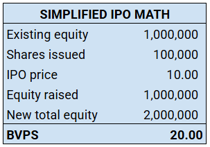

As an IPO investor, you were able to purchase the shares at \$10. You paid only 50% of tangible book value.

**Good, liquid banks typically don't trade for 50% of tangible book value.**

The president explained all of this to Larry, *including how he himself had made a killing on the bank's conversion.*

And he didn't stop there. **He left Larry with a tip.**

*"You should check out this little bank in Queens,"* he said. *"They are preparing for a conversion themselves, and I think it will be a good one."*

That little bank in Queens was called Jamaica Savings Bank. And JSB ended up being a killer investment.

## Jamaica Savings Bank

JSB was founded way back in 1866 in the Jamaica neighborhood of Queens, New York. The bank started with \$2,000 of deposits and slowly grew over the decades. It made a few acquisitions in the 1930s and 1950s, but mostly it just trudged along and grew conservatively and organically.

This was a ho-hum mutual with little excitement (good or bad). Its biggest publicity came in 1964 when it opened a new futuristic headquarters and flagship branch.

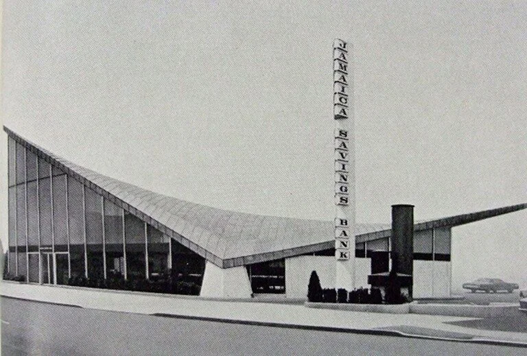

*JSB Headquarters 1964*

## The Investment

After his conversation with the friendly president at Nate's bank, Larry paid a visit to JSB. He met with the CFO who reiterated the same points surrounding the math of thrift conversions.

**Larry opened a deposit account right there on the spot.**

Less than two years later, on June 24, 1990, JSB Financial went public. Santa Monica bought **59,000** shares at **\$10 per share** for an initial investment of **\$590,000**. The pro-forma book value was **\$21 per share** (0.48x P/TBV).

Here's the investment outlined in Larry's own words:

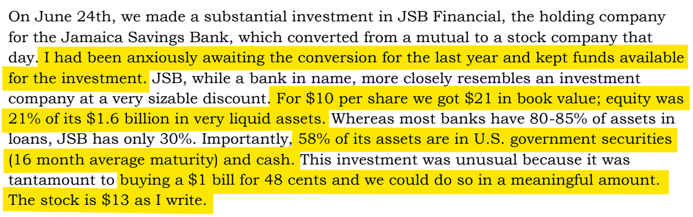

*SMP Letter to Partners July 5, 1990*

The shares shot up 30% to \$13 right after the IPO. Many investors sold for a quick profit. Larry decided to hold on as he saw a bigger pot of gold down the line.

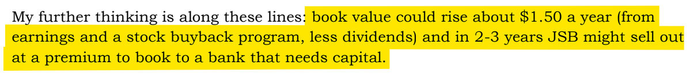

*SMP Letter to Partners July 5, 1990*

Following this logic, BVPS could be north of \$25 within three years and the company would be worth \$35 per share to a strategic buyer at 1.4x TBV. **This works out to a 51% annualized return over three years.**

Given the nature of the balance sheet (liquid, overcapitalized, and invested primarily in short-term government securities), the downside was minimal.

Thus, Larry found himself in investment nirvana: **low downside paired with big upside.**

## How it Played Out

JSB became an avid repurchaser of its own stock, buying back 7% of its outstanding shares in 1991 and another 8% in 1992.

Larry talked about it in his Q3 1992 letter to partners:

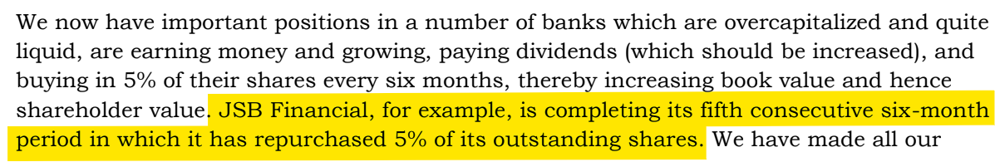

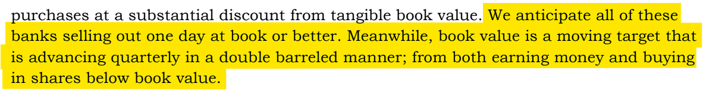

*SMP Letter to Partners October 21, 1992*

By 1993, JSB traded for north of \$25 per share, which was close to its tangible book value. Santa Monica had more than doubled its money in less than three years.

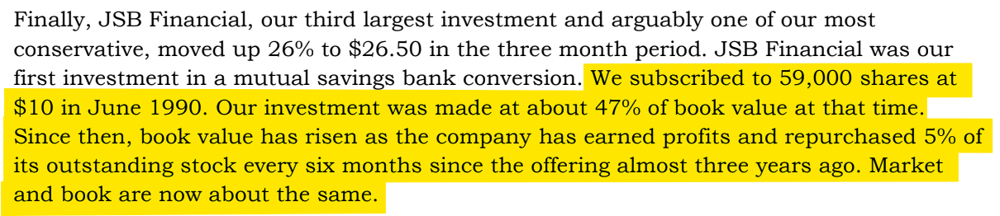

*SMP Letter to Partners April 15, 1993*

The share count was further reduced by 10% in 1993, 9% in 1994, 2% in 1995, and 7% in 1996. Shares outstanding fell by a cumulative **38%** from 1990 to 1998. **And most of these buybacks were done at or below tangible book value.**

Here's a financial snapshot of the 1990 to 1998 period:

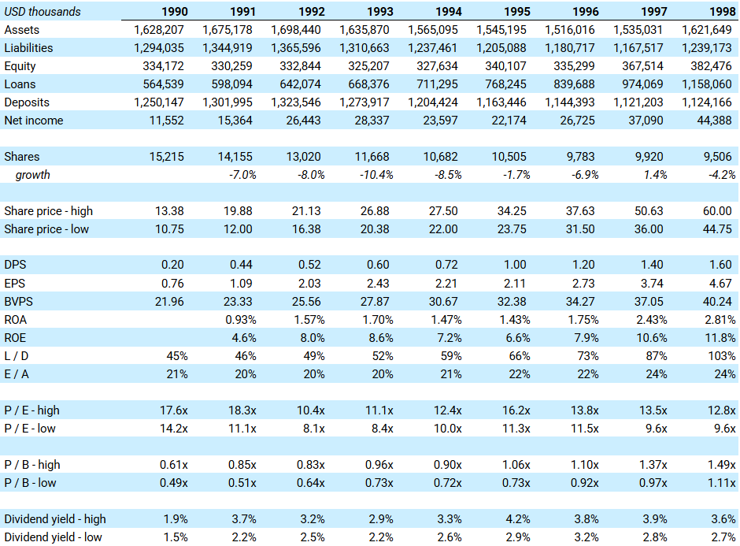

SMP held onto its shares for the entire period. From Larry's April 3, 1998 partnership letter:

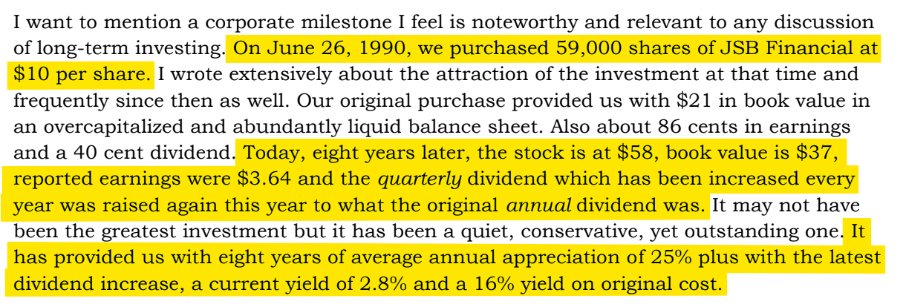

*SMP Letter to Partners April 3, 1998*

JSB entered a stock-for-stock merger with North Fork Bank (NFB) in 1999. Every one share of JSB received three shares of NFB.

Then, seven years later in 2006, NFB merged with Capital One Financial (with the option to receive cash or stock).

Here's a return summary for how you would have done based on how long you held. In all cases, dividends would have added a few points to the annual return figure.

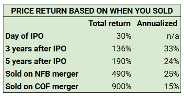

**These are incredible numbers for a low-risk investment.**

As for Larry, he held onto his stock until NFB sold to COF, at which point he elected to receive cash. **The \$590,000 investment in 1990 turned into more than \$5.5 million in 2006.**

## Postscript

Seth Klarman wrote about JSB in his book, *Margin of Safety.* Below are the excerpts for those who want additional detail.

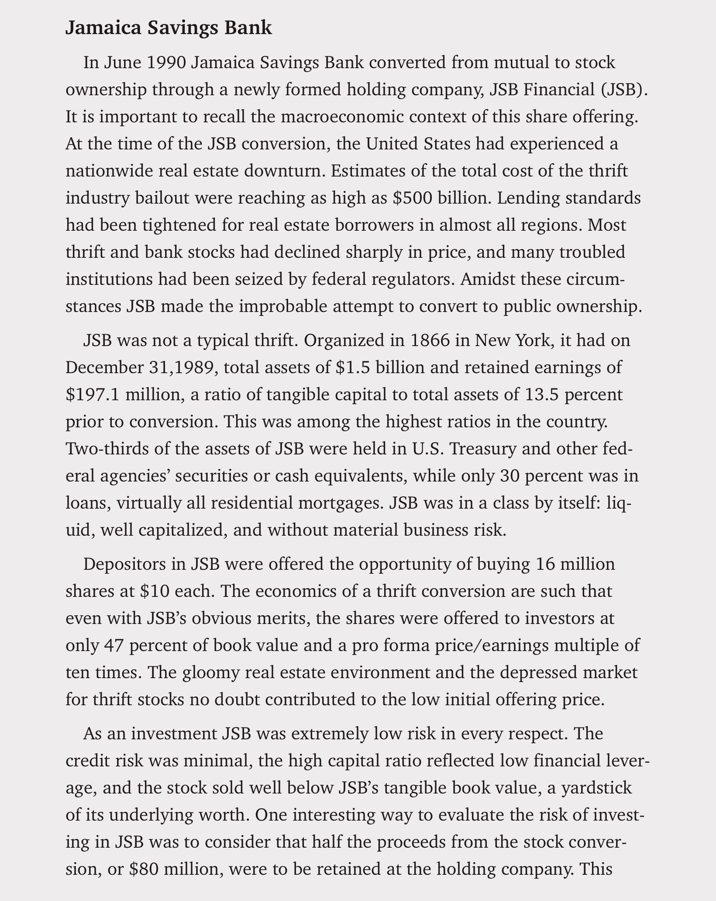

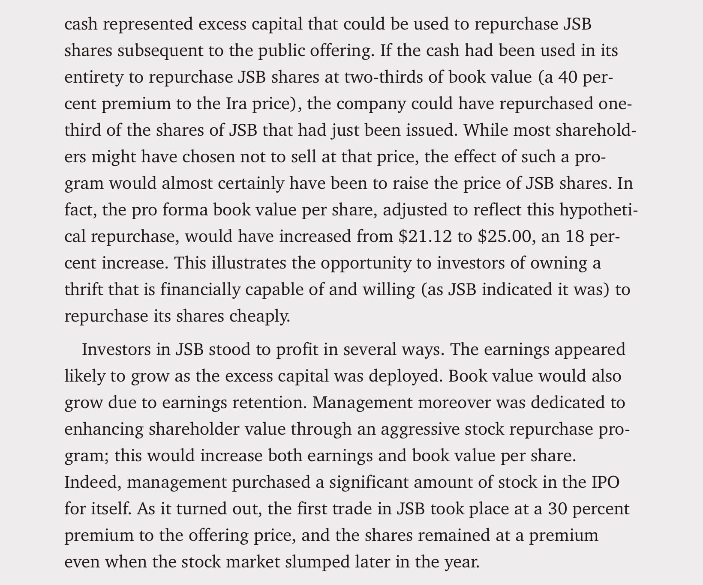

*Source: Margin of Safety*
