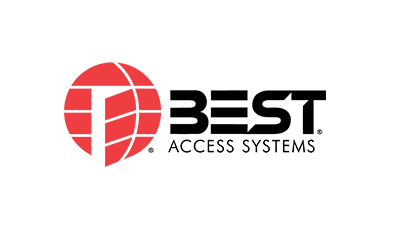
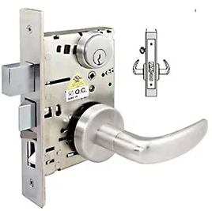
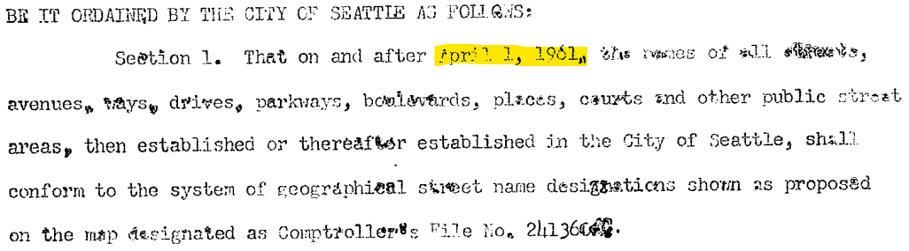
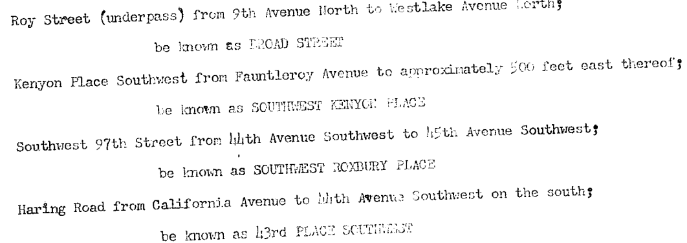
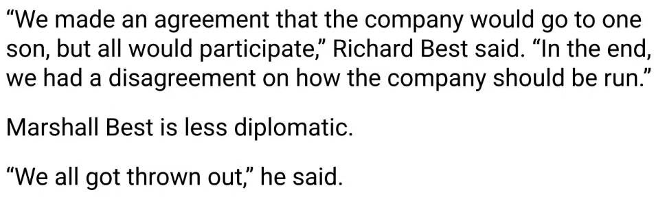
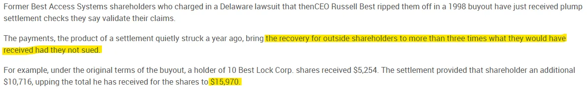

# The Best OTC Investment Story Never Told

6 May 2025 · Joe Raymond  
[Original article](https://www.joekraymond.com/the-best-otc-investment-story-never-told/)

*Lost shareholders, genealogy reports, family drama, appraisal rights*

Sometimes outstanding investment results come from unknown stocks.

Best Lock Corporation is a great example.

The company no longer exists and hasn't traded publicly in over 20 years. Even when it did trade, few people knew about it. It was obscure, illiquid, family controlled, boring, and far off-the-beaten path.

Most investors wouldn't bother with such a stock.

**But Best Lock returned around 20% annually from 1980 to 2003 (ignoring dividends).**

A \$100,000 investment would have turned into nearly \$8 million.

## Martin Nelson Jr.

Martin Nelson Jr. runs Martin Nelson & Company (MN&C)—a Seattle-based investment advisor and broker-dealer. For those interested in investing in obscure stocks, **Martin’s Best Lock story is a great case study.**

It has everything you'd want in such a story: a deeply discounted stock, a boring old business, lost shareholders, activism, family drama, appraisal rights.

Those who know Martin might know the story. It has been shared over intimate dinners and cocktail parties. It has never been told publicly to my knowledge.

I sat down with Martin and heard him recount this incredible story firsthand, and he has agreed to let me share it here.

## Making Markets

MN&C started making a market in Best Lock (BLOC) in the mid-1970s. Market makers provide bids and offers on select stocks, facilitating trading and liquidity. They earn a profit on the spread (the price between the bid and offer). (Here's the full FINRA definition for those interested: [6420. Definitions \| FINRA.org](https://www.finra.org/rules-guidance/rulebooks/finra-rules/6420?ref=joekraymond.com).)

The mid-1970s was a good time to find bargains, and BLOC certainly looked like a bargain. **It was trading for around 3-5x earnings and a discount to book value**.

Best Lock was a simple business. It designed, manufactured, and marketed lock mechanisms, primarily for doors.

So MN&C was making a market in the stock, matching buyers and sellers and earning a spread. Martin was also buying shares for his clients and himself as he could.

But Best Lock was peculiar.

The annual report showed over 4,000 shareholders of record, yet MN&C was only getting a few orders a year. **Where were all the shareholders and why wasn’t there more volume in the stock?**

Martin flew to the company’s headquarters in Indianapolis to view a shareholder list. It was about two inches thick and listed all 4,000 stockholders.

**But there was a problem with the list.**

Many of the addresses in the shareholder register were wrong. Most holders were from Seattle (where the company was founded), and **Seattle changed their directional scheme for street names in 1961**.

Martin knew this because he was a kid in Seattle when the ordinance passed.

*Source: [https://clerk.seattle.gov/search/ordinances/89910](https://clerk.seattle.gov/search/ordinances/89910?ref=joekraymond.com)*

Here are some examples of address changes:

*Source: [https://clerk.seattle.gov/search/ordinances/89910](https://clerk.seattle.gov/search/ordinances/89910?ref=joekraymond.com)*

**The company hadn’t updated the old addresses on its books.**

Martin then asked to see a list of shareholders who had cashed the most recent dividend check. This list was less than half the size of the full shareholder list.

**He discovered that some holders hadn’t been cashing their dividend checks for years.**

What’s going on here?

## Lost Shareholders

Best Lock was founded in Seattle in 1922 by Frank E. Best. Like many startups in the 1920s, shares were sold door-to-door to average citizens. When the Depression hit, Best Lock stopped paying dividends. Then the company moved its headquarters from Seattle to Indianapolis to be closer to suppliers and customers.

Let’s get into the mind of the average shareholder.

They bought the stock from a door-to-door salesman during the roaring 1920s. Then the Great Depression came along. No more dividends. Boarded up factory. Most of these fly-by-night stock listings from the 20s were down 95%+.

**The thing must be worthless, right?**

It makes sense why shareholders would write off their Best Lock investment. There were other, more pressing things to worry about.

By the late 1970s when Martin was looking at the shareholder list, nearly 50 years had passed and the company was again profitable, growing, and paying dividends. After going through the Depression, World War II, moving to Indianapolis, and the Seattle address overhaul, many shareholders had been lost.

In many cases, **heirs had no idea they inherited the stock.**

## Door Knocking

Martin knew he had an opportunity on his hands: **an illiquid stock with lost shareholders trading for a low-single-digit P/E multiple.**

He decided to form a new company dedicated to finding the rightful owners of these shares. This involved genealogical research and many hours spent at the local library and county records office. Over time, **he was able to find dozens of holders who had no idea they owned Best Lock shares.**

Martin would contact these shareholders (many of whom were second and third generation owners) and say something along the lines of:

*“I know of an asset you own that you don’t know you own. It’s worth X amount of dollars and I will put you in touch with it. My fee will be one third of the total value. You don’t have to pay anything out of pocket. I will even pay **your** attorney to verify that all of this is real and correct.”*

This was a compelling proposition.

Imagine someone knocking on your door and offering thousands of dollars for an asset you didn’t know you owned.

Few said no.

Best Lock was trading for around \$30 per share at the time, so after his one third fee Martin was buying the shares for around \$20. **This equated to 2-3x earnings.**

Over time, Martin was able to acquire roughly 15% of the float (shares not held by the Best family) using this approach.

## Family Dynamics

This is where the story takes a surprising turn.

In the 1980s and early 1990s, Best Lock was run by Walter Best, the son of founder Frank Best. Walter had four sons who also worked in the business. **Together, the Best family controlled a little over half of the outstanding voting interest in Best Lock.**

Martin’s entrepreneurial buying effort (as well as some other well-known value investors getting involved) had caused a bit of a stir in the Best family. As Martin recalls, one of Walter’s sons, Russell (along with the corporate attorney), convinced Walter that it was a good idea for the family to consolidate ownership in the next generation. By their reasoning, this would help fend off any unfriendly outside shareholders.

Walter agreed, and **Best Lock loaned Russell the money to buy his father’s shares in the business.**

This transaction gave Russell Best outright control of Best Lock.

**A week later, Russell dismissed his father and brothers from the company**.

He made himself Chairman/CEO and he and his wife were the sole directors of the company.

*Source: Indianapolis Business Journal August 1, 2005*

What's interesting is that **the Best family already had absolute control of the corporation.** Even before Russell took over, there was nothing Martin Nelson or any other minority shareholder could do to force change on Best Lock, assuming the family voted their collective shares in unison.

## The Reverse Split Takeout

A few years after taking full control, Russell decided to take the company private. He did this through a series of reverse splits in 1998 that effectively cashed everyone out for \$525 per share—a high-single-digit multiple of earnings. The stock had been trading for \$300 prior to the reverse splits, so the cash out price was a nice **75% premium**.

A group of minority shareholders dissented and perfected their appraisal rights in Delaware—arguing that Russell Best had violated his fiduciary duty, and that the \$525/share figure was too low for a company of Best Lock’s caliber.

## The Sale of Best Lock

At some point in the legal process, Russell decided to explore a sale of the entire company. Stanley Black & Decker stepped up to the plate and offered \$310 million to buy Best Lock (more than triple the reverse split takeout price). Final payout for the dissenting shareholders was received in April 2003.

*Source: Indianapolis Business Journal Vol. 24, Iss. 5 (April 14, 2003)*

Those initial shares Martin was buying for \$20 in 1980 turned into \$1,597 in 2003, **good for** **a CAGR of 20% before dividends over the 23-year period.**

Not bad for an unknown thinly traded Pink Sheet stock shrouded in family drama.

## Postscript

*A few author notes:*

*-There were three different publicly traded vehicles related to Best Lock operating company: Frank E. Best, Best Universal Lock, and Best Lock Corporation. There was circular ownership which made the situation somewhat complicated (and perhaps contributed to the undervaluation). I only discussed Best Lock Corp. in this article to keep things simple. All three stocks worked out well for shareholders.*

*-Best family members ousted by Russell started another business in 2005 called Marshall Best Security. The company is* <a href="https://www.marshallbestsecurity.com/?ref=joekraymond.com" rel="noreferrer noopener"><em>still around</em></a>*.*

*-Frank Best must have spent some time selling shares in Hawaii because a number of lost shareholders resided there. Martin and his wife spent a week in Hawaii buried in obituaries at the library. “She never lets me forget that!”*

*-Martin remembers one lost shareholder specifically who was being evicted from her mobile home. He wrote her a check for \$40k for her Best Lock shares she had no idea she owned.*

*-The attorney working for Martin and the other dissenters on the appraisal case took a 1/3 contingency fee. After Best Lock he bought a house on Malibu Beach and retired.*

*-This account is based on interviews and limited publicly available information. Any inaccuracies are unintentional. Much of this case study relies heavily on Martin’s recounting of events (verified by public documents and other shareholders, when readily available). This is especially true for the section regarding family dynamics. Walter Best was Martin’s main contact in the family.*
