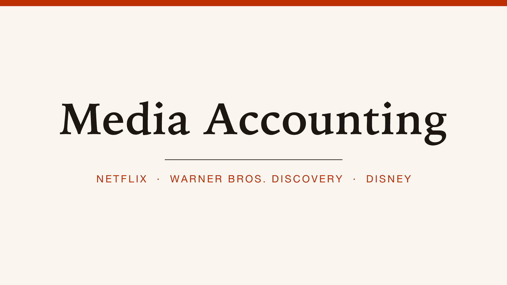
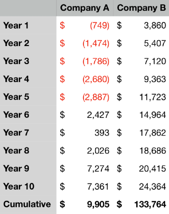
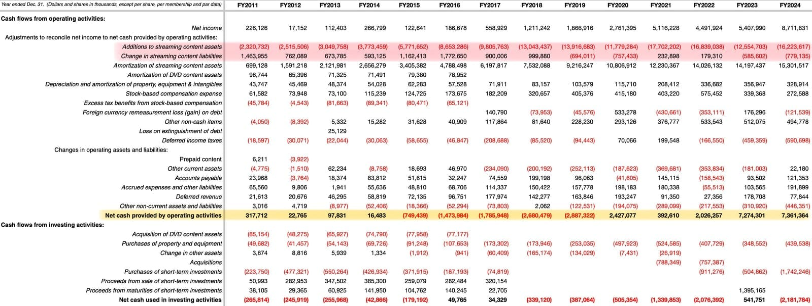
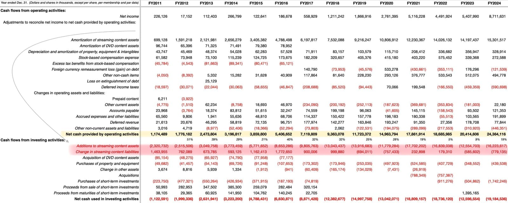
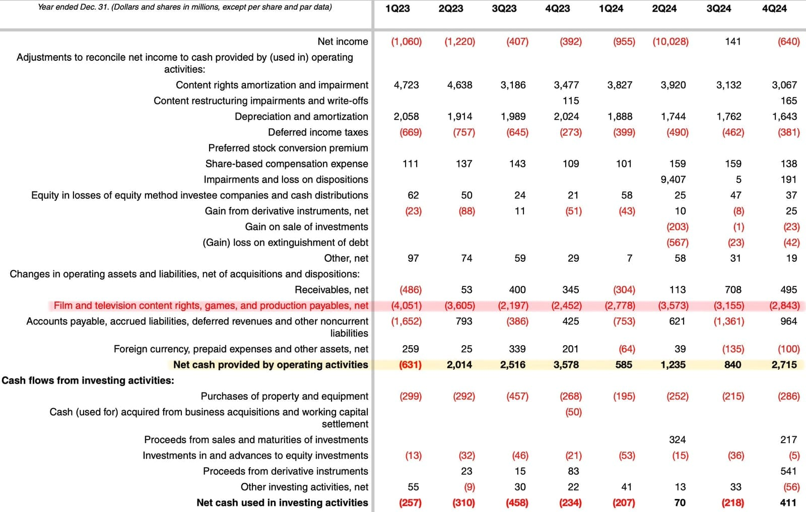
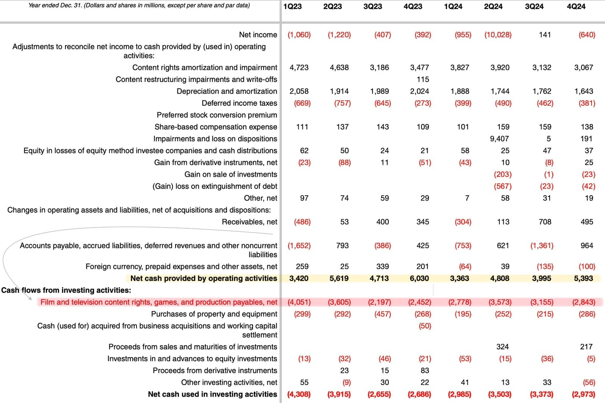
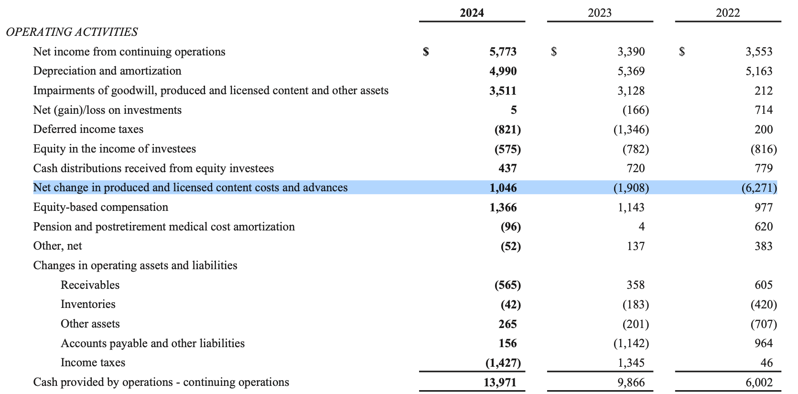
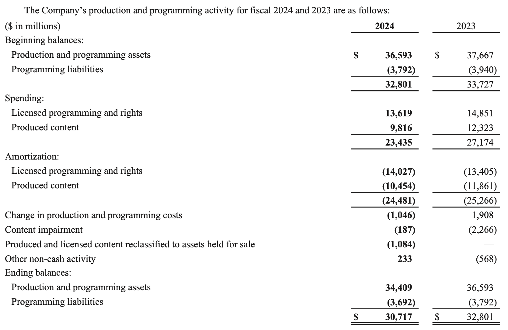

# Media Accounting

Oct. 23, 2025 · Rockwood Notes  
[Original article](https://rockwoodnotes.com/media-accounting/)  
Tags: $WBD, $NFLX, $DIS, Research

The following is an aggregation of notes and thoughts I put together while looking into Warner Bros Discovery (WBD) last summer, plus conversations I had with my friend [Lone Elm](https://loneelmcapital.com) while trying to figure it all out.

------------------------------------------------------------------------

### Would you rather?

Which of the following companies do you think you have a better chance of predicting the future cash flows of?

Trick question. They’re the same company. It’s Netflix’s operating cash flow for 2015-2024. Company “A” is Netflix’s operating cash flow *as reported*. Company “B” is Netflix’s operating cash flow with one minor adjustment.

In math, we were taught to move numbers around and manipulate formulas to make a problem easier to understand or solve. That’s what I’m going to show you here.

When media companies spend cash to make content, GAAP accounting classifies the spending as operating activities, which makes the cash flow from operations line lumpy and misleading.

Instead, I move the content spend line(s) from operating to investing activities and treat it as a capital expenditure. Common sense tells me, economically, that’s what it is. So, that’s how I treat it.

In order to do that, though, you have to know which lines to move. And it’s different for each company.

### Netflix (NFLX)

Netflix is the gold standard for reporting. It’s about as clean and consistent of a history as you can find. No real m&a. For the most part, segments/reporting are all the same. No stock splits.

They have a great presentation to understand their accounting around content spend you can find here: [Netflix Content Accounting Overview Presentation](https://s22.q4cdn.com/959853165/files/doc_downloads/2025/IR-Content-Accounting-Slides-May-2025.pdf)

They break it out into *additions to content assets* and *change in content liabilities.*

Here is Netflix’s *as-reported* cash flow statement:

The OCF line is quite lumpy\_.\_

But if we move the red highlighted lines out of operating activities into investing, the adjusted OCF line looks like a healthy growing stream of cash.

What we find is that, cumulatively, 2011-2024:

- EBITDA was \$148B
- (Adjusted) operating cash flow was \$142B compared to as-reported OCF of \$10B
- Cash content spend was \$(132B)

That seems a lot closer to the “true” cash generation and spend of the company.

If you’re curious how that compares to the income statement, cumulative operating and net income was \$41B and \$32B, respectively.

### Warner Bros Discovery (WBD)

For WBD, instead of *additions to and changes in streaming content assets and liabilities,* it’s called *film and television content rights, games, and production payables, net* under working capital adjustments, which is a good proxy for capitalized content but not gross content spend.

*Note: these are quarterly results for WBD*

### The Walt Disney Company (DIS)

Disney also gives you a *net change in produced and licensed content costs and advances* line that nets their cash spending against non-cash amortization.

To find the real cash spend, you can go to the footnotes (which you should always do regardless).

You can see the \$23.4 billion under “Spending” which is the content capex we’re looking for.

So, a revised cash flow statement for 2024 would show \$37.4 billion adjusted “cash provided by operations – continuing operations” and \$23B of content spend under investing activities.

### Quick note on third-party data providers

If you try to do any of this with third-party data providers like Tikr etc., they completely obscure all of this. Because they need to standardize financial data to process volume, they lump lines together into sometimes useless generic buckets.

For Netflix, the *additions to streaming content assets* because “Other Operating Activities” and WBD’s *Film and television content rights* becomes “Change in Net Other Operating Assets.”

If you were analyzing these companies for the first time using third-party data, you’d (hopefully) see the giant “other” line items and have to go straight to the source anyways. So, why not start there?

I digress.

### Some accounting

Management teams will tell you how much they’re spending on content. You don’t have to decipher it through the financials.

That said, my definition of understanding a business is understanding the accounting and how cash actually flows through the different financial statements. I like to hear management tell me how much they’re spending and understand where it shows up.

That’s why I rebuild financial statements by hand into long-form histories. You can learn a lot about what metrics are really driving the company and how cash moves around.

In general, media companies 1) spend cash to create content, 2) capitalize that cost as an asset on the balance sheet, and then 3) amortize it (transfer it to the income statement) as it gets consumed by audiences.

It goes something like this,

1.  content requires cash to make —\> cash gets spent to make the content —\> accounting puts that cost on the balance sheet as an asset
2.  people consume the content —\> a portion of that balance sheet asset is amortized (transferred) as an expense onto the income statement —\> the value of the asset on the balance sheet goes down
3.  the original cash spent in step one is an operating cash outflow on the cash flow statement —\> the later amortization is non-cash because you already paid the cash before, so it only shows up as an expense on the income statement

It’s important to point out a couple things.

First, if a cost is expensed as incurred, it goes straight to the income statement and reduces OCF at the same time (via net income), so you don’t see a separate add-back or line on the cash flow statement.

Which brings up a valuable reminder: the operating section of the cash flow statement is just a *reconciliation* of earnings to cash. That’s very different than cash accounting.

Netflix is easy because they break it out cleanly. For WBD, the working capital line they place content spend is a useful proxy for the amount of cash content spend that the company is capitalizing to the balance sheet. But, it’s a net change, not the gross amount spent.

For example, using the cash flow statement, you’d say WBD spent \$12B in 2024 when they actually spent close to \$20B.

There’s also costs expensed like participations and residuals costs paid out to talent, producers and rights holders (included in accrued liabilities) or the news gathering, production and on-air talent costs that run through the income statement.

So, it’s directionally accurate, but not fully descriptive of the cash content spend. Things like sports and news don’t flow neatly through the cash flow statement. But it gives a reasonable framework for spend against the cost of revenue amortization on the income statement.

### So what?

What’s the point? For me, it gave me a clearer perspective of how much cash these companies earn and spend. It also helps me compare the companies on an apples-to-apples basis.

When you adjust the statements, you realize

1.  Netflix and WBD generate and spend roughly the same amounts (surprising, given Netflix market cap is 10x larger – though, again, a quality of cash flow discussion).
2.  Earnings, as-reported OCF and EBITDA all do a poor job of comparing them. Netflix’s adjusted OCF and EBITDA are roughly the same whereas WBD’s adjusted OCF is almost twice what its reported EBITDA is.

It also helps you track cash content spend vs. P&L amortization. This metric helps tell you what part of the capex cycle media companies are in.

- When cash spend \> amortization, the company is spending cash to build its library faster than its expensing old content, making earnings (and EBITDA) look better than cash flow because cash is paid up front and expensed later.
- When cash spend is approximately equal to amortization, the company is spending enough to top up the library and replace the content that is amortizing. In theory, you should see FCF and earnings converge.
- If cash spend \< amortization, the company may be accelerating write-downs of bad investments or underinvesting in new content to artificially prop up cash flows or deleverage.

### What are they worth?

The problem I have with media companies is I don’t know what they’re worth. They clearly generate a lot of cash from operations. But the moment you stop spending it on more content, your competition is going to kill you.

It’s hard under that type of competitive landscape to see how you ever really extract meaningful cash out of a company. Sure, you can probably ease off the brakes for a year or two – maybe do some buybacks. But most of it is going back into more content.

[Lone Elm](https://loneelmcapital.com/) compared it to insurance:

> If the industry is disciplined, then everyone can extract some cash from their library and produce new stuff at a measured pace that still allows for returns… but if you have one irrational player that cares more about building scale than profitability, then the whole industry has to engage in an arms race or just suffer for a while.

Now, if all you care about is “FCF” – for simplicity, defined as-reported OCF less capex – then you’re going to get the same bottom line numbers whether you move the lines around or not, or understand how cash and content spend flow through the various statements.

You’ll also have a very different – arguably superficial – understanding of the cash generation and capital intensity of the businesses.

Hopefully you have a little bit better perspective of the cash movements for media companies. I’ll leave it up to you to decide what “maintenance capex” is, which is probably the single most important number to determine for valuing them.

For me, I let this philosophical dilemma cost me a 3-bagger in a year.

[Investing is hard.](https://investing-is-hard-podcast.simplecast.com)

------------------------------------------------------------------------

**Disclaimer**

*I sell access to historical research and what I’m investing my money in, not investment advice or portfolio management. I am not a licensed financial advisor, I don’t manage money for anyone, and nothing here is tailored to your situation or a recommendation to buy or sell a security. Nothing I say or do constitutes any sort of professional investment, legal, accounting et al advice. I often own the stocks I write about and may buy or sell them at any time. This is my public research journal. It’s a place to share my work and improve my thinking. You should always do your own work, check your own facts, and make up your own mind. I am not liable or responsible for any decisions or adverse effects you experience if you make decisions or form opinions based on what I write.*
